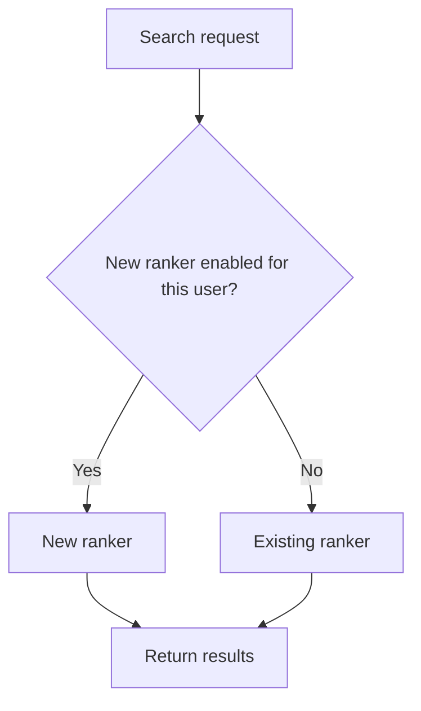

---
aliases:
  - Feature Flag
  - Feature Toggle
  - Feature Toggles
note_type: concept
search_stage: serving
tags:
  - search-eng
---

A **feature flag**, also called a **feature toggle**, is a switch that lets an application choose which behaviour to use. It can enable a feature for everyone, selected users, or a gradually increasing audience.[^azure]

## Deploy the code and release the feature separately

Imagine a search service with an existing [[Search Ranking|ranker]] (the component that orders results) and a new ranker:

- **Deploy:** Put both implementations into production, with the new ranker disabled.
- **Release:** Enable the new ranker for the intended users.

The code can therefore be deployed on Monday and exposed to users on Thursday. This separation is useful in [[Continuous Integration & Deployment]].[^azure]

## How the switch works

The **toggle point** chooses a code path. The **toggle router** makes that decision using **configuration** (rules) and **context** (such as the user). Keep targeting rules together instead of repeating them throughout the code.[^fowler]

For our illustrative search service, the decision becomes:



**Illustrative pseudocode**, not a runnable library example:

```text
use_new = flags.evaluate_boolean(
    key = "new-search-ranker",
    context = current_user,
    default = false
)

ranker = new_ranker if use_new else existing_ranker
return ranker.rank(candidates)
```

Here, `false` selects the existing ranker. The `default` is the value used if flag evaluation fails; it does not force the flag off. OpenFeature uses this explicit fallback convention.[^openfeature]

**Assumption:** Both rankers accept the same candidates and return compatible results. The example chooses one ranker; it does not automatically retry the other if ranking itself fails.

## Four reasons to use a flag

Pete Hodgson groups flags by purpose, lifetime, and how dynamically decisions vary.[^fowler]

| Type | Purpose | Typical lifetime |
| --- | --- | --- |
| Release | Keep unfinished work hidden | Temporary |
| Experiment | Compare variants across user groups | Until the experiment ends |
| Ops | Disable costly or unhealthy functionality | Temporary or lasting kill switch |
| Permissioning | Offer features to particular customers | Often long-lived |

These are design categories, not mandatory product labels or expiry periods.

## Roll out the new ranker gradually

An **illustrative rollout**, with percentages chosen for explanation:

1. Enable it for internal testers.
2. Expose it to 1% of eligible users.
3. Monitor errors and latency; expand to 10%, then 100%, only when the agreed checks pass.
4. Disable it if those checks fail.

Flags can support this [[Canary Deployment|canary release]] without deploying a separate build for each audience.[^azure]

For a user-based rollout, keep assignment consistent so the same person does not switch rankers on every request. A group assigned to a variant is a **cohort**.[^experiments]

An [[AB Testing|A/B test]] additionally needs a hypothesis, randomised assignment, predefined outcome metrics, and a planned analysis. A rollout that stays healthy does not by itself demonstrate improved search quality. For example, track search success as an outcome and latency as a guardrail.[^experiments]

## Practical rules and common mistakes

- **Check configuration updates.** Startup settings may require restarting or redeploying; runtime settings can change independently.[^fowler]
- **Test both paths**, including the configuration intended for production.[^fowler]
- **Choose the error fallback deliberately.** In this example it is the existing ranker. Record evaluation failures so an error fallback is distinguishable from a deliberate off decision; OpenFeature exposes evaluation details for this.[^openfeature]
- **Remove temporary flags.** Assign an owner and a cleanup task.[^fowler]
- **Enforce permissions on the server.** Hiding a button with a flag does not prevent someone calling its endpoint. A permissioning flag must work with proper authorisation checks.[^owasp]

In this example, switching back changes subsequent ranking decisions. It cannot undo results already shown or repair data changed by earlier requests. Treat that as a limit of the switch, not a complete recovery plan.

## Quick check

The new ranker is deployed, but its flag is off for every user. Has the feature been released?

> [!example]- Answer
> No. The implementation is present in production, but users still receive the existing ranker's results.

## References & Useful Links

[^fowler]: [Pete Hodgson — Feature Toggles (aka Feature Flags)](https://martinfowler.com/articles/feature-toggles.html) — Main reference on Martin Fowler's site; categories, design, and lifecycle.
[^azure]: [Microsoft Learn — Feature management overview](https://learn.microsoft.com/en-us/azure/azure-app-configuration/concept-feature-management) — Deployment versus release, targeting, and gradual rollout.
[^openfeature]: [OpenFeature — Evaluation API](https://openfeature.dev/docs/reference/concepts/evaluation-api/) — Explicit defaults on evaluation errors and diagnostic details.
[^experiments]: [Microsoft Research — Patterns of trustworthy experimentation, pre-experiment stage](https://www.microsoft.com/en-us/research/articles/patterns-of-trustworthy-experimentation-pre-experiment-stage/) — Hypotheses, randomisation, metrics, and experiment planning.
[^owasp]: [OWASP — Authorization Cheat Sheet](https://cheatsheetseries.owasp.org/cheatsheets/Authorization_Cheat_Sheet.html) — Why access checks must be enforced on the server.
