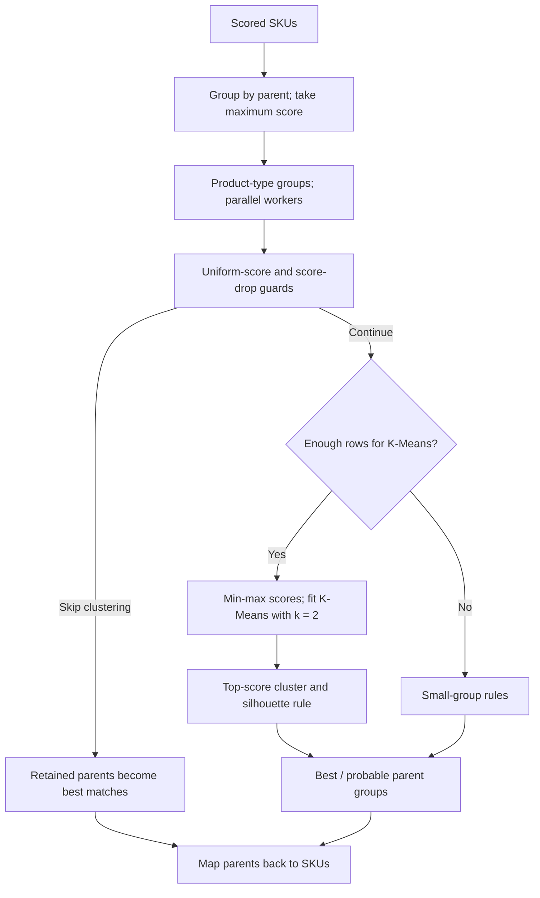

---
tags:
  - "clustering"
  - "ds-foundations"
  - "search-eng"
note_type: concept
search_stage: foundations
---

## Overview

**K-Means** groups observations around $k$ averages, called **centroids**. Each observation belongs to its nearest centroid. It is an [[Unsupervised Learning|unsupervised learning]] method: it discovers groups without being given their correct labels.[^sk-kmeans]

For example, the numbers **1, 2, 3, 10, 11, 12** form two obvious groups. With $k = 2$, K-Means can find centres at **2** and **11**. The worked example below shows how repeated assignment and averaging gets there.

In search, the observations could instead be **reranker scores for one query**. Two clusters might separate relatively high scores from relatively low scores. Naming the higher group “relevant” is an additional product rule: K-Means itself knows nothing about the query or product meaning.

## Steps in the K-Means Algorithm

**Lloyd's algorithm** is the usual alternating procedure for fitting K-Means.[^sk-kmeans]

1. **Initialise:** choose $k$ starting centroids.
2. **Assign:** put each observation in the cluster with the nearest centroid, using Euclidean distance. Squaring that distance preserves which centroid is nearest.
3. **Update:** replace each centroid with the mean of its assigned observations.
4. **Repeat:** stop when assignments stabilise, movement falls below the implementation's tolerance, or the iteration limit is reached.

The result can depend on the starting centroids. **K-means++** spreads out the initial choices; multiple starts reduce the risk of a poor local solution but do not guarantee the global optimum.[^sk-api]

### Objective and notation

For the unweighted case:

- $N$: number of observations.
- $d$: number of numeric features per observation.
- $x_i$: feature vector for observation $i$.
- $k$: requested number of clusters.
- $\mu_j$: centroid of cluster $j$.
- $C_j$: indices of observations currently assigned to cluster $j$.

Minimise the **within-cluster sum of squares (WCSS)**, also called **inertia**:[^sk-kmeans]

$$
J = \sum_{i=1}^{N}\min_{1 \leq j \leq k}\lVert x_i-\mu_j\rVert_2^2
$$

**Centroid update for a nonempty cluster:**

$$
\mu_j = \frac{1}{|C_j|}\sum_{i\in C_j}x_i
$$

The mean minimises squared distance within a fixed cluster. An empty cluster has no mean, so implementations need a separate recovery rule.[^ir-book]

## Worked Example

**Inputs**

- One-dimensional observations: **1, 2, 3, 10, 11, 12**.
- Number of clusters: $k = 2$.
- Deliberately poor starting centroids: $\mu_1 = 1$ and $\mu_2 = 2$.
- Equal weight for every observation.

### Iteration 1: assign and update

Point 1 joins cluster 1; points 2, 3, 10, 11 and 12 join cluster 2.

**Update cluster 1:**

$$
\mu_1 = 1
$$

**Update cluster 2:**

$$
\mu_2 = \frac{2+3+10+11+12}{5}=7.6
$$

The second centroid moves towards the larger values. This changes the boundary for the next assignment.

### Iteration 2: reassign and update

Points 1, 2 and 3 are now closer to centroid 1. For point 3, compare squared distances:

**Distance to centroid 1:**

$$
(3-1)^2=4
$$

**Distance to centroid 2:**

$$
(3-7.6)^2=21.16
$$

Point 3 therefore joins cluster 1. Points 10, 11 and 12 remain in cluster 2.

**Update cluster 1:**

$$
\mu_1 = \frac{1+2+3}{3}=2
$$

**Update cluster 2:**

$$
\mu_2 = \frac{10+11+12}{3}=11
$$

### Iteration 3: check convergence

Assignments stay the same, and the means remain 2 and 11.

**Cluster 1 contribution:**

$$
J_1=(1-2)^2+(2-2)^2+(3-2)^2=2
$$

**Cluster 2 contribution:**

$$
J_2=(10-11)^2+(11-11)^2+(12-11)^2=2
$$

**Total inertia:**

$$
J=J_1+J_2=4
$$

This example recovers the separated groups even from a poor start; it does not establish that every initialisation succeeds on other datasets. The iterations and arithmetic were recalculated with Python's standard library during this update.

## Determining the Value of $k$ in K-Means

- **Domain purpose:** choose a useful granularity. Two groups for a high/low score policy is a design choice, not evidence that two natural populations exist.
- **Elbow method:** fit several values of $k$ and plot inertia. A bend suggests diminishing returns; it does **not** certify an optimal cluster count, and a clear elbow may not exist.
- **Silhouette analysis:** compare within-cluster cohesion with separation from other clusters.
- **Stability and usefulness:** check whether memberships survive different starts or modest data changes, and whether the groups support the intended decision.

The best achievable inertia cannot increase when more clusters are allowed. Consequently, choosing the smallest inertia alone rewards larger $k$; imperfect local fits can also make an empirical curve noisy.[^ir-book]

### Evaluating clustering quality with silhouette

For observation $i$, define:

- $a_i$: its mean distance to other observations in its own cluster.
- $b_i$: the smallest mean distance to observations in any other cluster.

**Per-observation silhouette:**[^sk-silhouette]

$$
s_i=\frac{b_i-a_i}{\max(a_i,b_i)}
$$

Values near **1** indicate good separation; near **0**, a boundary or overlap; negative values suggest the observation is closer on average to another cluster. `silhouette_score` returns the mean, while `silhouette_samples` returns individual values.

The metric requires at least two distinct clusters and fewer clusters than observations. A singleton gets silhouette 0 in scikit-learn. Neither a high silhouette nor low inertia proves that a cluster is meaningful for the application.[^sk-silhouette][^sk-samples]

### Python example

This self-contained example uses the same six observations. Explicit `n_init=10` requests ten starts; current scikit-learn defaults use `n_init='auto'`, which runs once with k-means++.[^sk-api]

```python
import numpy as np
from sklearn.cluster import KMeans
from sklearn.metrics import silhouette_score

X = np.array([[1.0], [2.0], [3.0], [10.0], [11.0], [12.0]])
model = KMeans(n_clusters=2, init="k-means++", n_init=10, random_state=42)
labels = model.fit_predict(X)

print(np.sort(model.cluster_centers_.ravel()))  # Expected: [2. 11.]
print(model.inertia_)                         # Expected: 4.0
if 1 < np.unique(labels).size < len(X):
    print(silhouette_score(X, labels))        # Expected: about 0.8505
```

Cluster IDs are arbitrary: label 0 does not necessarily mean “low” or “high”. Compare centroids to interpret them. The snippet was syntax-checked, but scikit-learn was unavailable locally, so it was not executed. API details were checked on 6 October 2026.[^sk-api]

## Search Application: K-Means and Discovery Engine

### Why cluster reranker scores?

Google's Discovery Engine ranking API returns a relevance score between 0 and 1 for each record, without an ESCI category.[^google-ranking] A system that wants to label results “best match” still needs a selection policy.

The supplied engineering handoff describes a former pipeline using `semantic-ranker-default-004`, score clustering and business ranking. The repository's `ab_flag` documentation retains the description “discovery engine + clustering + linear model”. This supports the historical design explanation; it does not establish which version is deployed today.[^local-schema]

**Design intuition:** when scores lack a validated global cutoff, clustering can adapt the split to each query or product-type group. For illustrative scores **0.92, 0.89, 0.85, 0.30, 0.25, 0.20**, two clusters can isolate the three higher values. This is relative separation: even an entirely irrelevant candidate set has a highest-scoring group.

### What the inspected Python code actually calls

**Source snapshot:** checked on 6 October 2026 in `/Users/A3126435/Desktop/Projects/aml-ai-search`, at HEAD `50bdf5bcf1a9ade2f734ad4b2ee62da5f66c302a`. The inspected Python reranker directory had no tracked modifications.

- **Implemented but bypassed:** `clustering_helper.py` imports `KMeans`. Its `_get_best_matches` helper fits two clusters to min–max-scaled scores. The helper chain goes through `_identify_best_matches_with_clustering`, optionally `_identify_best_matches_by_product_type_parallel`, and `_perform_clustering`.[^local-clustering]
- **Current caller:** `search_reranker_fastapi.py` calls `get_best_probable_matches`. That method filters `esci_class` to Exact/Substitute and returns an empty probable-match dataframe. It does not call the K-Means chain. A search of Python files under `serving/` found no caller of `_perform_clustering`.[^local-caller]
- **Missing labels:** at this filter, Complement, Irrelevant and missing/unrecognised labels are not retained as best matches. Missing predictions are not thereby proven irrelevant.[^local-clustering]

> [!note] Code check, not deployment verification
> These findings describe the inspected Python source. The supplied handoff also reports an Exact/Substitute policy in Rust; Rust execution and deployed cross-language parity were not rechecked for this note.

### How the legacy clustering path works

The retained `_perform_clustering` helper first groups SKUs by parent and uses each parent's maximum score. It can cluster all parents together or use product-type groups with parallel workers. The diagram summarises the latter branch; whole-set and condition-specific branches differ in their filtering. This is not the current request path.[^local-clustering]



The surrounding rules matter as much as the clustering:

1. **Uniform-score guard:** skip when the coefficient of variation is below 0.275 and the mean score, rounded upward to two decimal places, exceeds 0.25. An additional guard handles identical scores. These constants are application choices.[^local-config]
2. **Score-drop filter:** inspect consecutive drops in descending scores. A mean-plus-standard-deviation heuristic can filter parents and skip clustering early. Its “significant drop” terminology is not a statistical guarantee of relevance.
3. **Small groups:** the product-type helper has special handling for two or three retained rows, comparing their scores with the top score using a 15% relative-drop rule. The lower-level K-Means helper bypasses clustering below three observations. “Unstable below four items” is therefore not a universal K-Means rule.
4. **Fit:** use `KMeans(n_clusters=2, random_state=42, n_init=10, max_iter=100)` on one normalised score per observation.
5. **Select:** identify the cluster containing the highest-scoring observation and apply the silhouette rule below. Map selected parent IDs back to their SKUs; a parent's best variant can therefore affect its siblings.[^local-clustering]

**Silhouette selection rule.** Let $t$ be the highest-scoring observation, $c_i$ its peers' cluster labels, and $s_i$ their silhouettes. When $s_t \geq 0.05$, retain an observation as a best match only if:

$$
c_i=c_t
\quad\text{and}\quad
\frac{s_i}{s_t}\geq 0.75
$$

This compares **cluster fit**, not reranker scores. When the top silhouette is below 0.05, the helper uses its cluster alone. If either output category is empty, it falls back to separating by the higher-centroid cluster. If silhouette computation fails, zero silhouettes lead to the cluster-only fallback.[^local-clustering]

**Why normalise?** The code uses min–max [[Score Normalization]]. For one nonconstant feature, this applies the same positive scale and shift to every value. By the distance formulas, it preserves the ideal K-Means partition and silhouette values, apart from numerical effects. It does not create a relevance threshold or perform [[Probability Calibration]]. With several features, scaling them differently can change the clustering.

### Why the ESCI filter changes the decision

[[ESCI]] supplies **Exact, Substitute, Complement and Irrelevant** labels. The classifier learns distinctions from labelled examples; the application then chooses which classes to keep. Keeping Exact/Substitute is a product policy, not an intrinsic requirement of ESCI.

| Decision | Score clustering | ESCI filtering |
|---|---|---|
| Input | Scores within the candidate group | Predicted query–product labels |
| Keep rule | Cluster and additional heuristics | Selected classes, here Exact/Substitute |
| Meaning | Relatively high within this set | Predicted relevance category |
| Key risk | Splits or promotes an unsuitable set | Classification errors or missing labels |

ESCI removes the need for this particular high/low clustering step. It does not guarantee correct relevance decisions or calibrated probabilities.

### When an additional cutoff might help

A **largest-score-gap rule within Exact/Substitute** is a possible experiment, not a default improvement. Specify whether the gap is absolute or relative, a minimum meaningful gap, tie handling and a no-cut fallback. Without these, it can still split an entirely relevant set. It is also different from the legacy mean-plus-standard-deviation drop filter.

Evaluate any extra cut on held-out query–product judgments: relevant items lost, precision among retained items, empty-result rate, and final [[NDCG]] at a stated cutoff. Keep relevance filtering separate from [[Search Result Diversification|diversity]]: clustering product embeddings can help organise similar results or reduce repetition, but it does not answer the same high/low-score question.

## Limitations & Common Pitfalls

- **Forcing a partition:** requesting two clusters encourages a split even when one useful group exists. Identical observations can produce fewer than the requested number of distinct clusters.
- **Geometry:** K-Means favours compact groups under Euclidean distance; elongated shapes, unequal spreads and imbalanced sizes can produce undesirable partitions.[^sk-assumptions]
- **Feature scales and outliers:** a large numeric scale can dominate distance, while extreme values move means. Choose [[Feature Scaling]] based on feature meaning, rather than assuming raw units are comparable.
- **Candidate dependence:** in the search example, changing recall candidates or product-type grouping can change who is kept even when an item's own score stays fixed.
- **Initialisation and reproducibility:** a fixed seed makes one setup repeatable; it does not prove stability under data or library changes.
- **Serving cost:** fitting clusters repeatedly and computing silhouettes adds work. The legacy code includes thread pools, but their presence does not establish a measured CPU or latency problem. Benchmark representative candidate counts before making that claim.
- **Debugging:** explain the parent aggregation, group, filtering guards and silhouette decision; “K-Means removed it” is insufficient for this pipeline.

## K-Means vs. Hierarchical Clustering

| Aspect | K-Means | Hierarchical clustering |
|---|---|---|
| Output | One flat partition | Nested groups, often shown as a dendrogram |
| Cluster count | Choose $k$ before fitting | Choose a cut; some APIs also allow a target count before fitting |
| Shape | Compact Euclidean groups | Depends on linkage; single and Ward behave differently |
| Cost | Lloyd assignment is $O(Nkd)$ per iteration | Many standard implementations need costly pairwise-distance work |
| Useful when | A flat grouping is enough | The hierarchy itself matters |

[[Heirarchical Clustering|Hierarchical clustering]] can merge groups bottom-up or divide them top-down. It still needs a rule for choosing the final partition.[^sk-overview]

Other alternatives include [[DBSCAN]], which uses density and can leave observations as noise, and [[Gaussian Mixture Models]], which provide soft memberships and can model different cluster covariances. The K-Means connection to Gaussian mixtures requires restrictive spherical, equal-covariance assumptions and a hard-assignment/limiting interpretation; an ordinary equal-covariance mixture still has soft assignments.[^sk-kmeans]

## Exercise

Suppose a query produces scores **0.12, 0.11, 0.10, 0.02, 0.01, 0.00**, but human judgments mark every result Irrelevant.

1. Could two clusters be well separated?
2. Would selecting the higher-scoring cluster make those products relevant?
3. Which evidence should decide whether this filter improves search?

> [!example]- Suggested answer
> Yes, the scores can form two separated groups while every item is irrelevant. Clustering describes their relative geometry, not their meaning. Use query–product judgments to check retained precision and relevant items lost, then evaluate the final ranking and serving cost separately.

## Related Notes

- [[RFM]] — Apply clustering to customer recency, frequency and monetary features.
- [[Unsupervised Learning]] — Where clustering fits among learning approaches.
- [[Heirarchical Clustering]], [[DBSCAN]] and [[Gaussian Mixture Models]] — Alternative grouping assumptions.
- [[ESCI]] — Relevance labels and the distinction between classification and ranking policy.

## References & Useful Links

[^sk-kmeans]: [scikit-learn: K-means](https://scikit-learn.org/stable/modules/clustering.html#k-means) — Objective, Lloyd updates, local minima and the restricted Gaussian-mixture connection.
[^sk-api]: [scikit-learn: KMeans API](https://scikit-learn.org/stable/modules/generated/sklearn.cluster.KMeans.html) — Initialisation, `n_init`, stopping criteria and output attributes. Checked 6 October 2026.
[^ir-book]: [Manning, Raghavan and Schütze: K-means, Introduction to Information Retrieval](https://nlp.stanford.edu/IR-book/html/htmledition/k-means-1.html) — Centroid optimisation, convergence, cluster-count tradeoffs and algorithmic cost.
[^sk-silhouette]: [scikit-learn: silhouette_score](https://scikit-learn.org/stable/modules/generated/sklearn.metrics.silhouette_score.html) — Silhouette definition, interpretation and valid cluster counts.
[^sk-samples]: [scikit-learn: silhouette_samples implementation](https://github.com/scikit-learn/scikit-learn/blob/main/sklearn/metrics/cluster/_unsupervised.py) — Per-observation silhouette computation and the singleton-zero convention.
[^sk-assumptions]: [scikit-learn: Demonstration of k-means assumptions](https://scikit-learn.org/stable/auto_examples/cluster/plot_kmeans_assumptions.html) — Failure examples involving anisotropy, unequal variance and uneven cluster sizes.
[^sk-overview]: [scikit-learn: Overview of clustering methods](https://scikit-learn.org/stable/modules/clustering.html#overview-of-clustering-methods) — Alternative algorithms and their grouping assumptions.
[^google-ranking]: [Google Cloud: Improve search and RAG quality with ranking API](https://docs.cloud.google.com/generative-ai-app-builder/docs/ranking) — Record-level relevance scores and named semantic-ranker versions; it does not verify this project's deployment.
[^local-clustering]: [Local Python clustering helper](</Users/A3126435/Desktop/Projects/aml-ai-search/serving/endpoint_search_reranker_fastapi/helper/clustering_helper.py>) — Inspected guards, parent aggregation, K-Means/silhouette logic and ESCI-only `get_best_probable_matches`; source snapshot recorded above.
[^local-caller]: [Local Python reranker caller](</Users/A3126435/Desktop/Projects/aml-ai-search/serving/endpoint_search_reranker_fastapi/search_reranker_fastapi.py:2411>) — Calls `get_best_probable_matches` before downstream ranking.
[^local-config]: [Local reranker configuration](</Users/A3126435/Desktop/Projects/aml-ai-search/serving/endpoint_search_reranker_fastapi/config.py:135>) — Clustering thresholds and Exact/Substitute best-match flags.
[^local-schema]: [Local request-schema documentation](</Users/A3126435/Desktop/Projects/aml-ai-search/serving/schema/pydantic_schemas.py:296>) — Historical Discovery Engine/clustering experiment descriptions. The model-version and Rust-parity context came from the supplied engineering handoff.

Existing supplementary tutorials, retained from the original note:

- [K-Means Clustering Algorithm — Javatpoint](https://www.javatpoint.com/k-means-clustering-algorithm-in-machine-learning) — Introductory walkthrough.
- [Difference Between K-Means and Hierarchical Clustering — GeeksforGeeks](https://www.geeksforgeeks.org/difference-between-k-means-and-hierarchical-clustering/) — Additional comparison; use the qualifications above.
- [K-Means Clustering in Python — Statology](https://www.statology.org/k-means-clustering-in-python/) — Additional Python example. These three tutorials were not reverified in this update.
