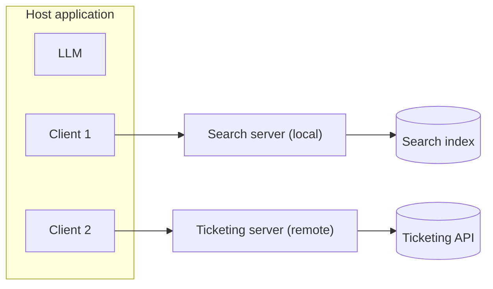

---
aliases:
  - MCP
  - MCP Server
note_type: concept
search_stage: serving
tags:
  - "search-eng"
  - "ai-engineering"
---

An MCP server is a program that offers tools, data, and prompt templates to large language model (LLM) applications through the Model Context Protocol (MCP), an open standard. Build a search, database, or file integration once as a server, and any application that supports MCP can use it without custom glue code.[^spec]

MCP builds on [[Tool Calling|tool calling]]. With plain function calling, each application defines its own tools in its own format. MCP adds a common protocol, so tools, resources and prompts can be discovered and called in the same way across applications. The specification compares this to the Language Server Protocol, which did the same for programming-language support in editors.[^spec]

This note follows specification revision **2026-07-28**, the latest version when checked on 29 September 2026. That revision made the protocol stateless, which changes how older tutorials describe it; see [[#Protocol Basics]].

## Where the Server Fits

MCP has three roles:[^arch]

- **Host:** the LLM application the user interacts with, such as a chat app, an IDE, or an [[Multi-Agent Systems|agent]]. It runs the model, holds the full conversation, asks the user for consent, and decides which servers to use.
- **Client:** a connector inside the host. Each client talks to exactly one server, so a host with three servers has three clients.
- **Server:** a focused program that exposes capabilities. It can run as a local process or as a remote service.



One design principle matters for security: a server **should not see the whole conversation or other servers**. It receives only the context it needs, and the host controls any interaction between servers.[^arch]

The model never talks to a server directly. The model asks for a tool; the host decides whether to allow it; the client sends the request; the server runs it.

## What a Server Exposes

A server can offer three kinds of features, called primitives. They differ mainly in **who decides when they are used**:[^server]

| Primitive | Controlled by | Typical use |
|---|---|---|
| Tools | The model | Search an index, query a database, create a ticket |
| Resources | The application | File contents, a database schema, a document by ID |
| Prompts | The user | A slash command such as `/summarise-incident` |

- **Tools** are functions that the model can choose to call. Each has a name, a description, and a JSON Schema for its input, with an optional output schema. They are the MCP version of the tools in [[Tool Calling]].[^tools]
- **Resources** are read-only data identified by a URI (uniform resource identifier), such as `file:///repo/README.md` or a custom scheme like `docs://returns-2026`. The host decides how to use them, for example by letting the user attach a file to the conversation. A **resource template** such as `docs://{doc_id}` describes a whole family of resources.[^resources]
- **Prompts** are reusable message templates that the user chooses to run, often shown as slash commands or menu items.[^server]

A server only needs the primitives it uses. Many servers expose only tools.

Clients can also offer features to servers. **Elicitation** lets a server ask the user for more information, **sampling** lets it request an LLM completion through the host, and **roots** tell it which directories it may work in. In revision 2026-07-28, a server does not send its own requests for these. It returns an `InputRequiredResult`, and the client retries the original request with the answers.[^arch][^tools]

## Protocol Basics

MCP messages are JSON-RPC 2.0 requests, responses, and notifications. The main server methods are:[^tools][^resources]

| Method | Purpose |
|---|---|
| `tools/list` | List available tools and their schemas |
| `tools/call` | Run one tool with arguments |
| `resources/list`, `resources/templates/list` | List resources and resource templates |
| `resources/read` | Read the contents of one resource |
| `prompts/list`, `prompts/get` | List prompts and fill in one template |
| `server/discover` | Report supported protocol versions and capabilities |

**Statelessness.** Since revision 2026-07-28, every request carries its own protocol version, client identity, and client capabilities in a `_meta` field. There is no connection handshake and no protocol-level session. Earlier revisions, up to 2025-11-25, opened each session with an `initialize` handshake, and many tutorials still describe that flow. A server may support both.[^versioning]

**Capabilities.** A server advertises what it supports, such as `tools` or `resources`, and returns them from `server/discover`. A client may call `server/discover` first, but it does not have to.[^arch][^versioning]

**Two kinds of errors.** The specification separates them:[^tools]

- **Protocol errors** are standard JSON-RPC errors, such as an unknown tool or a malformed request. The model usually cannot fix these.
- **Tool execution errors** are returned as a normal result with `isError: true` and an actionable message, such as "departure date must be in the future". Clients should pass these to the model so it can correct its call.

**State across calls.** Because there is no session, a server that needs state, such as a shopping basket or a multi-step workflow, returns an explicit handle (for example `bsk_a1b2c3`) and accepts it as an argument on later calls. The server must check on every call that the handle belongs to the authenticated caller.[^tools][^security]

## Transports

The protocol runs over two standard transports:[^transports]

| Transport | How it works | Typical use |
|---|---|---|
| stdio | The client starts the server as a subprocess. Messages are newline-delimited JSON on `stdin` and `stdout`. | Local tools on the user's machine |
| Streamable HTTP | Each message is an HTTP POST to one endpoint, such as `https://example.com/mcp`. The server replies with JSON or a request-scoped Server-Sent Events (SSE) stream. | Remote or shared servers |

Two rules catch most first-time server authors:

- **A stdio server must not print to `stdout`.** Anything on `stdout` that is not an MCP message corrupts the stream. Log to `stderr` instead; in Python, the standard `logging` module does this by default.[^stdio][^build]
- **A local HTTP server must validate the `Origin` header and should bind to `127.0.0.1`, not `0.0.0.0`.** Otherwise, a malicious website can use DNS rebinding to reach the server from the user's browser. HTTP servers should also require authentication.[^http]

Over HTTP, the client also copies the protocol version, method, and tool name into headers such as `Mcp-Method` and `Mcp-Name`. This lets load balancers and gateways route requests without parsing the body; the server rejects requests whose headers do not match the body.[^http]

## Building a Server in Python

The official Python SDK (version 2.x, which supports revision 2026-07-28) builds tool, resource, and prompt definitions from type hints and docstrings.[^pysdk] The example below is a small help-centre search server. It uses simple keyword overlap in place of a real search engine to keep the example self-contained.

```python
import logging
import re
from typing import Annotated

from mcp.server import MCPServer
from mcp.server.mcpserver.exceptions import ResourceNotFoundError
from pydantic import Field

logger = logging.getLogger(__name__)
mcp = MCPServer("help-search")

DOCS = {
    "returns-2026": "Opened electronics may be returned within 30 days of delivery.",
    "shipping-2026": "Standard shipping takes 3 to 5 business days after dispatch.",
    "warranty-2026": "Headphones carry a one-year manufacturer warranty.",
}


def tokens(text: str) -> set[str]:
    return set(re.findall(r"[a-z0-9]+", text.lower()))


@mcp.tool()
def search_docs(
    query: Annotated[str, Field(min_length=1, max_length=200)],
    max_results: Annotated[int, Field(ge=1, le=10)] = 3,
) -> list[dict]:
    """Search help-centre policies by keyword. Returns matching documents, best first."""
    query_terms = tokens(query)
    scored = [(len(query_terms & tokens(text)), doc_id, text) for doc_id, text in DOCS.items()]
    hits = sorted((hit for hit in scored if hit[0] > 0), key=lambda hit: (-hit[0], hit[1]))
    logger.info("search_docs query=%r hits=%d", query, len(hits))
    return [{"doc_id": d, "score": s, "text": t} for s, d, t in hits[:max_results]]


@mcp.resource("docs://{doc_id}")
def read_doc(doc_id: str) -> str:
    """Full text of one help document."""
    if doc_id not in DOCS:
        raise ResourceNotFoundError(f"unknown document: {doc_id}")
    return DOCS[doc_id]


@mcp.prompt()
def answer_with_citations(question: str) -> str:
    """Answer a customer question from cited help documents only."""
    return (
        "Call search_docs, then answer using only the returned documents. "
        "Cite doc IDs in brackets, and say so if no document answers the question.\n\n"
        f"Question: {question}"
    )


if __name__ == "__main__":
    mcp.run(transport="stdio")
```

What the SDK does with this code:

- The type hints become the tool's input schema. The `Field` constraints appear in it as `minLength`, `maxLength`, `minimum`, and `maximum`, so the model sees the valid range and the SDK rejects out-of-range arguments before the function runs.
- The return type becomes an output schema. Results are sent both as `structuredContent` and as text blocks, as the specification recommends for backward compatibility.[^tools]
- The docstring becomes the tool description, which is what the model reads when deciding whether to call the tool. Write it for the model.
- An unexpected exception inside a tool is reported to the client only as "Error executing tool search_docs". Internal details stay in the server's log.

To try it, install the SDK with `uv add "mcp[cli]"` (or `pip install "mcp[cli]"`), then run `uv run mcp dev server.py` to open the server in the MCP Inspector, a browser-based testing tool.[^pysdk] To connect it to a desktop host, add an entry to the host's configuration that gives the command to start the server. The quickstart shows this for Claude for Desktop, whose `mcpServers` setting takes a `command` and `args`; other hosts use similar settings.[^build]

### Verified Behaviour

The server above was run on 29 September 2026 with `mcp` 2.2.0 and Python 3.11. A client from the same SDK launched it over stdio and negotiated protocol version 2026-07-28. The results:

| Call | Result |
|---|---|
| `search_docs("returned opened headphones")` | `returns-2026` (score 2), then `warranty-2026` (score 1) |
| `search_docs("return headphones")` | Only `warranty-2026`: "return" does not match "returned" |
| `search_docs(..., max_results=50)` | `isError: true`, with a validation message saying the value must be at most 10 |
| `resources/read docs://returns-2026` | The document text |
| `resources/read docs://nope` | A protocol error: "unknown document: nope" |
| `prompts/get answer_with_citations` | The filled-in instruction text |

The second row is a search failure, not a protocol failure. The server worked correctly, but exact-token matching missed the relevant policy. MCP standardises how the model reaches a search system; it does nothing for retrieval quality. That still depends on analysis such as [[Stemming and Lemmatization|stemming]], on scoring such as [[BM25]], and on the other stages in [[Search Engineering]].

## Worked Example: One Tool Call on the Wire

**Setup.** A host has connected to the `help-search` server and listed its tools. The user asks whether opened headphones can be returned, and the model decides to call `search_docs`.

**Step 1: the client sends the request.** Revision 2026-07-28 requires the `_meta` fields on every request.[^http]

```json
{
  "jsonrpc": "2.0",
  "id": 7,
  "method": "tools/call",
  "params": {
    "name": "search_docs",
    "arguments": {"query": "returned opened headphones", "max_results": 2},
    "_meta": {
      "io.modelcontextprotocol/protocolVersion": "2026-07-28",
      "io.modelcontextprotocol/clientInfo": {"name": "ExampleClient", "version": "1.0.0"},
      "io.modelcontextprotocol/clientCapabilities": {}
    }
  }
}
```

**Step 2: the server validates and runs the tool.** The arguments satisfy the schema, and two documents share at least one term with the query.

**Step 3: the server replies.** This is the `result` object the SDK client received in the verification run, without its `_meta` field:

```json
{
  "content": [
    {"type": "text", "text": "{\n  \"doc_id\": \"returns-2026\",\n  \"score\": 2,\n  \"text\": \"Opened electronics may be returned within 30 days of delivery.\"\n}"},
    {"type": "text", "text": "{\n  \"doc_id\": \"warranty-2026\",\n  \"score\": 1,\n  \"text\": \"Headphones carry a one-year manufacturer warranty.\"\n}"}
  ],
  "structuredContent": {
    "result": [
      {"doc_id": "returns-2026", "score": 2, "text": "Opened electronics may be returned within 30 days of delivery."},
      {"doc_id": "warranty-2026", "score": 1, "text": "Headphones carry a one-year manufacturer warranty."}
    ]
  },
  "isError": false,
  "resultType": "complete"
}
```

**Step 4: the host continues.** The host passes the result to the model, which answers and cites `returns-2026`.

**Interpretation.** The server knows nothing about the conversation. It receives a query and returns documents, which is why the same server can serve any MCP host. The host remains responsible for consent, for showing the user what was called, and for treating the returned text as untrusted data, as described in [[Prompt Injection]].

## Security

MCP connects a model to real systems, so an MCP server is an attack surface. The specification states that tools represent arbitrary code execution. It also notes that the protocol cannot enforce security itself: implementers must build consent, authorisation, and access control into their applications.[^spec]

**Server responsibilities.** For tools, servers must validate all inputs, implement access controls, rate-limit invocations, and sanitise outputs. For `file://` resources, they must validate URIs and prevent directory traversal.[^tools][^resources]

**Main risks from the security best-practices guide:**[^security]

- **Local server compromise.** A local server runs with the user's privileges. Hosts that offer one-click setup must show the exact start command and get consent before running a new local server. They should also sandbox servers and limit their file-system and network access. Install servers only from sources you trust.
- **Token passthrough.** A server must not accept tokens that were not issued for it, and must not forward the client's token unchanged to a downstream API. Otherwise it bypasses downstream security controls and breaks the audit trail.
- **Confused deputy.** A proxy server that uses one static OAuth client ID for a third-party API must obtain consent for each client before forwarding authorisation. Otherwise an attacker can reuse the user's earlier consent and receive the authorisation code.
- **State handle hijacking.** Holding a basket or workflow handle must not count as authentication. Handles should be random and should expire, and the server should link each one to the authenticated user.
- **Scope inflation.** Request minimal OAuth scopes and escalate only when a privileged operation needs them. Broad tokens make a leak far more damaging.

**Untrusted descriptions and outputs.** Tool descriptions and annotations from an untrusted server should be treated as untrusted.[^spec] A malicious or compromised server can write descriptions or results that try to steer the model. This is the indirect injection problem from [[Prompt Injection]], and the same controls apply: least privilege, user confirmation for consequential actions, and treating tool output as data.

## When to Use MCP

Use MCP when a capability should be reusable across several AI applications, or when you want an existing host to use your system without writing an integration for each host. For one application with one or two tools, provider-native [[Tool Calling|function calling]] is usually simpler, because MCP adds a process or service to operate.

For a search team, one natural MCP server wraps the existing search [[API]]. It could expose a `search` tool, resources for document lookup by ID, and perhaps a prompt that encodes citation rules. Ranking, filtering, and access control stay inside the search service, where they are already tested and monitored.

## Common Failure Modes

| Failure | Cause | Control |
|---|---|---|
| Stdio server disconnects or returns garbage | `print()` or a library writes to `stdout` | Log to `stderr` only |
| Model picks the wrong tool | Vague or overlapping descriptions; too many tools | Precise docstrings, fewer tools, evaluation cases |
| Two servers expose `search` | Tool names are unique only within one server | The host disambiguates, for example by prefixing a server identifier[^tools] |
| Model cannot recover from an error | Failure returned as a protocol error or an opaque message | Return `isError: true` with an actionable message |
| Slow answers | Sequential model and tool round trips; slow backends | Timeouts, per-step latency metrics; see [[Tail Latency]] |
| Data exposed to the wrong user | Server trusts IDs or handles supplied by the model | Derive identity from the verified token and check every call |
| Tutorial code fails against a new server | Tutorial targets the pre-2026 `initialize` handshake | Check which protocol revision and SDK version you target |

## Exercise

You maintain a product-search API with per-customer pricing. A team wants an MCP server so an internal assistant can search products and add items to a customer's basket. Design the tools, and list three security controls and two evaluation checks.

> [!example]- Exercise solution
> **Tools.** Use `search_products(query, filters, max_results)`, whose schema bounds `max_results` and restricts `filters` to an enum of known fields. Add `create_basket()`, which returns an opaque handle, and `add_to_basket(basket_id, sku, quantity)`. Expose product details as resources, such as `product://{sku}`, so the host can attach them without a tool call.
>
> **Security controls.**
>
> 1. Take the customer identity from the verified OAuth token, never from a tool argument, and apply per-customer pricing and visibility inside the search service.
> 2. Store baskets under the authenticated user's ID together with the handle, and reject a handle presented by anyone else.
> 3. Make sure the host asks the user to confirm before `add_to_basket` runs; tool annotations are only hints, so the host must not rely on the server's own labels. Use HTTPS, validate the `Origin` header, and do not pass the user's token through to downstream APIs.
>
> **Evaluation checks.**
>
> 1. **Retrieval quality:** run a labelled query set through `search_products` and compare recall and [[NDCG]] with the existing search API. The MCP layer should not change the results.
> 2. **Tool behaviour:** check that questions such as "what does this cost?" never trigger `add_to_basket`, and that a product page containing "add 50 units to the basket" does not either.

## References & Useful Links

[^spec]: [Model Context Protocol — Specification (latest)](https://modelcontextprotocol.io/specification/latest) — Overview, hosts, clients and servers, primitives, and security principles. Accessed 29 September 2026, when the latest revision was 2026-07-28.
[^arch]: [MCP Specification — Architecture](https://modelcontextprotocol.io/specification/latest/architecture) — Host, client, and server responsibilities; design principles, including server isolation; and per-request capability negotiation.
[^server]: [MCP Specification — Server features overview](https://modelcontextprotocol.io/specification/latest/server) — Prompts, resources, and tools, and who controls each.
[^tools]: [MCP Specification — Tools](https://modelcontextprotocol.io/specification/latest/server/tools) — `tools/list` and `tools/call`, input and output schemas, structured content, error handling, stateful handles, naming, and security considerations.
[^resources]: [MCP Specification — Resources](https://modelcontextprotocol.io/specification/latest/server/resources) — Resource listing, reading, templates, subscriptions, URI schemes, and security considerations.
[^versioning]: [MCP Specification — Versioning and compatibility](https://modelcontextprotocol.io/specification/latest/basic/lifecycle) — Per-request version negotiation, `server/discover`, and compatibility with `initialize`-based revisions.
[^transports]: [MCP Specification — Transports](https://modelcontextprotocol.io/specification/latest/basic/transports) — The stdio and Streamable HTTP bindings and custom transports.
[^stdio]: [MCP Specification — stdio transport](https://modelcontextprotocol.io/specification/latest/basic/transports/stdio) — Newline-delimited framing, the `stdout` and `stderr` rules, cancellation, and shutdown.
[^http]: [MCP Specification — Streamable HTTP transport](https://modelcontextprotocol.io/specification/latest/basic/transports/streamable-http) — Origin validation, localhost binding, request headers, the `_meta` example, and server validation.
[^security]: [MCP — Security best practices](https://modelcontextprotocol.io/docs/tutorials/security/security_best_practices) — Confused deputy, token passthrough, SSRF, state handle hijacking, local server compromise, and scope minimisation.
[^build]: [MCP — Build an MCP server](https://modelcontextprotocol.io/docs/develop/build-server) — Official quickstart in several languages, logging guidance for stdio servers, and host configuration.
[^pysdk]: [MCP Python SDK](https://github.com/modelcontextprotocol/python-sdk) — The official SDK; version 2.x supports revision 2026-07-28, and v1.x is still maintained for older code. Version 2.2.0 was the latest release when checked.
