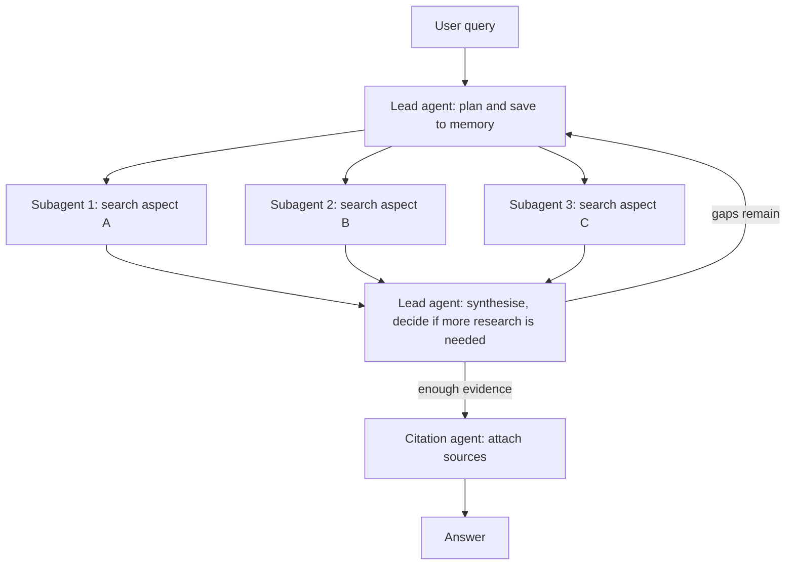

---
aliases:
  - Multi-Agent System
  - Multi-Agent LLM Systems
  - MAS
  - Agentic Systems
note_type: concept
search_stage: serving
tags:
  - "search-eng"
  - "ai-engineering"
---

A multi-agent system uses several AI agents that work together on one task. In current LLM applications, an **agent** is a large language model (LLM) that uses tools in a loop, deciding its next step from what the tools return. A multi-agent system splits the work between several such agents, for example a lead agent that plans and delegates to worker agents that search in parallel.[^anthropic-mas]

The idea is older than LLMs: distributed AI and multi-agent [[Reinforcement Learning|reinforcement learning]] study many interacting agents. This note covers the LLM-based kind.

## From One Call to Many Agents

Complexity should grow one step at a time, and only when a simpler design demonstrably falls short. Anthropic's guidance describes a ladder:[^anthropic-agents]

1. **Single LLM call:** often enough when combined with retrieval and in-context examples.
2. **Augmented LLM:** one model with retrieval, [[Tool Calling|tools]], and memory.
3. **Workflows:** LLMs and tools orchestrated through **predefined code paths**.
4. **Agents:** the LLM **directs its own process** and tool use, looping until done or until a stopping condition.
5. **Multi-agent systems:** several agents, each with its own prompt, tools, and context window.

The workflow–agent distinction is about who controls the path: your code or the model.[^anthropic-agents]

## Common Patterns

The first four are workflow patterns; orchestrator-workers can be a workflow or, when the lead agent loops, a multi-agent system.[^anthropic-agents]

- **Prompt chaining:** fixed sequential steps, with programmatic checks between them.
- **Routing:** classify the input, then send it to a specialised prompt, tool, or model. The classifier can be an LLM or a conventional model, such as [[Query Intent Classification|intent classification]].
- **Parallelization:** *sectioning* splits a task into independent parts; *voting* runs the same task several times and aggregates.
- **Evaluator-optimizer:** one LLM generates, another critiques, and the loop repeats.
- **Orchestrator-workers:** a central LLM decides the subtasks at run time, delegates them, and synthesises the results.

Anthropic's Research feature uses orchestrator-workers:[^anthropic-mas]

## Why Use Several Agents?

Anthropic reports these benefits for its research system:[^anthropic-mas]

- **Separate context windows:** each subagent explores one aspect and returns a condensed result, so the lead agent is not flooded with raw search results.
- **Parallelism:** independent directions are explored at the same time. Running 3–5 subagents in parallel, each making parallel tool calls, cut research time by up to 90% on complex queries.
- **Separation of concerns:** each agent gets its own tools, prompt, and exploration path.
- **Measured gain:** on Anthropic's internal research evaluation, a Claude Opus 4 lead agent with Claude Sonnet 4 subagents outperformed a single Claude Opus 4 agent by 90.2%.
- **Token budget:** on the BrowseComp browsing benchmark, token usage alone explained 80% of performance variance. With the number of tool calls and the model choice, three factors explained 95%.

The last point matters: much of the gain comes from spending more tokens, split across context windows, rather than from agents "collaborating" in some deeper sense.

## Costs and Poor Fits

- **Tokens:** in Anthropic's data, agents used about 4× the tokens of a chat interaction, and multi-agent systems about 15×.[^anthropic-mas]
- **Tightly coupled tasks:** tasks where all agents need the same context, or with many dependencies between agents, fit poorly. Anthropic cites most coding tasks as an example.[^anthropic-mas]
- **Coordination overhead:** early versions spawned 50 subagents for simple queries, duplicated each other's searches, and searched endlessly for sources that did not exist.[^anthropic-mas]
- **Latency and compounding errors:** agentic systems trade latency and cost for task performance, and autonomy brings compounding errors.[^anthropic-agents]

## Worked Example: Cost and Compounding Errors

### Cost of switching a feature to multi-agent

**Inputs.** Only the 15× multiplier comes from Anthropic's data; the rest are assumptions for illustration.

- A chat answer uses 2,000 tokens.
- A multi-agent answer uses 15 times as many, 30,000 tokens.
- The blended price is $3 per million tokens.
- Traffic is 100,000 queries a day.

**Step 1 — cost per chat answer.**

$$
2{,}000 \times \frac{3}{1{,}000{,}000} = 0.006 \text{ dollars}
$$

**Step 2 — cost per multi-agent answer.**

$$
30{,}000 \times \frac{3}{1{,}000{,}000} = 0.09 \text{ dollars}
$$

**Step 3 — daily cost at 100,000 queries.**

$$
0.006 \times 100{,}000 = 600 \text{ dollars}
$$

$$
0.09 \times 100{,}000 = 9{,}000 \text{ dollars}
$$

**Interpretation.** The design is worth it only for queries whose answers are valuable enough to justify an extra $8,400 a day, such as open-ended research. Routing only the hard queries to the multi-agent path, and answering simple ones directly, keeps most of the benefit at a fraction of the cost.

### Compounding errors

**Inputs.** A task needs $n$ steps, and each step succeeds with probability $p$. Assume steps fail independently; real failures are often correlated.

**Step 1 — ten steps at 95% reliability.**

$$
0.95^{10} \approx 0.599
$$

**Step 2 — ten steps at 99% reliability.**

$$
0.99^{10} \approx 0.904
$$

**Interpretation.** A step that looks reliable on its own still gives a 40% chance that the whole task fails somewhere. This is why production agents need checkpoints, retries, the ability to resume after errors, and evaluation of the final state rather than only individual steps.[^anthropic-mas]

## Why Multi-Agent Systems Fail

Cemri et al. analysed over 1,600 annotated traces from 7 multi-agent frameworks. They built a taxonomy (MAST) of 14 failure modes grouped into three categories, with inter-annotator agreement of $\kappa = 0.88$:[^mast]

1. System design issues.
2. Inter-agent misalignment.
3. Task verification.

The same paper notes that multi-agent gains on popular benchmarks are often minimal. Only its abstract was read for this note; the individual failure modes are listed in the paper.[^mast]

**Security.** Every agent that reads untrusted text, such as web pages, retrieved documents, or tool results, is exposed to [[Prompt Injection|prompt injection]]. With several agents, a compromised output can be passed on as another agent's instructions, so treat messages between agents as data, and restrict each agent's tools to what its role needs.

## Evaluating Agents

- **Judge outcomes, not paths.** Agents take different valid routes to the same answer, so check the result and the end state rather than a prescribed sequence of steps.[^anthropic-mas]
- **Start small.** Anthropic began with about 20 queries drawn from real usage; early changes had effects large enough to see with few cases.[^anthropic-mas]
- **LLM-as-judge with a rubric:** factual accuracy, citation accuracy, completeness, source quality, and tool efficiency. Anthropic found a single judge call producing 0.0–1.0 scores and a pass/fail grade the most consistent.[^anthropic-mas] Validate any judge against human labels; see [[LLM Evaluation]].
- **Human testing and tracing:** people found issues the evals missed, such as agents preferring SEO content farms over authoritative sources. Full production tracing made failures diagnosable.[^anthropic-mas]
- **Track cost and latency per query** alongside quality, including the slow tail ([[Tail Latency]]).

## LLM Agents vs RL Agents

In [[Reinforcement Learning]], an agent learns a policy from rewards by interacting with an environment, usually modelled as a [[Markov Decision Process]]. A typical LLM agent is not trained online during use. Its "policy" is a prompted, pre-trained model deciding which tool to call next. The vocabulary is shared, but LLM agents usually improve through prompt, tool, and orchestration changes, not through reward-driven learning in production.

## When to Use a Multi-Agent Design

Use it only when most of these hold:

- The task is open-ended, and its steps cannot be predicted in advance.
- It splits into largely **independent** parts that benefit from parallel exploration.
- The needed information exceeds what one context window can hold.
- Each answer is valuable enough to pay roughly an order of magnitude more in tokens.
- You can evaluate final outcomes and trace intermediate steps.

Otherwise, prefer a single call, a fixed workflow, or one agent. [[Action-Plan]] applies the same rule to the portfolio project: avoid multi-agent orchestration unless the problem genuinely needs multiple independent roles.

Fast typed classifiers can sit inside these designs as cheap gates, for example to route, check guardrails, or decide when to escalate. [[System One Models]] are marketed for this role; evaluate them like any other component.

## Exercise

A search team wants an assistant that answers "Which of our 40 product categories had the largest drop in click-through rate last week, and why?" The data is in one analytics database, and a written explanation is required. Would you use a single agent, a fixed workflow, or a multi-agent system? Justify the choice and name two evaluation checks.

> [!example]- Exercise solution
> **Choice: a fixed workflow, possibly with one agent at the explanation step.**
>
> The steps are predictable: query the click-through rate by category for two weeks, compute the changes, pick the largest drop, then pull diagnostics for that category, such as traffic mix, ranking changes, and outages. The data sits in one database, so there is nothing to explore in parallel across sources, and the parts depend on each other. A multi-agent system would multiply cost without adding coverage.
>
> **Checks.**
>
> 1. **Numerical correctness:** compare the reported category and drop against a SQL query computed independently.
> 2. **Grounded explanation:** every causal claim must cite a metric or log retrieved in the run. Flag unsupported claims, and check that correlation is not presented as proven cause (see [[AB Testing]]).

## References & Useful Links

[^anthropic-agents]: [Anthropic — Building effective agents (December 2024)](https://www.anthropic.com/engineering/building-effective-agents) — Workflows versus agents; prompt chaining, routing, parallelization, orchestrator-workers, evaluator-optimizer; guidance on when to use agents and on tool design. The page notes that its tooling landscape has since changed.
[^anthropic-mas]: [Anthropic — How we built our multi-agent research system (June 2025)](https://www.anthropic.com/engineering/multi-agent-research-system) — Orchestrator-worker architecture; the 90.2% internal evaluation gain; token usage explaining 80% of BrowseComp variance; 4× and 15× token multipliers; failure modes; evaluation and production-reliability lessons.
[^mast]: [Cemri et al. (2025), Why Do Multi-Agent LLM Systems Fail?](https://arxiv.org/abs/2503.13657) — MAST taxonomy: 14 failure modes in three categories, derived from annotated traces across 7 frameworks; notes minimal benchmark gains.
