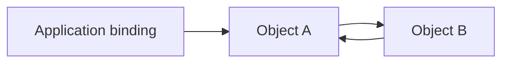

---
aliases:
  - "CPython Internals"
tags:
  - "python"
---

## Overview

**Python** is the language; **CPython** is its mainstream implementation, written mainly in C. CPython turns source into executable instructions, implements objects such as dictionaries, manages their lifetimes, and coordinates threads.

Start with one small example: counting how often a product appears.

```python
def record(counts, product):
    counts[product] = counts.get(product, 0) + 1

counts = {}
record(counts, "laptop")
record(counts, "laptop")
print(counts)  # {'laptop': 2}
```

Three questions hide inside that update:

- **Dictionary:** how does `"laptop"` find its value, including when hashes collide?
- **Memory:** what keeps the dictionary and its contents alive?
- **Concurrency:** what happens if two threads perform the update together?

This note develops those questions from first principles. The examples are illustrative, not production benchmarks.

> [!info] Version and build scope
> The main walkthrough uses **CPython 3.14 with the GIL enabled**. Source details are pinned to **3.14.3**, the locally available interpreter. Official documentation was checked on **7 October 2026** and served **3.14.8**. Maintenance-release GC changes and the optional free-threaded build are distinguished below; these implementation details are not universal Python-language guarantees.

All nine Python examples were executed successfully on CPython 3.14.3 on macOS, with the GIL enabled. The free-threaded behavior is documentation-backed; no free-threaded performance measurements were made.

## From Source Code to Running Objects

CPython tokenises and parses source into an **abstract syntax tree (AST)**, converts it into instructions, optimises a control-flow representation, and emits bytecode.[^compiler]

- A **code object** holds executable bytecode and associated information, such as constants and names.
- A **function object** combines code with an environment, including globals and any captured closure cells.
- An execution **frame** holds state for a particular call, such as local bindings and the current instruction.[^datamodel]

Inspect a function's instructions with `dis`:

```python
import dis

def record(counts, product):
    counts[product] = counts.get(product, 0) + 1

dis.dis(record)
```

Look for the operations implementing lookup, addition and assignment. Exact opcode names and boundaries change across versions. CPython can specialise instructions for observed runtime types; `dis.dis(record, adaptive=True, show_caches=True)` can expose that machinery. Disassembly is an inspection tool, not a thread-safety proof.[^dis]

## Names, References and Copies

A name refers to an object. Assignment normally creates another binding; it does not recursively copy the object.[^copy]

```python
items = {"laptop": ["A", "B"]}
alias = items
shallow = items.copy()

shallow["laptop"].append("C")
shallow["phone"] = ["P"]

print(alias is items)                     # True
print(shallow is items)                   # False
print(items["laptop"])                   # ['A', 'B', 'C']
print("phone" in items)                   # False
```

There are two dictionaries but one shared nested laptop list. A shallow copy creates a new outer container; mutations to a shared child remain visible through both. Adding an outer key affects only the copied dictionary. A deep copy recursively copies supported contents, with memoisation to handle cycles and repeated references.[^copy]

Connect this distinction to [[Deep and Shallow Copy (Python)]]. It also explains why an object can survive after one name is deleted: another container, closure or name may still reference it.

## Dictionary Collisions

### A hash narrows the search; equality identifies the key

A **hash** is an integer derived from a key. A dictionary uses it to select candidate locations instead of searching every key. Unequal keys may have the same hash: that is a **hash collision**. Different hashes can also select the same initial table slot.

Keys need stable hashes and a consistent equality rule. Equal keys must have equal hashes; the reverse is not required. Changing a key's hash-relevant state after insertion can make lookup fail.[^datamodel]

**Collision does not mean overwrite.** An existing entry is updated when the key matches, not merely because the hash matches. For example, `1`, `1.0` and `True` compare equal and can address the same dictionary entry; that is different from two unequal colliding keys.[^dict-api]

### What the table stores

In CPython 3.14.3, an ordinary **combined dictionary** separates:

- **Indices:** sparse hash-table slots pointing to entries, or marking empty/deleted slots.
- **Entries:** keys and values; general-key entries also store hashes.

This compact layout connects to [[Locality of Reference]]. Some instance dictionaries instead share a keys table while keeping separate values; see the key-sharing design.[^dict-source][^key-sharing]

Lookup uses **open addressing**: it probes alternative slots inside the table, rather than maintaining a linked list at each bucket. A probe uses identity/equality checks to find the key, continues past nonmatches and deleted slots, and stops unsuccessfully at a never-used slot.[^dict-source]

Insertion order is separate from hash order. Python guarantees dictionary insertion order: updating an existing key keeps its position; deleting and reinserting moves it to the end.[^dict-api]

### Worked example: two different keys with the same hash

**Setup:** immutable keys whose deliberately poor hash function always returns 7. Generated equality still compares their names.

```python
from dataclasses import dataclass

@dataclass(frozen=True)
class Product:
    name: str

    def __hash__(self):
        return 7  # Deliberate collisions for this demonstration.

a = Product("A")
b = Product("B")
stock = {a: 4, b: 9}

print(hash(a) == hash(b), a == b)  # True False
print(len(stock), stock[Product("A")], stock[Product("B")])  # 2 4 9

del stock[a]
print(stock[Product("B")])        # 9
stock[Product("B")] = 12
print(len(stock), stock[b])       # 1 12
```

**Interpretation:** A and B coexist despite identical hashes. A fresh, equal B object finds B's entry. Deleting A does not make B unreachable, and assigning through an equal B updates its value.

### Following the probe sequence

For a nonnegative hash and a power-of-two table size, the following reproduces the slot recurrence used by CPython 3.14.3. It is an educational calculation, not a dictionary implementation.[^dict-source]

**Inputs:** hash 7, eight slots, and three probe positions.

```python
hash_value = 7
mask = 8 - 1
perturb = hash_value
slot = hash_value & mask
positions = []

for _ in range(3):
    positions.append(slot)
    perturb >>= 5
    slot = (slot * 5 + perturb + 1) & mask

print(positions)  # [7, 4, 5]
```

**Result:** a collision at slot 7 sends lookup to slot 4, then slot 5. These are table slots, not insertion-order positions. This example uses a positive hash; CPython's C implementation also handles signed hashes through unsigned arithmetic.

A deletion leaves a **dummy marker**: replacing it with “never used” could incorrectly terminate a later colliding key's lookup. The table preserves unused slots and resizes around its usable-capacity limit, approximately two-thirds of index slots in this implementation.[^dict-source]

### What “constant-time lookup” assumes

With well-distributed hashes and inexpensive hash/equality operations, lookup is expected $O(1)$; insertion is amortised $O(1)$. A resize can require $O(n)$ work for $n$ entries. Severe collisions can make one lookup $O(n)$ and building a table $O(n^2)$.[^design-faq][^datamodel]

Those bounds do not make user-defined `__hash__` or `__eq__` free. A key may run expensive Python code during comparison. Constant hashes are useful for the example and poor for real key types.

String and bytes hashes are randomised between processes by default to make engineered collision attacks harder. Therefore, `hash("laptop")` is unsuitable as a persistent identifier or a cross-service cache-key contract.[^datamodel]

## Reference Counting and Cyclic Garbage Collection

### Two complementary mechanisms

**Reference counting** tracks strong ownership of an object. In the usual GIL-enabled build, an ordinary object's last strong reference disappearing normally triggers deallocation. Removing its references to other objects can then release those objects too.[^refcount]

**Cyclic garbage collection (GC)** handles unreachable cycles whose members still reference one another. A positive reference count alone does not prove that useful application code can reach an object.[^gc-design]

`del name` removes a binding; it is not an instruction to forcibly destroy the object. Conversely, `gc.disable()` disables automatic cyclic collection, not reference counting.[^gc-api]

### Why a cycle survives reference counting

Consider two objects, A and B, each referencing the other.



Remove the application binding. A and B still have incoming references from each other, but the application cannot reach either. A collector needs to distinguish **internally referenced** from **externally reachable**.

A simplified explanation of CPython's cycle-detection algorithm:[^gc-design]

1. Choose the tracked objects to examine and copy their reference counts into temporary bookkeeping.
2. Discount references coming from within that candidate set, using each container's traversal support.
3. Objects with remaining external references are reachable. Follow their outgoing references to preserve everything reachable from them too.
4. The remaining unreachable group can be cleared, subject to finalisation and resurrection handling.

A temporary count of zero is only a candidate for reclamation: a reachable candidate might still point to it. The collector does not simply free every cycle, nor does it alter real reference counts while doing the accounting.

### Worked example: observe a cycle without keeping it alive

**Setup:** a self-referencing object, observed through a **weak reference**, which does not keep it alive. Temporarily disable automatic cyclic collection so the before/after observation is controlled.

```python
import gc
import weakref

class Node:
    pass

was_enabled = gc.isenabled()
gc.disable()
try:
    node = Node()
    node.self = node
    observe = weakref.ref(node)
    del node

    print(observe() is not None)  # True: the cycle still exists.
    gc.collect()                 # Explicit collection still works.
    print(observe() is None)      # True: the unreachable cycle was collected.
finally:
    if was_enabled:
        gc.enable()
```

**Interpretation:** the self-reference prevented immediate reclamation. Explicit cyclic collection removed the unreachable object. Do not expect a fixed return count from `gc.collect()`; it can also collect unrelated objects in the process.

### Generations depend on the exact version

Generational collection prioritises objects by survival history to avoid repeatedly scanning the entire tracked population. The main idea is that many objects die young; exact scheduling is an implementation choice.

For **GIL-enabled CPython**, the 3.14 maintenance boundary matters:[^gc-api]

| Version | Relevant behavior |
|---|---|
| 3.14.0–3.14.4 | Generation 1 removed; incremental old-generation collection; `threshold2` ignored |
| 3.14.5 onward in the checked 3.14 docs | Middle generation and `threshold2` restored to the 3.13-style behavior |

The local 3.14.3 interpreter is on the first side of that boundary. Free-threaded GC has different coordination and scanning details; the pinned design describes scanning all tracked containers.[^gc-design] Check the build before copying tuning advice.

### Reclaimed objects do not guarantee lower process memory

Distinguish these cases:

- **Still reachable:** a cache, global, queue, callback or closure retains an object. GC cannot decide that the application no longer wants it.
- **Unreachable cycle:** cyclic GC can recover it.
- **Freed object, retained storage:** an allocator can retain memory for reuse, so resident set size (RSS) need not fall immediately.[^free-threading]

[[Closures - Python]] and [[Python Decorators]] are relevant because captured state and wrappers can extend object lifetimes. Resource lifetime is a separate concern: use context managers for files and locks; see [[with - python]]. Do not depend on GC timing to close a resource.[^design-faq]

**Reference-count caveat:** some CPython objects are immortal. Their counts are not ordinary ownership tallies, and `sys.getrefcount()` also introduces a temporary reference. Free-threaded reference counting has additional mechanisms and can defer reclamation.[^refcount][^sys][^pep703]

## The Global Interpreter Lock

### What the GIL protects

In a GIL-enabled interpreter, the **Global Interpreter Lock (GIL)** allows one thread at a time to execute Python code while protecting runtime state, including reference-count and object operations. CPython threads are operating-system threads; the GIL constrains their access to an interpreter, rather than eliminating threads.[^threads]

**Concurrency** means tasks can make overlapping progress. **Parallelism** means tasks execute simultaneously. Threads can overlap blocking I/O because CPython releases the GIL around supported blocking operations. Native extension code can also release it while doing work that does not access Python objects.[^threads]

Thus, a pure-Python CPU loop and a native numerical kernel can behave very differently in a thread pool. Check the actual library operation; “written in C” alone does not guarantee that it releases the GIL.

### Why the GIL does not make an update atomic

Return to the counter: reading a value, adding one and writing it back is a **compound operation**. Protecting the dictionary's internal consistency does not make the whole application operation indivisible.

**Setup:** two threads deliberately read the old value before either writes. A barrier makes the lost update reproducible rather than relying on a lucky scheduling race.

```python
from threading import Barrier, Thread

counts = {"laptop": 0}
both_read = Barrier(2, timeout=5)

def increment():
    previous = counts["laptop"]
    both_read.wait()
    counts["laptop"] = previous + 1

workers = [Thread(target=increment) for _ in range(2)]
for worker in workers:
    worker.start()
for worker in workers:
    worker.join()

print(counts["laptop"])  # 1, despite two attempted increments.
```

**Interpretation:** both threads read zero and both write one. The dictionary remains valid; the application's count is wrong. This demonstrates a compound-operation race, not a claim that every integer `+=` will exhibit a race in every CPython release.

**Fix:** protect the entire read–modify–write sequence with an application lock.[^threads][^free-threading]

```python
from threading import Lock, Thread

counts = {"laptop": 0}
lock = Lock()

def increment():
    with lock:
        counts["laptop"] = counts.get("laptop", 0) + 1

workers = [Thread(target=increment) for _ in range(2)]
for worker in workers:
    worker.start()
for worker in workers:
    worker.join()

print(counts["laptop"])  # 2
```

### Choosing a concurrency mechanism

| Mechanism | Typical fit | Main tradeoff |
|---|---|---|
| Threads, GIL enabled | Blocking I/O; native work that releases the GIL | Shared state needs coordination |
| `asyncio` | Many cooperative I/O tasks | CPU work blocks the event-loop thread |
| Processes | Independent CPU-heavy Python work | Startup, memory and data-transfer costs |
| `InterpreterPoolExecutor`, 3.14+ | CPU work in isolated interpreters | Separate state and serialised task data |
| Free-threaded CPython | Parallel Python threads with compatible dependencies | Synchronisation and runtime overhead |

An asyncio event loop runs one task at a time and switches when a task yields; adding `async` does not make CPU work parallel.[^asyncio] Process pools bypass a shared interpreter's GIL. Python 3.14's interpreter pool gives each worker an isolated interpreter with its own GIL; it is not the same as ordinary threads sharing one dictionary.[^executors]

Choose based on measured CPU work, waiting time and transfer overhead. Compare this with the runtime and ownership approaches in [[Rust and Go]].

### What changes with free-threaded CPython?

Optional free-threaded builds arrived experimentally in 3.13. In 3.14 they became officially supported while remaining optional; this does not mean ordinary 3.14 installations have no GIL.[^pep779]

Removing the GIL requires replacement mechanisms: biased/deferred reference counting, container protection and coordinated collection. It does not mean “the same interpreter with all locks deleted”.[^pep703]

Built-in containers use internal protection, but multi-step application invariants still need locks. An incompatible extension can re-enable the GIL, and a free-threaded build can run with it enabled. Check both **build capability** and **runtime state**:[^free-threading]

```python
import sys
import sysconfig

print(sys.version)
print("Free-threaded build:", sysconfig.get_config_var("Py_GIL_DISABLED") == 1)
print("GIL enabled now:", sys._is_gil_enabled())  # CPython 3.13+
```

Free threading can enable parallel Python execution, but speedup depends on contention, workload and dependencies. It can also change memory use and reclamation timing. Benchmark the full workload, including single-thread overhead; avoid assuming linear scaling with core count.[^free-threading]

## Practical Investigation Checklist

1. **Record the environment:** CPython version, build type, active GIL state, operating system and relevant extensions.
2. **For a slow dictionary:** check key count, hash distribution, hash/equality cost and insertion/deletion patterns. A collision-heavy demonstration is not a representative production benchmark.
3. **For growing memory:** check whether objects remain reachable before blaming cyclic GC. Compare `tracemalloc` snapshots to locate traced allocation growth; native allocations outside its tracking need other tools.[^tracemalloc]
4. **For object size:** `sys.getsizeof()` reports directly attributed size, not the recursively retained object graph.[^sys]
5. **For poor parallel scaling:** separate Python CPU time, native computation, I/O waits, lock contention and inter-worker transfer. Measure throughput and latency as distinct outcomes.

Common interview traps:

- “Same hash means same key.” Equality still matters.
- “A shallow copy is just another name.” It has a distinct outer container.
- “`del` immediately frees the object.” Other strong references or a cycle may remain.
- “The GIL makes my code thread-safe.” It does not protect every compound invariant.
- “Python threads can never run in parallel.” Native work, independent interpreters and free-threaded builds change the answer.
- “Every Python 3.14 patch has the same collector.” The 3.14.5 change is a counterexample.

## Exercises

1. **Collisions:** extend the `Product` example to 100 keys. Instrument equality calls for a missing-key lookup. Explain why the count can grow with the number of keys without asserting a fixed count across versions.
2. **Reachability:** retain the cyclic `Node` in a separate list before deleting its name. Predict the weak-reference result before and after clearing that list and collecting again.
3. **Concurrency:** explain why placing the example's barrier inside the lock would be wrong: the waiting thread would prevent the second thread from reaching the barrier.
4. **Source reading:** find `do_lookup`, `PERTURB_SHIFT` and `dictresize` in the pinned dictionary source. Connect them to lookup, collision resolution and resizing.[^dict-source]

## Related Notes

- [[Deep and Shallow Copy (Python)]] — Shared references and copying; use the worked example here to distinguish outer-container changes from nested mutations.
- [[Closures - Python]] — Captured bindings and object lifetimes beyond a function call.
- [[Python Decorators]] — Wrappers retain callable objects and may retain additional state.
- [[with - python]] — Explicit resource cleanup using context managers.
- [[Locality of Reference]] — Why memory layout affects performance beyond asymptotic complexity.
- [[Rust and Go]] — Contrast CPython's reference counting and cyclic GC with ownership and tracing-GC approaches.

## References & Useful Links

Sources checked on 7 October 2026. Source-code links use the local example version, 3.14.3; rolling 3.14 documentation may describe later maintenance releases.

[^compiler]: [CPython 3.14.3: Compiler design](https://raw.githubusercontent.com/python/cpython/v3.14.3/InternalDocs/compiler.md) — Source-to-bytecode compilation stages.
[^datamodel]: [Python 3.14: Data model](https://docs.python.org/3.14/reference/datamodel.html) — Objects, functions, frames, hash/equality contracts and hash randomisation.
[^dis]: [Python 3.14: dis](https://docs.python.org/3.14/library/dis.html) — Inspecting bytecode, specialisation and implementation/version dependence.
[^copy]: [Python 3.14: copy](https://docs.python.org/3.14/library/copy.html) — Assignment, shallow copying and deep copying.
[^dict-source]: [CPython 3.14.3: Objects/dictobject.c](https://raw.githubusercontent.com/python/cpython/v3.14.3/Objects/dictobject.c) — Compact layout, open addressing, perturbation, dummy slots and resizing.
[^key-sharing]: [Mark Shannon, PEP 412: Key-Sharing Dictionary](https://peps.python.org/pep-0412/) — Motivation for sharing keys between instance dictionaries; read the pinned source for current layout details.
[^dict-api]: [Python 3.14: Dictionaries](https://docs.python.org/3.14/builtins/stdtypes.html#mapping-types-dict) — Key behavior and insertion-order guarantees.
[^design-faq]: [Python 3.14: Design and History FAQ](https://docs.python.org/3.14/faq/design.html) — Dictionary lookup, memory management and explicit resource cleanup.
[^refcount]: [Python 3.14 C API: Reference Counting](https://docs.python.org/3.14/c-api/refcounting.html) — Strong references, deallocation, immortal objects and free-threaded caveats.
[^gc-design]: [CPython 3.14.3: Garbage collector design](https://raw.githubusercontent.com/python/cpython/v3.14.3/InternalDocs/garbage_collector.md) — Reference cycles, temporary counts, reachability traversal and build-specific collection.
[^gc-api]: [Python 3.14: gc](https://docs.python.org/3.14/library/gc.html) — Collection controls and the 3.14.5 generation/threshold changes.
[^threads]: [Python 3.14 C API: Thread states and the GIL](https://docs.python.org/3.14/c-api/threads.html) — Runtime protection, blocking I/O and native-code GIL release.
[^asyncio]: [Python 3.14: asyncio Task](https://docs.python.org/3.14/library/asyncio-task.html#asyncio.Task) — Cooperative event-loop scheduling.
[^executors]: [Python 3.14: concurrent.futures](https://docs.python.org/3.14/library/concurrent.futures.html) — Thread, process and interpreter pools and their constraints.
[^free-threading]: [Python 3.14: Free-threading support](https://docs.python.org/3.14/howto/free-threading-python.html) — Build/runtime detection, extension compatibility, locking and memory behavior.
[^pep703]: [Sam Gross, PEP 703: Making the GIL Optional in CPython](https://peps.python.org/pep-0703/) — Design rationale for reference-counting, container and collector changes.
[^pep779]: [Thomas Wouters, Matt Page and Sam Gross, PEP 779](https://peps.python.org/pep-0779/) — Supported but optional free-threading status in Python 3.14.
[^tracemalloc]: [Python 3.14: tracemalloc](https://docs.python.org/3.14/library/tracemalloc.html) — Allocation snapshots and tracing scope.
[^sys]: [Python 3.14: sys](https://docs.python.org/3.14/library/sys.html) — `getsizeof`, `getrefcount` and runtime inspection.
