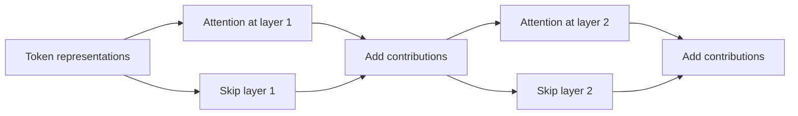

---
tags:
  - search-eng
  - ds-foundations
---

**Paper:** *Attention is Not All You Need: Pure Attention Loses Rank Doubly Exponentially with Depth* — Yihe Dong, Jean-Baptiste Cordonnier, and Andreas Loukas, ICML 2021; arXiv revised in 2023.[^dong]

Attention helps tokens exchange information. This paper asks whether repeatedly doing **only** that can erase the differences between tokens. Under the analyzed conditions, pure self-attention drives their representations toward the same vector. Residual connections and feed-forward networks therefore have roles beyond making optimization easier.

> [!note] Two different papers
> *Attention Is All You Need* (Vaswani et al., 2017) introduces the Transformer; its expanded explanation and architecture infographics are in [[Transformers#Attention Is All You Need: What the Paper Introduced|Transformers]]. This 2021 paper studies degeneration in pure attention. The two titles refer to different questions.

## Background

Attention was first developed to help sequence models use the relevant parts of a long input. In translation, it let the decoder look back at every source word instead of relying on one fixed-length summary vector.[^bahdanau] It later became the core of [[Transformers|Transformer]] networks. This paper asks what attention on its own contributes, and what the other parts of a Transformer block are for.

### Relevant attention details already in the vault

Read these in order if queries, keys, and values are still unfamiliar:

1. [[Transformers#Self-Attention Step by Step|Queries, keys, values, and row-wise softmax]] — Queries match keys; the resulting weights mix values. The score matrix and value vectors play different roles.
2. [[Transformers#Worked Example with Three Tokens|The red / running / shoes calculation]] — A complete numerical attention pass, followed by a causal-mask example.
3. [[Transformers#Multi-Head Attention|Multi-head attention]] — Separate learned projections and mixtures, then concatenation and output projection. Multiple heads alone do not remove the pure-attention result studied here.
4. [[Transformers#The Rest of a Transformer Block|Residual connections and feed-forward networks]] — The components this paper isolates and compares.
5. [[Transformers#Three Architecture Families|Self-attention versus cross-attention]] and [[Decoder-Only Model (Transformers)#Causal Masking|causal masks]] — Useful boundaries: do not assume a result for the paper's analyzed self-attention setting automatically describes every masking pattern or architecture.

[[Softmax Function]] explains normalization, and [[Embeddings]] supplies the representation vocabulary. The example below reuses the three token vectors from [[Transformers]] so the connection stays concrete.

## Problem

Transformers stack three kinds of component: self-attention, residual (skip) connections, and feed-forward networks (MLPs). Their success is well documented, but why the combination works is less understood. The authors study self-attention networks (SANs) in isolation to see what happens as layers are stacked.[^dong]

## Main Contribution

- **Path decomposition.** The output of a multi-head, multi-layer self-attention network can be written as a sum of smaller terms. Each term, or "path", follows one choice of head, or a skip, at each layer and behaves like a deep single-head network.
- **Rank collapse.** The authors derive conditions under which pure attention converges **doubly exponentially** with depth toward a matrix with identical token rows. They call this an inductive bias towards "token uniformity"; the limiting matrix has rank at most one.
- **Counteracting mechanisms.** Skip connections introduce paths that preserve earlier representations. MLPs can slow the convergence through their nonlinear transformations. These are different mechanisms, not a guarantee that either component prevents collapse for every parameter setting.
- **Interpretation.** Deep self-attention networks with skip connections behave like an ensemble of weakly dependent shallow networks.[^dong]

## Evidence

The local PDF is **arXiv v1, 5 March 2021**. Its main analysis and experiments (§§2–4, Figures 2–4) were read for this revision; the latest arXiv record is v2, 1 August 2023. The following details refer to the local v1, without assuming the versions are identical.[^dong]

| Experiment | Setup | What the authors report |
|---|---|---|
| Component removal, Figure 2 | BERT, ALBERT, and XLNet, at initialization and after pretraining; 32 Wikipedia biography excerpts, 128 tokens each | Rapid token-uniformity convergence when skip connections are removed; residual paths are especially important |
| Two-dimensional trajectories, Figure 3 | A trained single-layer module repeatedly predicts two circular arcs; hidden widths 32, 86, and 128 | Pure attention can merge the trajectories; width, MLPs, and skips change the observed convergence |
| Path isolation, Figure 4 | Sequence memorization, sorting, and convex-hull prediction; sampled path subsets at inference, five repetitions | Short paths retain more predictive power than long paths in the tested settings |

Figure 2 measures **relative residual size**: how different the token rows remain, relative to the size of their representations. It is not a translation-quality score. Removing components from pretrained networks also changes what the remaining components receive; the authors explicitly caution that this is a distribution shift for the MLPs. These experiments support the identified tendency, without establishing a universal failure threshold for deep models.[^dong]

## Intuition

Within a head, each token receives a weighted mixture of projected value vectors. Repeated mixing can make representations more alike, much as repeatedly blurring an image removes detail. As tokens become alike, their attention patterns can also become alike, strengthening the effect. This input-dependent feedback is part of why the paper's result is stronger than an analogy to repeated averaging with one fixed matrix.

![[Attachements/Attention - Rank Collapse.svg]]

*Schematic only: the bars show the idea of losing token differences, not measured feature values, ranks, or convergence rates.*

### Worked example: all tokens receive the same mixture

**Inputs and assumptions**

- Three token rows represent `red`, `running`, and `shoes`, in that order.
- Each vector has two features; value and output projections are identities.
- Every query is assigned the same uniform attention weights. This is an illustrative limiting case, not the weights calculated in the original three-token example.

**Step 1 — write the distinct token vectors.**

$$
X = \begin{bmatrix}1&0\\0&1\\1&1\end{bmatrix}
$$

The input has rank two: its columns contain two independent directions of variation.

**Step 2 — give every query the same weights.**

$$
A = \frac{1}{3}\begin{bmatrix}1&1&1\\1&1&1\\1&1&1\end{bmatrix}
$$

**Step 3 — mix the values.**

$$
AX = \begin{bmatrix}\frac{2}{3}&\frac{2}{3}\\\frac{2}{3}&\frac{2}{3}\\\frac{2}{3}&\frac{2}{3}\end{bmatrix}
$$

Every token now has the same vector. The output has rank one and no longer distinguishes `red` from `running` or `shoes`. The number of rows and features has stayed the same; **rank** concerns independent information, not the tensor's dimensions.

**Step 4 — add a residual path.** Ignore normalization in this toy calculation:

$$
X + AX = \begin{bmatrix}\frac{5}{3}&\frac{2}{3}\\\frac{2}{3}&\frac{5}{3}\\\frac{5}{3}&\frac{5}{3}\end{bmatrix}
$$

The updated rows are still distinct because each retains its previous vector. This shows how a skip can preserve differences; it is not a proof that any residual network must retain full rank.

### What doubly exponential means

Let $e_\ell$ measure the residual difference from a matrix of identical token rows after layer $\ell$. A simplified description of the paper's cubic contraction is:

$$
e_{\ell+1} \le C e_\ell^3
$$

Here $C$ depends on quantities such as projection-weight bounds, head count, and key width. This is an explanatory recurrence, not the full theorem: a contraction needs the bound to become smaller than the current residual. The theorem does not assert convergence for every possible input and parameter setting.[^dong]

For a **separate illustrative scalar example**, assume $C=1$ and $e_0=1/2$, and take equality in that recurrence.

**Step 1 — after one layer.**

$$
e_1 = \left(\frac{1}{2}\right)^3 = 0.125
$$

**Step 2 — after two layers.**

$$
e_2 = \left(\frac{1}{2}\right)^9 = 0.001953125
$$

**Step 3 — after three layers.**

$$
e_3 = \left(\frac{1}{2}\right)^{27} \approx 7.45\times10^{-9}
$$

The exponent grows as $3^\ell$, rather than merely in proportion to depth. These numbers illustrate the rate; they are not measured Transformer results, and the fixed uniform-mixing example above does not establish this rate.

### Why the other components matter

- **Residual connections:** a token can retain its earlier state while adding information from attention. In the path view, some routes bypass attention layers altogether.
- **Feed-forward networks / MLPs:** the same nonlinear function acts separately on each token. It can amplify remaining differences and slow contraction, depending on its parameters. It cannot recover token identity from already identical inputs by itself: the same function maps identical rows to identical outputs.
- **Layer normalization:** it supports training, but a shared per-token normalization also maps identical rows to identical rows. It is not a substitute for a path retaining token differences. See [[Layer Normalization#Where the Normalisation Sits|normalization placement]].

### Path decomposition in plain language

A path chooses a head at each layer, or a bypass when a skip connection is available. The paper expresses the network output as a sum of such contributions. A physically deep network can therefore contain routes with only a few attention-mixing steps.

The diagram suppresses individual heads, projections, MLPs, and normalization to show the bypass choices. The paths share the network's states and attention patterns; they are not independently trained models. The paper's “ensemble of shallow networks” interpretation concerns short attention paths, not a claim that depth is useless.

## Limitations and Assessment

- The main theorem concerns the analyzed pure-attention setting with weight bounds and a convergence region. Real Transformers include other components; neither arbitrary parameter settings nor every causal, sparse, or position-injection scheme are covered automatically.
- Convergence toward token-uniform matrices does not mean the tensor loses rows or features, or becomes exactly rank one after a fixed number of finite layers. An arbitrary rank-one matrix need not have identical rows; the paper studies the stronger token-uniform limit.
- The result explains why the non-attention parts of a block are essential; it does not claim that attention is unimportant.
- Assessment: the paper is useful for understanding architecture choices, for example why removing residual connections from a deep Transformer can make token representations indistinguishable.
- In search, token distinctions matter for [[BERT#Search Applications|query understanding and relevance scoring]]. This paper supplies architectural intuition, not evidence that a particular deployed retriever or ranker has collapsed or that one architecture will rank better.

## Exercise

Suppose `red`, `running`, and `shoes` have become three identical token vectors. Can a shared position-wise MLP distinguish them again without access to a residual state or other position-specific information? Explain why a residual path can help **before** the distinctions disappear.

> [!example]- Exercise solution
> No: identical inputs to the same deterministic function produce identical outputs. A residual path can carry earlier, distinct token states around a mixing operation, as the worked example demonstrates. It does not recreate information after every available path has already lost it.

## Connections

- [[Transformers#The Rest of a Transformer Block|The rest of a Transformer block]] — Residual connections and feed-forward layers.
- [[Transformers#Attention Is All You Need: What the Paper Introduced|Attention Is All You Need, 2017]] — Original contribution, worked attention calculation, and architecture infographics.
- [[Layer Normalization]] — Another component that stabilises deep stacks.
- [[Transformer Papers]] — The wider reading list.

## Full Text

![[Attention is not all you need.pdf]]

## References & Useful Links

[^dong]: [Dong, Cordonnier & Loukas (2021), Attention is Not All You Need: Pure Attention Loses Rank Doubly Exponentially with Depth](https://arxiv.org/abs/2103.03404) — Version history and full paper; the embedded local copy is arXiv v1. Its §§2–3 support the path decomposition, conditional convergence, and component analysis; §4 and Figures 2–4 support the experimental summary. Appendix proofs were not independently verified. The [ICML 2021 proceedings entry](https://proceedings.mlr.press/v139/dong21a.html) confirms publication details.
[^bahdanau]: [Bahdanau, Cho & Bengio (2014), Neural Machine Translation by Jointly Learning to Align and Translate](https://arxiv.org/abs/1409.0473) — Origin of attention for translation.
