## Overview and Reading Guide

Search2.0 turns a query and customer context into grouped, ordered product results. In the Rust implementation, **product search coordinates the request, recall finds candidates, and reranking selects and orders them inside one process**. Query parsing, embedding generation, ESCI relevance inference, and storage remain external dependencies.

This is the implementation companion to [[Search Architecture]], linked from [[Search Engineering]]. Read the main diagrams for the overall flow; expand the foldable callouts for examples and less obvious behavior. The callouts use Obsidian's native collapsed syntax, so their titles remain visible while the details can be opened as needed.[^format]

The implementation uses the `serving-rs/` workspace. Source paths beginning with `crates/`, `knowledge/`, or `deploy/` are relative to that directory. Catalogue ingestion, model training, and index publishing supply the data and artifacts consumed by online serving.[^map]

| Read this section                         | To understand                                               |
| ----------------------------------------- | ----------------------------------------------------------- |
| [[#System Boundary and Responsibilities]] | What runs inside Rust and what remains remote               |
| [[#Startup and Shared State]]             | What must exist before the service accepts requests         |
| [[#End-to-End Request Flow]]              | The sequence from HTTP input to response                    |
| [[#Query Understanding and Filters]]      | How entities become routing and retrieval constraints       |
| [[#Recall and Candidate Expansion]]       | Dense/sparse math, actual RRF role, tiers, and expansion    |
| [[#Reranking and Final Ordering]]         | ESCI, engagement features, ONNX, availability, and grouping |
| [[#Alternative Request Paths]]            | Lookup, multiple type groups, and more-like-this            |
| [[#Failures and Fallbacks]]               | Errors, graceful broadening, and degraded success           |
| [[#Observability and Diagnosis]]          | How to locate the first divergence                          |
| [[#Deployment and Runtime Lifecycle]]     | Image build, deployment handoff, probes, and shutdown       |
| [[#Known Gaps and Review Questions]]      | What remains incomplete or needs live verification          |

## System Boundary and Responsibilities

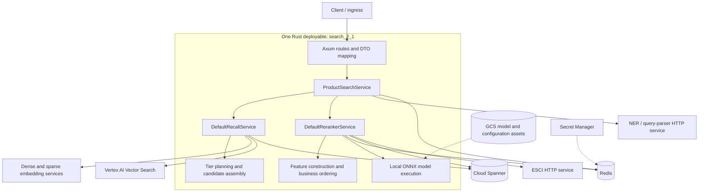

Solid arrows describe request-time calls or internal work. Dashed arrows show supporting initialization dependencies. GCS also supplies startup mappings, described below. This diagram does not imply that every arrow occurs on every request: caches and intent routing can bypass work.[^startup][^recall-wiring]

| Layer | Owns | Concrete entry points |
|---|---|---|
| `api` | HTTP routes, request/response DTOs, error mapping, startup composition | `main.rs`, `lib.rs`, `state.rs`, `handlers/product_search.rs` |
| `domain::product_search` | Session reuse, query understanding policy, filters, route selection, fallback, response meaning | `service.rs`, `intent.rs`, `filters.rs` |
| `domain::recall` | Recall workflow, tier policy, deduplication, expanded candidate assembly | `service.rs`, `policy.rs`, `candidate.rs` |
| `domain::reranker` | Metadata/relevance workflow, feature construction, normalization, final ordering | `pipeline.rs`, `features.rs`, `scoring.rs` |
| `domain::ports` | Interfaces describing the outside capabilities the domain needs | `QueryEmbedder`, `VectorSearch`, `ProductMetadataRepository`, `EsciModel`, and others |
| `infra` | HTTP, Redis, Spanner, GCS, vector-search transport, ONNX adapters | Implementations of domain-owned interfaces |
| `shared` | Configuration, structured logging, tracing | `config/`, `observability.rs` |

The dependency direction and request flow are different views. At startup, API composition code constructs concrete infrastructure adapters. During a request, the domain calls interfaces without needing to know which Redis client, SQL library, or HTTP transport implements them.[^startup]

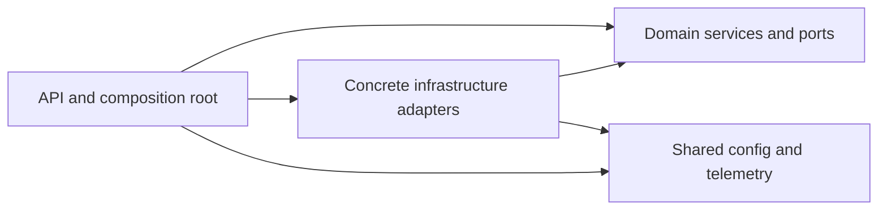

> [!info]- Why keep three services inside one process?
> A product-search call invokes recall and reranker as Rust methods. It avoids serializing and transmitting their large intermediate candidate sets between separate HTTP services. The three responsibilities still have separate domain modules and interfaces. External calls still incur network latency, and local inference still consumes CPU; the architecture alone does not establish a speedup. See [[Microservices]], [[Latency vs Throughput]], and [[Rust and Go]].

### Data that Must Already Exist

The online service consumes several independently maintained data products:

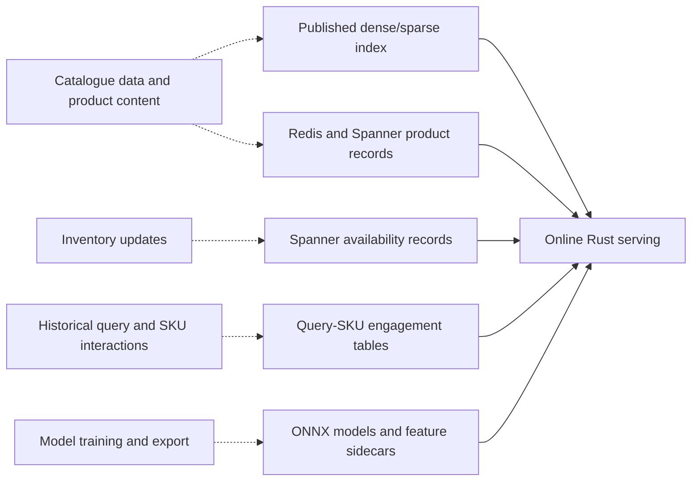

The dashed upstream paths are **conceptual prerequisites**, not verified ingestion job definitions. A consistent serving snapshot needs compatible embedding/index versions, metadata keys, model feature order, and engagement windows. See [[Index Updates]], [[Feature Engineering]], [[Data Leakage]], and [[Learning to Rank]].

## Startup and Shared State

The actual entrypoint is `crates/api/src/main.rs`. It installs a TLS crypto provider, loads configuration, initializes telemetry, builds the app, and binds the listener only after construction succeeds.[^startup]

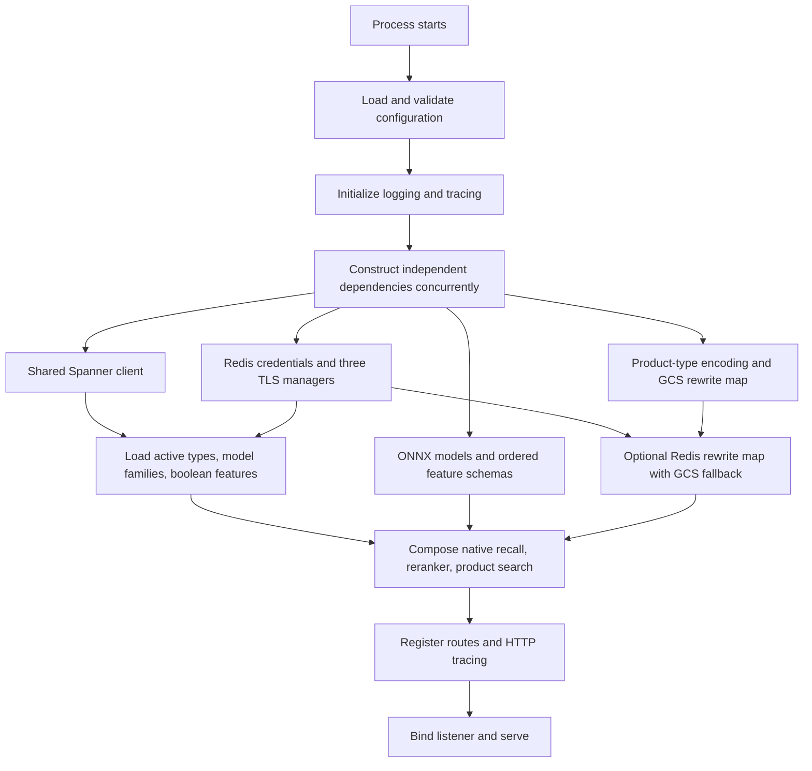

Important construction rules:

- **Required configuration and required dependency construction fail before bind.** A healthy listener therefore means startup completed; it does not guarantee every remote dependency will remain healthy.
- **Both ONNX branches are attempted.** Failure to load the configured default branch aborts startup. Failure of the other branch is logged and tolerated; requests selecting that unavailable branch later fail reranking and can degrade to recall results.[^onnx]
- Product types, active model families, and boolean-feature catalogues are initially loaded and then refreshed by caching adapters. A product-type ranking-map load failure instead yields neutral ranks.
- Query rewriting can load a Redis map, with the already-loaded GCS map as its startup fallback. This is not a new GCS download for each search.
- There are **three independently connected Redis managers**: product search, recall, and reranker. Adapters inside each boundary share its manager; a large command batch in one boundary does not share the same socket with the other two.[^startup]

> [!info]- What `Arc`, traits, and shared state mean here
> `AppState` holds values such as `Arc<dyn RecallService>`. `Arc` is a reference-counted pointer whose reference count can be updated safely across threads. Cloning it shares ownership of the existing service; it does not construct another service. The `dyn` interface permits a concrete production adapter to sit behind the domain contract. `Send + Sync` constraints allow the service to participate in the concurrent server safely. `Arc` alone does not make mutable contents safe: local ONNX sessions use a mutex because execution needs mutable access. This connects ownership to the runtime model described in [[Rust and Go]].[^rust-arc][^onnx]

## End-to-End Request Flow

### Public Contract

The main route is **`POST /api/v1.0/predictions`**. The required fields are `search_id`, `query_id`, and `query`. A minimal illustrative request is:[^api]

```json
{
  "search_id": "example-search-001",
  "query_id": "example-query-001",
  "query": "gaming laptop under 1000",
  "num_results": 100,
  "ab_flag": "test"
}
```

These example IDs and query are explanatory inputs, not a captured production request.

| Input family           | Fields and current meaning                                                                       |
| ---------------------- | ------------------------------------------------------------------------------------------------ |
| Identity and query     | IDs correlate sessions/logs; query drives understanding and retrieval                            |
| Size                   | `num_results` defaults to 100; domain validation accepts 1–1000                                  |
| Routing                | `enable_more_like_this` changes the query into an anchor-SKU request                             |
| Refinements            | `prompt_ids`, `in_stock`, `membership_type`, `enable_marketplace`                                |
| Geography              | `zip_code`, `location_ids`, `location_id_map`, `store_id_map`                                    |
| Fulfillment selections | `same_day_shipping_applied`, `instore_applied`, `store_pickup_applied`                           |
| Model branch           | `ab_flag=test` selects engagement/LTR; other values select baseline; omission uses configuration |
| Exact SKU restriction  | `sku_hard_filter_list` becomes a `sku_id` filter and suppresses broad tiers                      |
| Optional side effect   | `persist_interim_results` calls the configured interim-results sink, currently a no-op           |

Snake case is canonical; camelCase aliases are accepted. List fields support arrays and legacy comma-delimited strings. Map fields support objects with string-list values and legacy JSON-encoded strings. Integer IDs are accepted by the list-field parser, **not by the map's `Vec<String>` parser**.[^api]

> [!warning]- Requested count, retrieval budget, and response size differ
> `num_results` is validated and passed into recall, but the native tier budgets are fixed by policy. The normal reranker caps output at **100 parents and 5 SKUs per parent**. The response mapper performs no further truncation to `num_results`. Lookup and degraded recall pass-through also follow their own paths. Therefore `num_results=10` is not an enforced promise of ten returned products in this implementation. This is a contract question to resolve, not a pagination feature to assume.[^api][^recall-policy][^rank]

### Orchestration Spine

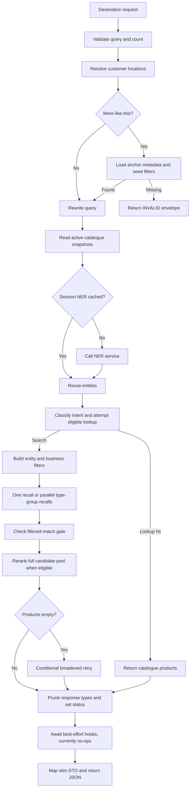

The diagram is the successful/degraded business flow. Propagated dependency errors can terminate earlier; their exact boundaries are in [[#Failures and Fallbacks]].[^product-search]

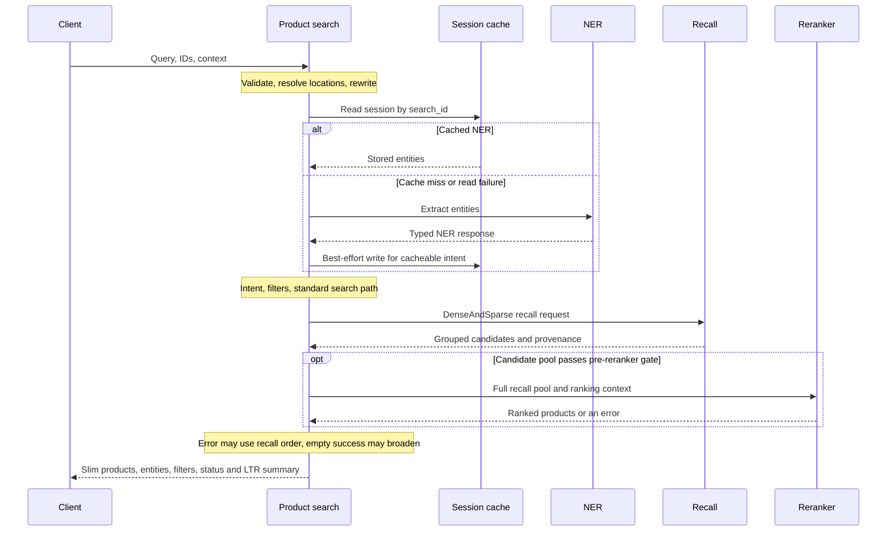

## Query Understanding and Filters

### Session Reuse and Intent

The service captures the original query before MLT or rewriting changes the effective query. It reads active catalogue snapshots, then looks for a cached NER response using **`search_id`**. A hit skips the remote NER call; intent metadata is recomputed. A miss calls the authenticated query parser. Session read/write errors are non-fatal. Fresh product-search and MLT sessions are eligible for best-effort write-back, with a 24-hour TTL in the Redis adapter.[^product-search][^session]

A session is not a cached final result. Recall and ranking still run. Nor is it keyed by every filter, model branch, or query string. Reusing a `search_id` for unrelated text can reuse old entities; correct session identity is part of the caller contract. See [[Search Caching]] and [[Query Understanding]].

The implemented routing distinctions are:

- **MLT:** explicit request flag; anchor preprocessing happens before NER.
- **Product lookup:** on a fresh ordinary search, token extraction and a nonempty Redis catalogue result are required. A digit pattern alone does not establish the route.
- **Product search:** the default route; confidence, NER presence, and multiple-type metadata influence subsequent work.
- **Invalid:** unresolved MLT anchor is a reachable early exit. The text-moderator interface could reject low-confidence input, but its production adapter currently allows all text.
- **More information:** the enum/status exists; the classifier does not implement a clarification-producing branch.[^intent][^product-search]

### From Entities to Constraints

[[Named Entity Recognition]] supplies candidate brands, product types, features, prices, and other entities. These are interpreted by policy rather than forwarded blindly. Active-type filtering, confidence thresholds, type narrowing, and active feature/model-family sets determine what becomes a filter.[^filters]

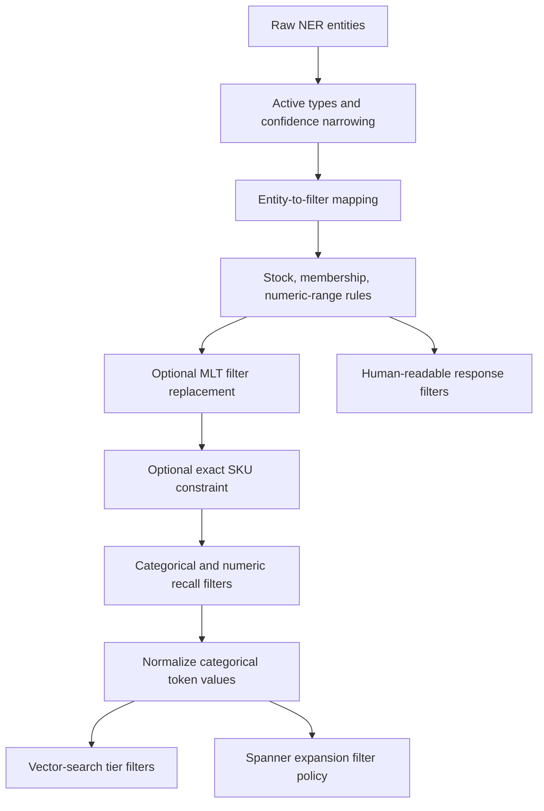

Key filter rules:

| Policy | Why it matters |
|---|---|
| Entity-specific thresholds | Type confidence, brand confidence, and model-family confidence have different meanings; there is no universal NER threshold |
| Active model-family gating | A predicted family/variation must pass selection thresholds and the active catalogue check |
| Active boolean features | A feature must be valid for the applicable product type before it constrains retrieval |
| In-stock transformation | Changes order-code filtering; availability additionally depends on location resolution and downstream data |
| Membership mapping | Known memberships rewrite price/deal filters to the associated member columns; arbitrary membership strings are not new supported tiers |
| Numeric-range merging | Adjacent/overlapping bounds are consolidated before recall |
| Categorical normalization | At the recall boundary: trim, lowercase, replace spaces with hyphens, drop empty tokens |
| SKU restriction | Retained even by the broadened fallback; unfiltered tiers must not bypass it |

> [!info]- Why model-family selection is more than one threshold
> In the fresh-session policy, a base model family must first exceed its 0.97 gate before a family or variation survives. The selected value is then checked against the active catalogue. An inactive selected variation does not automatically fall back to the base family. Cached sessions relax the initial gate but still validate the selected value. That means the same raw NER payload can produce different constraints depending on session state and catalogue state. Compare the processed entities and actual filters before attributing a missing product to vector similarity.[^filters]

### Location Resolution Has Precedence Rules

1. If `zip_code` is supplied, resolve it through the location repository. Otherwise start from the caller's `location_id_map`.
2. Preferred stores in `location_ids["user_preferred_store"]`, plus their nearby stores, replace the `instore` group.
3. Applied same-day shipping clears the map when same-day-shipping locations were resolved.
4. Nonempty `instore_applied` or `store_pickup_applied` clears the map independently.

These are the current product-search rules; do not interpret applied store selections as merely adding more locations. Separately, **`store_id_map`** supplies condition-specific retrieval columns for Get It Fast tier expansion. Location availability in recall, availability used for ranking, and prompt rendering are separate paths.[^locations]

## Recall and Candidate Expansion

Recall implements [[Candidate Generation]] using [[Dense Retrieval]] and [[SPLADE|learned sparse retrieval]]. Both modalities feed the native vector-search path. The dense path is configurable: DVS uses an HTTP embedding service; otherwise the adapter uses a Vertex text-embedding model. Sparse embedding remains an HTTP call. Dense and sparse computation run concurrently on a cache miss.[^recall-math-embedding]

The checked-in T02/P03/P04 values select `text-embedding-005`, not the DVS path. They identify different vector deployments: `productembeddings_v5`, `productembeddings_v16`, and `productembeddings_v15`, respectively. These are configuration observations, not proof of what is currently serving traffic.[^recall-current-config]

### Read the Recall Mathematics in This Order

Start with [[Embeddings]], [[Cosine Similarity]], [[Dense Retrieval]], and [[SPLADE]]. Then read [[Hybrid Retrieval]] for RRF, [[Filtered Vector Search]] for eligibility, and [[Candidate Generation]] for candidate assembly. [[outputs/Understanding Transformer to Search 2.0|Understanding Transformer to Search 2.0]] provides the longer checklist from Transformer fundamentals to these serving stages.

**One running example:** query `gaming laptop under 1000`. Assume one currency, a supported laptop type, and a valid price upper bound. A is a gaming laptop, B is a laptop sleeve, and C is an ordinary office laptop. All vectors, weights, prices, and ranks in the calculations below are invented teaching inputs, not model outputs or production measurements.

The serving distinction to keep in mind is **representation → per-tier retrieval → tier merge → expansion → relevance filtering → final ranking**. These steps do not share one universal score.

### Dense Retrieval: Compare Learned Whole-Text Vectors

A query encoder maps the effective query to a dense vector; compatible catalogue vectors must already exist in the index. Let $E_Q$ be the query encoder and $E_D$ the catalogue encoder:

$$
u=E_Q(q).
$$

$$
v_d=E_D(\operatorname{text}(d)).
$$

The catalogue representation is independent of this particular query, so it can be precomputed. A Transformer encoder may contextualize tokens and pool them into a vector; the exact pooling/training recipe belongs to the embedding model. The Rust Vertex adapter requests `outputDimensionality` and returns the model's values; it does not implement a new pooling layer or normalize those values itself. Do not label a latent coordinate “gaming” or “price” as if the model exposes a fixed feature dictionary.[^recall-math-embedding]

**Dot-product similarity** for vector width $m$:

$$
s_{\mathrm{dense}}(q,d)=u^\top v_d=\sum_{j=1}^{m}u_jv_{d,j}.
$$

**Cosine similarity** for nonzero vectors:

$$
\operatorname{cos}(u,v_d)=\frac{u^\top v_d}{\lVert u\rVert_2\lVert v_d\rVert_2}.
$$

With unit-normalized vectors, dot product equals cosine. Without normalization, vector magnitude also affects a dot product. A similarity is not a relevance probability; a nearby laptop sleeve can still be the wrong answer. See [[Cosine Similarity]] and [[Dense Retrieval]].

#### Worked Dense Calculation

**Inputs:** use two dimensions instead of the real model width. Query $u=(1,0)$; A has vector $(0.8,0.6)$; B has $(0.6,0.8)$; C has $(0,1)$. Each has unit norm, so dot product and cosine agree.

**1. Score A.**

$$
s_{\mathrm{dense}}(q,A)=1\times0.8+0\times0.6=0.8.
$$

**2. Score B.**

$$
s_{\mathrm{dense}}(q,B)=1\times0.6+0\times0.8=0.6.
$$

**3. Score C.**

$$
s_{\mathrm{dense}}(q,C)=1\times0+0\times1=0.
$$

Dense order is A, B, C. At a depth of two, A and B enter this toy list; C does not. B's inclusion shows why embedding similarity alone does not settle whether a candidate fulfills the query.

#### Distance Names Do Not Determine Score Direction

For unit vectors, squared Euclidean distance has this relationship to dot product:

$$
\lVert u-v_d\rVert_2^2=2-2u^\top v_d.
$$

Using A's dot product from the example:

$$
\lVert u-v_A\rVert_2^2=2-2\times0.8=0.4.
$$

Higher dot product therefore corresponds to lower squared Euclidean distance in this normalized example. Google defines its configured `DOT_PRODUCT_DISTANCE` as negative dot product and supports sparse dot-product distance; the dense index also has configurable normalization and distance settings.[^recall-math-index] Its hybrid tutorial describes returned dense/sparse values as **inverted distances**, where larger values mean closer matches.[^recall-math-google]

These are different API contexts. Rust preserves the returned numeric fields; it does not derive a universal conversion from their names. The deployed index configuration determines the actual metric and normalization. The cosine example above is an explanation, not proof that the production dense score is cosine.

### Sparse Retrieval: Match Shared Weighted Coordinates

A sparse vector stores a small number of nonzero coordinates in a much larger space. A term-based model can use vocabulary IDs as coordinates; a coordinate/value pair is not a dense embedding with missing numbers. For a learned sparse model, related terms absent from the original text may receive nonzero weights. See [[SPLADE]].

For query weights $w_j^q$, document weights $w_j^d$, and vocabulary $V$, sparse dot-product scoring is:

$$
s_{\mathrm{sparse}}(q,d)=\sum_{j\in V}w_j^q w_j^d.
$$

Only shared nonzero coordinates contribute. In the Rust wire contract, `query_embeddings_dimension` supplies coordinate IDs and `query_embeddings` supplies the corresponding values. The adapter rejects unequal lengths and zips the two arrays into typed pairs. Its comments describe a SPLADE service; the service's actual checkpoint, vocabulary, pooling, and pruning are defined by the model service.[^recall-math-embedding]

#### Worked Sparse Calculation

**Inputs:** query weights `{gaming: 2, laptop: 1}`. A has `{gaming: 0.5, laptop: 1}`; B has `{laptop: 3, sleeve: 2}`; C has `{office: 2, laptop: 1}`. Coordinates absent from a vector have weight zero. Treat these as invented whole-word coordinates for readability; a real vocabulary may use subwords.

**1. Score A.**

$$
s_{\mathrm{sparse}}(q,A)=2\times0.5+1\times1=2.
$$

**2. Score B.**

$$
s_{\mathrm{sparse}}(q,B)=2\times0+1\times3=3.
$$

**3. Score C.**

$$
s_{\mathrm{sparse}}(q,C)=2\times0+1\times1=1.
$$

Sparse order is B, A, C. The `sleeve` coordinate contributes nothing because the query does not activate it. B still wins through its large `laptop` contribution. That is a plausible failure pattern to inspect, not evidence that a real SPLADE model would assign these weights.

The sparse scores 3 and 2 cannot be compared directly with dense scores 0.8 and 0.6. Their spaces and scales differ. Neither the larger number nor the word “distance” establishes which product is more relevant.

#### Where SPLADE's Weights Come From

For a standard SPLADE-style encoder, let $h_i$ be the contextual vector at input position $i$, $e_j$ the vocabulary output embedding, and $b_j$ its bias. An MLM head produces a vocabulary logit:

$$
z_{ij}=\operatorname{transform}(h_i)^\top e_j+b_j.
$$

The max-pooling variant converts position-wise logits to one nonnegative vocabulary weight:

$$
w_j=\max_i\log\bigl(1+\operatorname{ReLU}(z_{ij})\bigr).
$$

ReLU zeroes negative logits; the logarithm dampens positive ones; pooling aggregates across positions. Training adds relevance and sparsity objectives. Expansion occurs because the head predicts over the vocabulary, not just input terms. Original SPLADE uses sum pooling; the later variant explores max pooling.[^recall-math-splade] None of these training operations run inside Rust's recall orchestrator; it consumes the remote service's representation.

### Filters and Top-K: Similarity Within an Eligible Set

Let $\mathcal D$ be indexed datapoints, $F_t(q,d)$ the eligibility predicate for tier $t$, and $K_t$ that physical request's neighbor budget. The eligible universe is:

$$
\mathcal D_t(q)=\{d\in\mathcal D:F_t(q,d)=\mathrm{true}\}.
$$

An ideal exact similarity query would produce:

$$
L_t(q)=\operatorname{TopK}_{d\in\mathcal D_t(q)}\bigl(s_t(q,d),K_t\bigr).
$$

This abstraction separates **eligibility**, **scoring**, and **depth**. The actual service uses the configured index algorithm and can apply crowding; it need not return the exact exhaustive top-K. [[Approximate Nearest Neighbours]] explains approximation error. The adapter requests an approximate-neighbor count of 1,000 and leaf-search fraction 0.5; neither number is a relevance threshold or a promise of 1,000 output products.[^recall-math-transport]

For an illustrative strict price interpretation, a candidate priced 1,200 fails the `under 1000` predicate even if it has the highest dense similarity. Another tier can use a broader eligible universe. If a candidate would rank second only after filtering but ranks 500th globally, globally retrieving ten and then filtering is not equivalent to searching the eligible set for ten. See [[Filtered Vector Search]].

No fixed dense/sparse similarity cutoff is applied by the recall candidate flow; it logs `similarity_threshold_applied=false`. Fixed top-K and eligibility are different from a score threshold.[^recall-math-candidate]

### RRF: General Fusion Math and Its Actual Role Here

[[Hybrid Retrieval]] explains reciprocal rank fusion (RRF): compare list positions rather than adding incompatible raw scores. For ordered source lists $L_s$, one-based rank $r_s(d)$, and positive smoothing constant $c$:

$$
\operatorname{RRF}(d)=\sum_{s:d\in L_s}\frac{1}{c+r_s(d)}.
$$

An absent item contributes zero from that source. The constant dampens the difference between positions; it is not the candidate count or an ESCI threshold. Fusion can only use candidates in its input windows.[^recall-math-rrf]

#### Worked RRF Calculation

**Inputs:** dense list `[A, B, C]`, sparse list `[B, D, A]`, and illustrative $c=10$. D is another product retrieved only by this sparse window. These lists extend the earlier scoring example to show missing-source behavior; they are not a captured serving result.

**1. Score A: dense rank 1, sparse rank 3.**

$$
\operatorname{RRF}(A)=\frac{1}{11}+\frac{1}{13}\approx0.167832.
$$

**2. Score B: dense rank 2, sparse rank 1.**

$$
\operatorname{RRF}(B)=\frac{1}{12}+\frac{1}{11}\approx0.174242.
$$

**3. Score C: dense rank 3, absent from sparse.**

$$
\operatorname{RRF}(C)=\frac{1}{13}+0\approx0.076923.
$$

**4. Score D: absent from dense, sparse rank 2.**

$$
\operatorname{RRF}(D)=0+\frac{1}{12}\approx0.083333.
$$

Fused order is **B, A, D, C**. This rewards agreement that B is high in both windows. It does not understand that B is a sleeve; a relevance model or constraint must address that.

A conceptual weighted version for two lists is:

$$
\operatorname{RRF}_{\alpha}(d)=\frac{\alpha\,\mathbf1[d\in L_{\mathrm{dense}}]}{c+r_{\mathrm{dense}}(d)}+\frac{(1-\alpha)\,\mathbf1[d\in L_{\mathrm{sparse}}]}{c+r_{\mathrm{sparse}}(d)}.
$$

Each absent-source term is defined as zero without evaluating an undefined rank. Equal weights halve the unweighted scores and preserve order. This formula illustrates weighting; it does not assert Google's internal smoothing constant or exact implementation. Google documents alpha 1 as dense-only, alpha 0 as sparse-only, and intermediate values as combining the two result sources.[^recall-math-google]

#### What the Inspected Rust Code Actually Sends

| Planned tier modality | Dense coordinates | Sparse coordinates | Serialized RRF block |
|---|---|---|---|
| Dense | Present | Absent | Omitted |
| Sparse | Absent | Present | Alpha 0 |
| Hybrid adapter capability | Present | Present | Configured alpha, default 0.5 |

`RecallStrategy::DenseAndSparse` in the ordinary product-search path enables separate **Dense** and **Sparse** tiers; it does not change them into a single **Hybrid** tier. All branches in the tier strategy's `transport_spec` emit Dense or Sparse. `build_query`, the official Vertex serializer, and the private gRPC serializer preserve that distinction. A hybrid-capable request type and a configured default alpha do not prove that both representations are fused in every request.[^recall-math-transport][^recall-current-policy]

**Consequently, there is no global RRF sum over the returned dense/sparse tiers in the recall path.** Sparse-only requests carry the RRF configuration selecting sparse results; the application later concatenates tier outputs in plan order and retains first-seen SKU context. It does not calculate the worked RRF scores above. The example teaches the general algorithm and helps explain the API fields without inventing a serving stage.[^recall-math-candidate]

### Ordered Merge Is Different from Rank Fusion

For ordered tier result lists $L_1,\ldots,L_T$, concatenate them:

$$
C=L_1\mathbin{\Vert}L_2\mathbin{\Vert}\cdots\mathbin{\Vert}L_T.
$$

For SKU $x$, the first occurrence used for join context is:

$$
i^*(x)=\min\{i:\operatorname{sku}(C_i)=x\}.
$$

Example: tier 1 returns `[A, B]`; tier 2 returns `[B, D, A]`. SKU context survives as `[A, B, D]`, with A and B's context from tier 1. This neither averages their distances nor adds their rank contributions. The later occurrence does not overwrite the earlier match type simply because it has a larger sparse score.

There is a prior sparse-specific operation: sort each sparse tier by descending returned sparse score and retain one row per parsed parent. Equal-score copies of the same SKU prefer COMBO, VARIATION, BSIN, then SKU parent contexts; other ties preserve input order. This happens **inside each sparse tier before** global concatenation. The absent modality's numeric field becomes `None`, not a fabricated zero score.[^recall-math-parsing]

The raw merged parent IDs still drive filtered/unfiltered Spanner expansion. The first-seen SKU subset provides join context for expanded rows. Different parent/variation identities can therefore survive beyond a simple SKU-list union. Read the next sections for those assembly rules.[^recall-math-candidate]

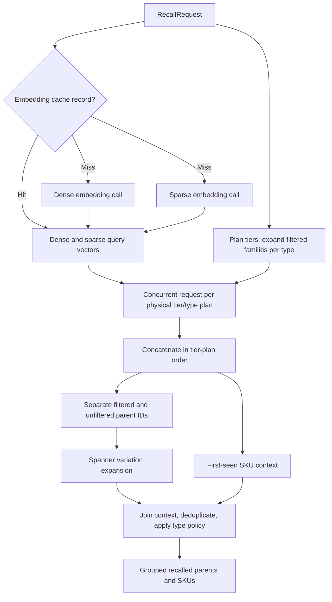

### Tier Planning

A **tier** is a particular modality, filter scope, and business purpose. It has its own vector request and top-K. The following budgets come from `RecallTierStrategy::transport_spec`, not from `num_results`.[^recall-current-policy]

| Tier label | Modality | Neighbor budget | Main purpose/gate |
|---|---|---:|---|
| `filtered_ranked_dense` | Dense | 50 | Featured rank constraint, when NER is present |
| `filtered_relevant_dense` | Dense | 50 | Featured relevance, when NER is present |
| `filtered_dense` | Dense | 75 | Request's entity-derived filters, when NER is present |
| `filtered_sparse` | Sparse | 50 | Same filtered scope using sparse representation |
| `unfiltered_sparse` | Sparse | 100 | Broader discovery when prompts and SKU hard restrictions do not suppress it |
| `unfiltered_dense` | Dense | 100 | Broader dense discovery; dense crowding is configured by transport |
| `filtered_dense_excluded_conditions` | Dense | 75 | Separate normally excluded conditions when no explicit conditions filter exists |
| `unfiltered_dense_excluded_conditions` | Dense | 100 | Broader excluded-conditions tier, also subject to unfiltered gating |
| `filtered_dense_available_*` | Dense | 50 | Nonempty matching location group |
| `unfiltered_dense_available_*` | Dense | 100 | Availability plus unfiltered eligibility |

The ordinary first four tiers require `ner_present`; excluded-condition tiers have their own gate. Availability groups cover digital, in-store, delivery, and shipping when matching locations exist. Nonempty `store_id_map` entries replace the corresponding base tiers with condition-specific variants. Availability tiers are appended after the fixed tier families.

**Physical request planning:** each filtered strategy expands into one physical request per allowed `product_type_id`, in token order; no allowed type emits no physical filtered request. Unfiltered strategies remain broad single requests. This inner per-type fan-out is distinct from the orchestrator's outer multiple-type-group recalls. The budget table is **per physical request**, before reduction/expansion. Dense transport uses configured `RECALL_CROWDING_NEIGHBORS`, while sparse requests disable crowding; checked-in values differ, including T02 1000 and P04 1. Do not infer effective transport crowding from a logical tier field alone.[^recall-current-policy][^recall-math-transport][^recall-current-config]

#### Worked Fan-Out and Budget Calculation

**Inputs:** one recall invocation, NER present, $p$ allowed product types, no prompts or SKU hard restriction, no explicit condition filter, and empty location/store maps. Five filtered families run per type: featured-ranked, featured-relevant, dense, sparse, and excluded-condition dense. Three broad families run once each: sparse, dense, and excluded-condition dense.

**1. Count physical requests.**

$$
T=5p+3.
$$

**2. Sum requested neighbor slots.**

$$
B=p(50+50+75+50+75)+100+100+100=300p+300.
$$

**3. Substitute two types for the request count.**

$$
T=5\times2+3=13.
$$

**4. Substitute two types for the slot budget.**

$$
B=300\times2+300=900.
$$

This is **at most 900 returned index-neighbor slots across 13 physical requests**, before deduplication and sparse per-parent reduction; failures, eligible-set size, approximation, and crowding can reduce the returned count. It is not 900 unique SKUs or parents. Spanner expansion can add SKU variations, so downstream row counts are not bounded by this number. `num_results` and the final display cap are separate controls.

### Filter Semantics Differ by Stage

“Unfiltered” means broader than the NER constraints, not unrestricted. Vector-search base guards normally require active products, exclude unclassified types and not-orderable products, and handle refurbished/pre-owned/clearance through dedicated condition tiers. Broad tiers can turn the predicted type allow-list into a deny-list to explore outside the predicted types.[^recall-current-policy]

Spanner expansion constructs a separate filtered and unfiltered policy. In this checkout:

- Filtered expansion retains request categorical/numeric filters, strips certain availability filters unless the preferred-store condition applies, and inserts an order-code guard when absent.
- Unfiltered expansion keeps a narrower base/conditional availability set and ensures active/order-code guards.
- Both expansion paths add a missing `is_active=true` guard. Their other filter allowlists still differ; shared storage does not imply identical eligibility.
- SQL conversion handles booleans, string arrays, scalar strings, and numeric restrictions according to supported columns. Unsupported filters can become errors rather than quietly ignored constraints.[^recall-current-policy]

See [[Filtered Vector Search]] for why filtering before retrieval and filtering expanded candidates have different effects.

### Deduplication, Parent Expansion, and Provenance

Vector datapoint IDs can encode individual SKUs or combos, such as `sku:*` and `combo:*_sku:*`. They must be parsed into candidate identity before parent expansion. `BSIN`, `VARIATION`, and `COMBO` are different parent kinds; the note uses the repository's BSIN identifier without assuming it is interchangeable with a SKU.[^recall-math-parsing]

Raw tier rows determine which parents enter the two expansion queries. **First-seen SKU deduplication** determines which retrieval context survives when joining the expanded rows. Parent match type comes from the first non-null matching context over ordered variation rows. A parent reached through several tiers therefore cannot safely be assigned provenance from whichever request finished first.[^recall-math-candidate]

Marketplace variation handling also matters: the policy orders variation rows by marketplace rank, prefers a BSIN represented by vector search in the relevant tie, and keeps one representative per `(parent_id, bsin_id)` before parent assembly. Dense/sparse distances and match type are intermediate ranking evidence, not the final public score.[^recall-current-policy]

> [!example]- Why concurrency must preserve order
> Tier A returns SKU X after 90 ms. Tier B returns the same SKU X after 20 ms. If A is earlier in the plan, A's context must survive first-seen deduplication. `join_all` runs both requests concurrently but returns their outcomes in input order. A merge in completion order could change X's provenance, parent classification, and later type filtering even though both requests returned the same IDs.[^recall-current-fanout]

> [!warning]- Empty expansion is not necessarily an empty recall
> `expand_recalled_products` returns the deduplicated vector neighbors when its variation list is empty. This can preserve candidates without enriched product-type metadata, including after the expansion filtering stage empties the rows. Treat the raw, expanded, post-filter, and final recall counts as distinct evidence. This branch needs specific live validation if eligibility guarantees depend on Spanner expansion.[^recall-current-policy]

### Relevance After Recall: ESCI, Types, and the Final Ranker

The word “relevant” appears at several boundaries. `filtered_relevant_dense` is a **tier policy name**: featured-product restriction plus request filters, without the featured-rank cutoff of `filtered_ranked_dense`. It is not the ESCI model's verdict and does not imply that a distance threshold was passed. NER type confidence, vector proximity, ESCI classes, and final ranker output are different evidence.

Read [[Named Entity Recognition]] for query entities, [[ESCI]] for the query–product rubric, [[Cross-Encoder]] for pair scoring, and [[Learning to Rank]] for feature ranking. In a conventional cross-encoder classifier, a jointly encoded query/product pair produces logits. If there are four class logits $z_c$, softmax gives:

$$
p_c=\frac{\exp(z_c)}{\sum_{k\in\{E,S,C,I\}}\exp(z_k)}.
$$

That is the standard classifier explanation in [[BERT]] and [[ESCI]], not a verified decoding formula for the private ESCI service. Rust receives a scalar score and a class; the scalar should not be equated with an Exact probability without the model's output contract.

#### The Current SKU Retention Rule

For candidate $i$'s returned ESCI class $y_i$, the pipeline retains:

$$
\operatorname{keep}_{\mathrm{ESCI}}(i)=\mathbf1[y_i\in\{\mathrm{Exact},\mathrm{Substitute}\}].
$$

This gate follows type selection. Complement and Irrelevant rows are removed; the current code has **no `explicit_attribute` retention exception**. A log field with that name remains but is set to zero.[^recall-math-relevance]

For the running example, the sleeve B can rank highly in sparse retrieval and still be classified Complement and removed. A can survive as Exact. A relevant product never retrieved cannot be restored by this gate. This is why candidate coverage and ESCI classification quality must be measured separately.

#### Type-Level Relevance Is Not an Average of Distances

For type $t$, the current scoring policy aggregates the maximum incoming relevance scalar and whether any SKU is Exact/Substitute:

$$
h_t=\max_{i:\operatorname{type}(i)=t}s_i.
$$

$$
b_t=\mathbf1[\exists i:\operatorname{type}(i)=t\ \land\ y_i\in\{E,S\}].
$$

With more than two distinct types, the policy uses the best-match flag, prioritizes NER types when limiting eligible types to eight, and fills remaining slots with non-NER types ordered by maximum score. If no type passes the best-match flag, it retains the maximum-scored type as a safety net. With at most two types, it skips this type-level reduction. A brand-search rule can further restrict to selected NER types when their intersection is nonempty and has at most three entries. The subsequent SKU class gate still applies, so a type fallback does not rescue Complement/Irrelevant rows.[^recall-math-relevance]

#### A Final Ranking Score Still Has Another Meaning

The retained rows become the feature ranker's cohort. Features may include ESCI evidence, retrieval distances, metadata, engagement, and availability. The ranker output and later business policy determine ordering; there is no formula that turns an RRF score directly into the final product score. The existing [[#Scores Are Different Quantities]] and [[#Availability and Two Levels of Ordering]] sections explain these downstream quantities in more detail.

For evaluation, distinguish judged relevance recall from index approximation. Let $R_q$ be the fixed set of judged relevant SKUs and $C_q$ the candidate SKU set at a named boundary:

$$
\operatorname{CandidateRecall}(q)=\frac{|C_q\cap R_q|}{|R_q|}.
$$

This requires a nonempty relevance set and a stated treatment of unjudged items; incomplete judgments do not reveal collection-wide true recall. For ANN agreement, let $G_K(q)$ be exact vector top-K under the same metric, eligibility and tie convention, and $A_K(q)$ be the approximate result:

$$
\operatorname{ANNRecall@K}(q)=\frac{|A_K(q)\cap G_K(q)|}{K}.
$$

The displayed ANN denominator assumes at least $K$ eligible neighbors and no extra crowding constraint. State a separate convention when fewer exist. High ANN agreement can reproduce an embedding's wrong sleeve ranking perfectly. See [[Approximate Nearest Neighbours]], [[Search Evaluation]], and [[NDCG]].

### Recall Exercise

For the running query, answer before changing a model:

1. A is extremely similar but fails the price filter. Which eligible universe excludes it?
2. B appears in two tiers, with different scores. Which occurrence supplies its SKU context?
3. An RRF field is present with alpha 0. Does that establish a dense+sparse fused ranking?
4. Two product types are allowed. How many requests and raw neighbor slots does the bounded budget example above allow?
5. B is Complement and its type survived type selection. Does B survive the current SKU gate?

Expected checks: the relevant tier's predicate; the first planned occurrence; sparse-only selection does not establish two-source fusion; **13 requests and 900 slots** under the example's assumptions; **no**. Validate the raw candidate, expansion, type, and ESCI boundaries separately in a real trace.

## Reranking and Final Ordering

The product-search orchestrator first checks whether any recall candidates have a `filtered`-prefixed match type. If none do and high-confidence NER types exist, it skips reranking and returns an empty primary result, which can trigger broadening. **When reranking runs, it receives the full recall pool**, not just that filtered subset.[^product-search]

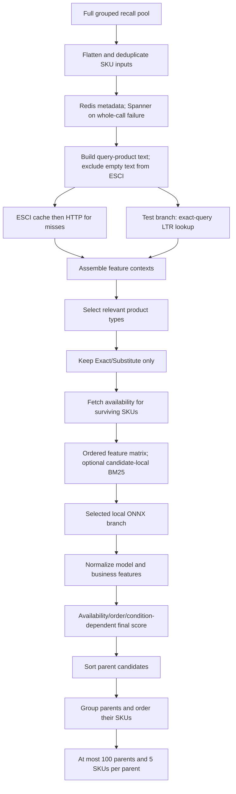

This source sequence is important: metadata first; then ESCI and LTR overlap; then relevance selection; then availability and model execution. Availability is not queried for the entire original pool in parallel with metadata.[^rank]

### Metadata and ESCI

Product metadata comes from Redis. The fallback decorator calls Spanner if the **whole Redis metadata call fails**. A successful Redis read with an empty name or missing fields is accepted as-is; it is not repaired SKU by SKU from Spanner.[^metadata]

ESCI input concatenates cleaned short-name and categorical-feature text. Empty text is excluded from inference. A missing score defaults internally to score zero and Irrelevant; it normally does not survive best-match retention. See [[Cross-Encoder]] and [[ESCI]].

The ESCI cache reads an override hash before the normal configured hash. It sends only remaining misses to the HTTP model and merges results in input order. A cache-read failure sends all inputs to the model. Ordinary inference does not write predictions back to these caches.[^esci]

Type selection considers per-type relevance, high-confidence types actually present in recall, and brand-search policy. The SKU filter retains **Exact or Substitute**; see [[#The Current SKU Retention Rule]]. The log calls this “clustering,” but the filter is class-based rather than KMeans. Normal product `match_quality` is the selected head SKU's class label; lookup uses its own `BEST_MATCH` label.[^rank][^scoring]

### Exact-Query Engagement Features

Query–SKU LTR features are read from **Spanner** by the metadata decorator. The baseline skips this lookup. The test branch performs the lookup concurrently with ESCI.[^ltr]

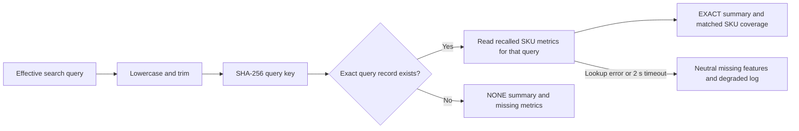

The SQL checks both hash and normalized query text, joins `ltr_queries` with `ltr_query_sku_metrics_v2`, and restricts metrics to the recalled SKU IDs. It reads 16 values: four windows each for clicks, the source's `order_3d_*` fields, add-to-cart, and product-page views. This is exact normalized-query matching; no approximate substitute-query or Gemini rewrite is part of this feature lookup.[^ltr]

An `EXACT` query match does not imply that every recalled SKU has metrics. `ltr_match_summary` distinguishes query match, matched queries, and candidate coverage. Missing values are mapped through the serving feature builder; the metric paths use neutral zero fills. That is an implementation convention to match training, not a general rule that missing means observed zero. See [[Learning to Rank]], [[Click Bias]], and [[Feature Engineering]].

> [!info]- Empty ESCI results preserve diagnostics
> If ESCI filtering leaves no Exact/Substitute SKUs, the reranker returns empty products while preserving the selected result types and LTR match summary. An empty product list does not by itself establish a dependency failure.[^recall-math-relevance]

### Ordered Features and ONNX Execution

The model artifact and its feature-name sidecar are loaded together. The domain constructs rows **in the sidecar's order**. Inputs include semantic score/class, query length, type encoding, price/deal signals, release-year boost, retrieval distances, featured rank, engagement metrics, and optional [[BM25]] over candidate short names, depending on the selected schema.[^features][^onnx]

Schema validation rejects an empty feature list or unimplemented feature names. Model output must contain one score per retained row. Discount calculation preserves wider price precision until construction of the float32 model matrix, because rounding before the calculation can cross a tree split. Unknown type encodings and feature defaults are logged.

The baseline uses the linear ONNX model; `test` uses the XGBoost engagement ONNX model. Model inference here is a synchronous local call, and each ONNX session is behind a mutex. Parallel external calls do not imply unlimited simultaneous model execution or isolation from runtime-thread CPU pressure.[^onnx][^rank]

### Scores Are Different Quantities

| Quantity | Role |
|---|---|
| Dense/sparse distance | Retrieval-stage evidence from the index |
| ESCI score and class | Query–product relevance and class-based retention |
| ONNX output | Selected baseline/engagement model output for the retained cohort |
| Normalized model score | Min–max scaling over this request's retained model outputs |
| Release-year boost | Business feature, separately normalized |
| Final score | Conditional business combination used within the ordering policy |

For model outputs $x_i$ in a retained cohort $C$, the current min–max rule is:

$$
\hat{x}_i = \frac{x_i-\min_{j\in C}x_j}{\max_{j\in C}x_j-\min_{j\in C}x_j}.
$$

When the range is effectively zero, every value becomes **0.5**. Boost normalization instead divides by the positive maximum and uses zero when no positive maximum exists. These distinctions matter when comparing requests or implementations. See [[Score Normalization]] and [[Probability Calibration]].[^scoring]

Let $m$ be normalized model score, $b$ normalized boost, $c$ normalized cheapness, and $a$ normalized availability. Current `combine_score` uses the following branches; these are implementation constants, not general ranking recommendations:

- **Coming soon or sold out:** $1+b$.
- **Pre-order:**

  $$
  \left(1 + b \cdot \frac{1}{1.1}\right)\left(1 + c \cdot \frac{0.1}{1.1}\right)
  $$

- **Buy/in-store and available:**

  $$
  \left(1 + m \cdot \frac{4}{9}\right)\left(1 + a \cdot \frac{5}{9}\right)
  $$

- **Buy/in-store, unavailable, new/open-box:** $1+m$.
- **Other current branches:** $1+b$.

Both model branches currently use these same combination factors, but their ONNX scores and feature schemas differ.[^scoring]

> [!example]- How a cohort change alters a surviving item's normalized score
> A model gives A=2, B=4, C=6, so B normalizes to 0.5. If C is removed before that normalization and the retained outputs are A=2, B=4, B becomes 1.0 despite unchanged raw prediction. Candidate-local BM25 can also change with the retained text corpus. Compare candidate identities and feature rows before concluding that a changed final score implies a changed model.

### Availability and Two Levels of Ordering

Availability is requested only for SKUs retained after relevance selection. No location map means no availability request. Failed availability reads degrade to an empty map. A returned availability condition must match the SKU's condition before it affects scoring. Product `available` is a fulfillment string or `null`; `null` does not prove the item is out of stock.[^rank][^availability]

Parent order is established by sorting candidate rows using:

1. ESCI class ordinal: Exact, Substitute, Complement, Irrelevant.
2. Order-code ordinal: pre-order; buy/in-store; coming soon; sold out, with source-specific defaults for missing/unknown values.
3. Condition ordinal: new, open-box, clearance, refurbished, pre-owned.
4. Availability priority.
5. Final score descending.
6. Parent ID, then SKU ID, for deterministic ties.

Rows are grouped by parent in that order. **Within each parent**, SKUs are reordered by availability priority, marketplace rank, then SKU ID, and capped at five. The first SKU after this second ordering supplies display metadata, class label, and availability. The selected head can differ from the row that first established the parent's position.[^rank]

This grouping is one form of presentation control; it is not evidence of a separate maximum-marginal-relevance diversification step. See [[Search Result Diversification]].

## Alternative Request Paths

### Direct Product Lookup

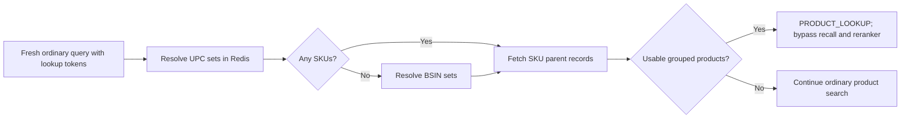

The current catalogue adapter resolves UPC before BSIN, then groups SKU records under their parent identity and applies marketplace ordering. Model lookup is disabled in this adapter. It does not implement the blueprint's general Redis-to-Spanner lookup fallback. A Redis error propagates; an empty successful lookup continues search. The lookup attempt occurs after NER/intent work in the fresh-session path, so bypassing recall/reranking does not mean bypassing all query understanding.[^lookup]

### More-Like-This

For MLT, the incoming query represents an anchor SKU. The metadata provider loads its short name, product type, and price. The service forces in-stock, replaces the effective query with the short name, and seeds a `more_like_this` prompt. The anchor type replaces the NER type constraint; a nonzero anchor price gives a range of **50%–150% of its price**.[^mlt]

Only the MLT whitelist survives the filter rewrite. The whitelist contains `brand`, while ordinary brand mapping uses `co_brands`, so those ordinary brand filters are dropped in the current implementation. The anchor SKU is removed before reranking and again at final assembly; the helper stops after the first parent from which it removes that SKU, an implementation detail worth checking for duplicated combo/variation representations.

> [!example]- Trace an MLT request
> Suppose anchor SKU X has short name “wireless headphones,” type T, and price 200. The effective query becomes the short name, the price range becomes 100–300, and type T becomes the type restriction. A missing/zero price creates no price range. Missing anchor metadata returns HTTP-successful `INVALID` with empty items/entities. Anchor X must not influence its own recommendation ranking. If the primary search is empty, MLT may broaden despite its synthetic prompt, dropping numeric constraints while retaining type, order code, and any SKU hard restriction.

### Multiple Type Groups

High-confidence ordinary searches with multiple types and more than one type token can run one recall per group. Each group gets shared constraints plus its own type and applicable features. Group query IDs append the type token. Calls run concurrently, results merge in group order, and first-seen parent IDs survive cross-group deduplication.[^product-search]

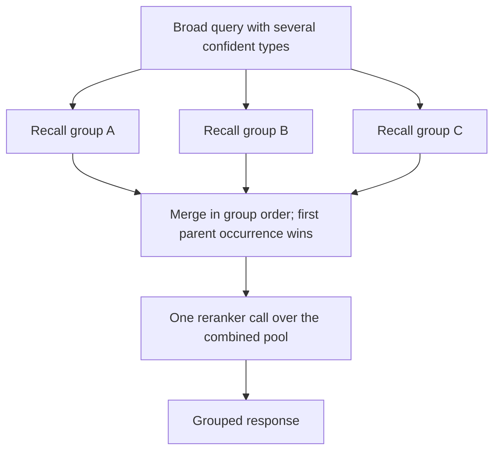

A failed type-group recall contributes no products while other groups can continue. This differs from a failed physical tier inside one recall, which causes that recall to return an error. Also, using multiple recall groups is not identical to returning model status 215: that final status requires a brand query with more than three result types.

## Failures and Fallbacks

There are two different recovery decisions: **reranker error → recall pass-through**, and **empty successful primary result → conditional broadened retry**. Neither guarantees the same relevance or constraints as the main ranked path.[^product-search]

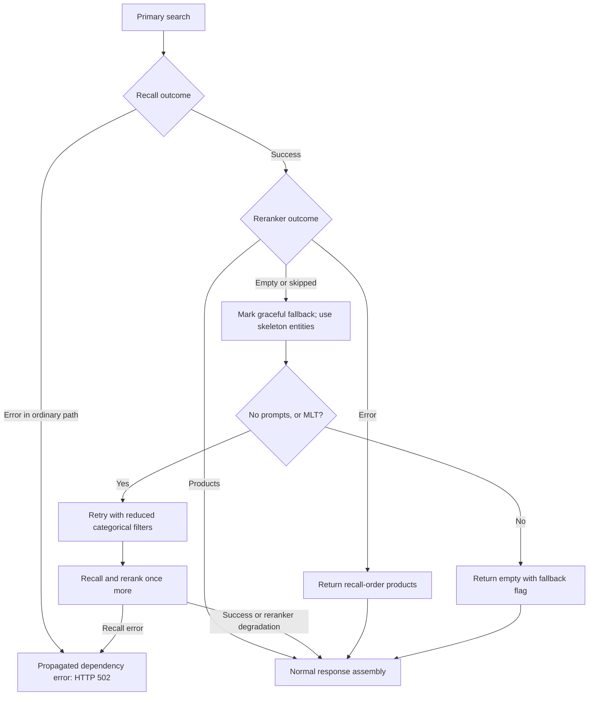

The broadening retains `product_type_id`, `conditions`, and `sku_id` for ordinary search; MLT retains `product_type_id`, `order_code`, and `sku_id`. All numeric filters are removed. With prompts on ordinary search, broadening is skipped. The response keeps the original derived filter list while using fallback entities, so inspect fallback logs for the effective retry constraints. `cache_disabled` is set for fallback without prompts, but the earlier NER-session write may already have happened.[^product-search]

| Situation | Actual boundary behavior | Consequence |
|---|---|---|
| Blank query or count outside 1–1000 | Domain invalid request → 422 | Malformed JSON/extraction errors have separate framework handling |
| Session cache read/write fails | Read becomes miss; write is ignored | NER may run; search can continue |
| NER call fails | Error propagates | Ordinary public request gets generic 502 |
| Embedding cache misses | Compute embeddings | Cache is read-only in this path |
| Embedding cache read/decode fails | Error propagates; no inner-embedder fallback | Cache failure differs from a cache miss |
| One vector tier fails | All joined outcomes are collected, then an error propagates from recall | A `partial_error` log is not partial-success serving |
| One outer type-group recall fails | Omit that group's products | Combined results can still be returned |
| Spanner variation expansion fails | Recall error propagates | No general Python recall fallback |
| Whole Redis metadata call fails | Try Spanner metadata | Missing fields on a successful Redis response do not trigger this |
| ESCI cache read fails | Score all inputs using HTTP model | A slower path can still succeed |
| ESCI HTTP or ONNX scoring fails | Reranker errors; product search uses recall-order products | HTTP 200 can conceal loss of ranking unless logs are inspected |
| LTR lookup fails or times out | Neutral features and `NONE` summary | Test branch can still execute |
| Availability fails or locations are absent | Empty availability map | `available=null` is ambiguous |
| No retained ESCI candidates | Empty successful reranker result | Can trigger broader search; summary-loss caveat applies |
| Unresolved MLT anchor | `INVALID` business envelope | Different from invalid HTTP input |
| Prompt provider/event/interim sink | Production adapters currently empty/no-op | Interface calls do not imply real prompt generation or persistence |

Sources for the table: product-search orchestration, cache decorators, recall assembly, reranker pipeline, and centralized API error mapping.[^product-search][^embedding-cache][^candidate][^metadata][^esci][^rank][^api]

> [!info]- An HTTP timeout is not the complete request budget
> The common authenticated HTTP client uses a 5-second per-request timeout. LTR SQL has a separate 2-second deadline. A full search can make several sequential phases, wait on a concurrent fan-out, and run a broadened retry. There is no single global end-to-end deadline defined in the route/service wiring. Summing child spans also overcounts overlapping work. See [[Tail Latency]].[^http][^ltr]

## Response Mapping

The response includes `search_id`, `query_id`, `query_intent`, `customer_filter_context`, `items`, `prompts`, `entities`, `filters`, `model_status`, `model_status_info`, `cache_disabled`, `is_graceful_fallback`, and `ltr_match_summary`.[^api]

Each public item is slim:

```json
{
  "id": "example-parent",
  "type": "BSIN",
  "skus": [{"id": "example-sku"}],
  "product_type": "Example type",
  "match_quality": "Exact",
  "available": null
}
```

This is a structural example, not a measured response. **Per-SKU scores, retrieval match metadata, and domain `product_id` are omitted by the public DTO.** In particular, it does not expose `esci_score` on each SKU. Debugging score parity requires logs or a separately verified diagnostic interface.

| Model status | Meaning in this source |
|---:|---|
| 210 | Product search; also fallback without prompts, even when no products survive |
| 211 | More information; defined but no implemented classifier branch identified |
| 212 | Invalid business intent |
| 214 | No SKU, when earlier status precedence does not override it |
| 215 | Brand search with more than three reranked result types |
| 217 | More-like-this with results |
| 222 | Successful direct product lookup |

These are **body status values**, not HTTP status codes. `query_intent` and final `model_status` encode different information. Successful transport, nonempty results, relevance quality, and healthy dependencies should be monitored separately.[^result]

## Cache, Storage, and Freshness

| Data | Current owner/source | Behavior relevant to correctness |
|---|---|---|
| NER session | Product-search Redis | Prefix plus search ID; 24-hour TTL; best-effort reads/writes |
| Query rewrite map | Startup-loaded Redis or GCS | Redis load can fall back to GCS; used as an in-memory mapping during requests |
| Active types/features/families | Background-refresh adapters | Catalogue state gates constraints; warm snapshots differ from querying tables every request |
| Query embeddings | Recall Redis decorator | Lowercased query appended to configured prefix; externally populated; no request write-back |
| Product/anchor/identifier metadata | Redis; selected metadata fallback to Spanner | Lookup, MLT, and reranker metadata have different fallback contracts |
| ESCI predictions | Reranker Redis hashes | Override before normal; partial misses inferred remotely; no ordinary write-back |
| Query–SKU engagement | Spanner | Test branch only; exact-query SQL; 2-second lookup deadline |
| Expanded variants | Spanner | Separate filtered/unfiltered query policies; 15-second exact-staleness read |
| Availability | Spanner plus per-process cache | 15-second exact-staleness read; cache TTL 5 seconds, capacity 64 requests |
| ONNX models and feature schemas | GCS at startup | Model selection remains request-specific after load |

Availability cache keys canonicalize the SKU set and fulfillment-to-location mapping. Concurrent identical misses share one backend operation. Its short cache lifetime adds potential age on top of the database snapshot age; “real-time availability” should not be read as a transactionally fresh stock guarantee.[^availability]

> [!warning]- Cache policies are not interchangeable
> Session cache failure becomes a miss; ESCI cache failure invokes the model; embedding cache failure propagates. Metadata fallback reacts to a whole-call error, not missing fields. A broad statement such as “Redis is optional” or “all caches fail open” would be false. These differences belong in operational dashboards and incident diagnosis, alongside hit rate and latency. See [[Search Caching]].

Rust composition selects a regional Redis host and constructs service-scoped managers. Multi-region replication, failover, and upstream writer topology require separate infrastructure configuration.

## Observability and Diagnosis

Structured logs carry search/query IDs, stage timings, filters, candidate counts, cache decisions, model branch, and degradation events. Candidate and feature digests make it possible to compare identities without printing entire matrices. OpenTelemetry export is configured separately from JSON logging.[^telemetry]

The current HTTP middleware deliberately starts a new application trace root instead of inheriting ingress parent context. Downstream calls inject trace context. Recall/reranker spans carry distinguishing component/service fields inside the single deployable; that should not be confused with three independently deployed services or automatically assumed separate exporter resources.

| Compare in this order | Evidence to inspect | What a difference suggests |
|---|---|---|
| 1. Runtime identity | Live image/hash, environment, model/index configuration | Deployment drift before a code hypothesis |
| 2. Query processing | Original/effective query, session hit, processed NER, filters | Rewrite/session/entity-policy divergence |
| 3. Embedding identity | Source/cache branch, dimensions, vector digests | Model or cached-vector divergence |
| 4. Tier plan | Labels, filters, budgets, physical request count | Different retrieval scope |
| 5. Recall funnel | Raw, deduplicated, expanded, post-filter, parent and SKU counts | Merge, expansion, or eligibility difference |
| 6. Reranker input | Canonical SKU digest and empty-text digest | Metadata completeness or earlier cohort difference |
| 7. Relevance/features | ESCI classes, LTR coverage, ordered schema and column digests | Cache/model/feature source or transformation difference |
| 8. Ordering/output | ONNX scores, normalized scores, parent cutoff, head SKU | Business ordering, tie-breaking, grouping, or DTO difference |

Useful source events include `product_search.request.received`, `product_search.recall.completed`, `recall.native.embedding_identity`, `recall.native.funnel_summary`, `reranker.native.input_candidates`, `reranker.native.post_esci_candidates`, `reranker.native.onnx_features_prepared`, `reranker.native.onnx_score_identity`, and `product_search.reranker.degraded`.[^product-search][^candidate][^rank]

> [!tip]- Diagnose the first difference, not the last visible score
> If Python scores 60 SKUs and Rust scores 400, compare retrieval and metadata completeness before comparing ranker weights. If SKU identities and raw outputs match but final scores differ, compare normalization cohorts and availability. If all intermediate results match but JSON differs, inspect the DTO. A live image mismatch invalidates the assumption that the inspected checkout explains the observed response.

For quality evaluation, keep four questions distinct: **candidate coverage**, **ranking quality**, **online customer outcomes**, and **serving performance**. Specify query/corpus snapshot, parent-versus-SKU unit, cutoff, judgment rubric, missing judgments, and aggregation before using [[NDCG]] or recall measurements. See [[Search Evaluation]] and [[Monitoring - MLOPS]].

## Deployment and Runtime Lifecycle

The checked-in deployment separates application image construction from MLCore promotion/deployment. The second build receives the image path and revision from a Pub/Sub handoff; it must not silently select an image from its own checkout.[^deployment]

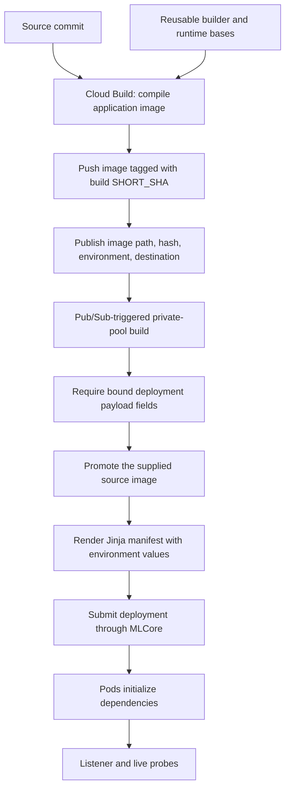

The app Dockerfile cross-compiles `search_2_1` for Linux ARM64 using the build platform's compiler, then copies the binary into the runtime image. The runtime uses an unprivileged user. Environment-specific values select projects, service names, caches, models, and vector deployments. This note intentionally points to those files rather than duplicating their entire configuration.[^deployment]

- `/health` and `/live` are mounted in all environments. Debug recall and reranker routes are mounted only when `APP_ENV` is not `Prod`.
- The manifest uses `/live` for both readiness and liveness. It is a process-level handler, not a dependency probe. Loss of one data source should be diagnosed through request behavior and telemetry.
- CPU/memory requests are essential to the manifest's percentage-based horizontal autoscaling targets. The renderer validates resource requirements.
- The present Cargo release profile favors iteration: application `opt-level=0`, dependency `opt-level=2`, and LTO off. Performance claims require the intended profile and matched runtime configuration.
- SIGINT/SIGTERM initiate graceful HTTP shutdown; after serving drains, the process flushes its trace provider and releases the logging guard.[^startup][^deployment]

The deployment Pub/Sub flow above is real checked-in infrastructure. It is separate from **search-result event publishing**, whose runtime adapter is still a no-op.

## Worked End-to-End Walkthrough

Consider `gaming laptop under 1000` with a fresh search ID, no prompts, and `ab_flag=test`. This is an illustrative trace; actual NER output, tier results, and order require a live request.

1. The API parses input and the domain validates the nonblank query and result count.
2. Location context is resolved if supplied. Rewriting may change the effective query; the original text is preserved for ranking context.
3. A session miss calls NER. **Assume** NER supplies an active laptop type and a valid maximum-price entity. Policy builds the corresponding type/price filters and any business adjustments.
4. Recall obtains dense/sparse vectors, possibly from the read-only embedding cache. Policy creates eligible filtered, broad, excluded-condition, and location tiers.
5. Tier outcomes merge in plan order. Raw parents are expanded in Spanner, first-seen SKU context is joined, and the service assembles grouped candidates.
6. If the filtered-match gate permits it, the full pool enters reranking. Redis supplies metadata; only a whole-call failure invokes metadata fallback.
7. ESCI and exact-query LTR lookup overlap. **Assume** the normalized query exists but only some candidates have metrics: query match is `EXACT`, while feature coverage is partial.
8. Type/class filtering selects the scoring cohort. Availability is fetched for surviving SKUs when locations exist; the test ONNX schema determines the ordered model matrix.
9. Raw outputs are normalized, business scoring and parent ordering are applied, and each parent gets its own ordered SKU list.
10. Public mapping emits IDs and display metadata, with diagnostic envelope fields but without individual scores. If the primary result is empty, the allowed broader retry can remove the price constraint; the fallback flag must therefore be read with the result.

> [!question]- Request-flow exercise
> Trace three changes to the example: (1) the session ID already exists with unrelated entities; (2) ESCI cache fails but model inference succeeds; (3) one vector tier fails. Identify which stages rerun, which errors propagate, and whether an HTTP 200 remains possible. Then explain why `available=null`, LTR `NONE`, and an empty `items` array each have multiple possible causes.

## Known Gaps and Review Questions

These implementation gaps and operational questions affect completeness, correctness, and diagnosis.

| Area | Source-backed current state | Follow-up needed |
|---|---|---|
| Applied prompts | `EmptyPromptProvider`; response prompts remain empty | Implement and verify the actual AppliedMerging contract if required |
| Search events | `NoopSearchEventPublisher` | Real prompt/overview event payload and publisher |
| Interim persistence | `NoopInterimResultsSink`; hook receives a final-result wrapper | Correct stage payload and real storage adapter |
| Moderation | `AllowAllTextModerator` | Clarify intended product behavior before claiming active moderation |
| Explicit attribute requests | Public DTO lacks the broader explicit categorical/numeric request contract discussed by migration notes | Verify required structured-retrieval scope |
| ESCI refresh | No per-request `cache_esci` field in the public DTO | Verify ownership of any scheduled refresh workflow separately |
| Requested result count | Validated but not consistently enforced downstream | Define response-size/pagination contract |
| Empty ESCI cohort | Empty products preserve result types and LTR summary | Distinguish relevance filtering from dependency failure |
| Recall policies | Filtered per-type fan-out and mandatory active guards | Validate matched deployed requests against the tier and expansion policies |
| Freshness and region behavior | Read staleness and caches are visible; upstream writers/replication were not traced | Establish catalogue, vector, feature, and inventory freshness contracts |
| Deployment and parity | Runtime behavior depends on deployed code, configuration, and dependencies | Match image, inputs, dependencies, cohorts, and ordering in the target environment |

### Open Work

- TODO: Capture one matched, result-bearing request for each branch: ordinary baseline/test, lookup hit/miss, MLT found/missing, multiple type groups, prompt-selected empty result, and degraded dependencies.
- TODO: Trace the upstream writers and version/freshness contracts for the vector index, embedding/ESCI caches, metadata, availability, and LTR tables.
- TODO: Verify the deployed index metric/normalization and actual sparse checkpoint/vocabulary/pruning before interpreting returned dense/sparse values as the toy formulas above. Match the running revision and inspect per-tier request/score identities; an RRF field alone does not establish two-source fusion.

## References & Useful Links

Source links point to the implementation files and supporting documentation. Repository links require access to the private repository.

[^map]: [serving-rs knowledge index](https://github.com/bby-corp/aml-ai-search/blob/1dfaa528621e7306135ffc62a0972508091cd4f9/serving-rs/knowledge/index.md) and [Rust architecture reference](https://github.com/bby-corp/aml-ai-search/blob/1dfaa528621e7306135ffc62a0972508091cd4f9/serving-rs/knowledge/architecture/rust-serving.md) — Repository concept map and implementation boundaries.
[^startup]: [main.rs](https://github.com/bby-corp/aml-ai-search/blob/1dfaa528621e7306135ffc62a0972508091cd4f9/serving-rs/crates/api/src/main.rs), [app construction](https://github.com/bby-corp/aml-ai-search/blob/1dfaa528621e7306135ffc62a0972508091cd4f9/serving-rs/crates/api/src/lib.rs), and [AppState composition](https://github.com/bby-corp/aml-ai-search/blob/1dfaa528621e7306135ffc62a0972508091cd4f9/serving-rs/crates/api/src/state.rs) — Startup sequence, dependency construction, adapters, Redis ownership, and shutdown.
[^api]: [Product-search DTOs](https://github.com/bby-corp/aml-ai-search/blob/1dfaa528621e7306135ffc62a0972508091cd4f9/serving-rs/crates/api/src/dtos/product_search.rs), [handler](https://github.com/bby-corp/aml-ai-search/blob/1dfaa528621e7306135ffc62a0972508091cd4f9/serving-rs/crates/api/src/handlers/product_search.rs), [error mapping](https://github.com/bby-corp/aml-ai-search/blob/1dfaa528621e7306135ffc62a0972508091cd4f9/serving-rs/crates/api/src/handlers/error.rs), and [routes](https://github.com/bby-corp/aml-ai-search/blob/1dfaa528621e7306135ffc62a0972508091cd4f9/serving-rs/crates/api/src/routes/mod.rs) — Accepted inputs, slim serialization, generic 502, and route visibility.
[^product-search]: [ProductSearchService](https://github.com/bby-corp/aml-ai-search/blob/1dfaa528621e7306135ffc62a0972508091cd4f9/serving-rs/crates/domain/src/product_search/service.rs) — `search`, `recall_and_rerank`, `multi_type_group_search`, `broadened_fallback_filters`, and `publish_and_persist` define orchestration and recovery.
[^intent]: [Intent policy](https://github.com/bby-corp/aml-ai-search/blob/1dfaa528621e7306135ffc62a0972508091cd4f9/serving-rs/crates/domain/src/product_search/intent.rs) — Classifier, confidence metadata, and type thresholds; lookup is finalized by the orchestrator rather than by numeric syntax alone.
[^filters]: [Entity/business filter policy](https://github.com/bby-corp/aml-ai-search/blob/1dfaa528621e7306135ffc62a0972508091cd4f9/serving-rs/crates/domain/src/product_search/filters.rs) — NER projection, feature/model-family gating, membership mapping, stock rules, and numeric-range merging.
[^locations]: [Location resolution in product search](https://github.com/bby-corp/aml-ai-search/blob/1dfaa528621e7306135ffc62a0972508091cd4f9/serving-rs/crates/domain/src/product_search/service.rs) and [Redis location adapter](https://github.com/bby-corp/aml-ai-search/blob/1dfaa528621e7306135ffc62a0972508091cd4f9/serving-rs/crates/infra/src/location/redis.rs) — `resolve_location_id_map`, ZIP/store reads, and precedence.
[^session]: [Redis session cache](https://github.com/bby-corp/aml-ai-search/blob/1dfaa528621e7306135ffc62a0972508091cd4f9/serving-rs/crates/infra/src/cache/redis.rs) — Search-keyed stored NER/intent and 86,400-second TTL.
[^recall-wiring]: [Recall service construction](https://github.com/bby-corp/aml-ai-search/blob/1dfaa528621e7306135ffc62a0972508091cd4f9/serving-rs/crates/infra/src/recall.rs), [HTTP embedding adapter](https://github.com/bby-corp/aml-ai-search/blob/1dfaa528621e7306135ffc62a0972508091cd4f9/serving-rs/crates/infra/src/embeddings/http.rs), and [Vertex embedding adapter](https://github.com/bby-corp/aml-ai-search/blob/1dfaa528621e7306135ffc62a0972508091cd4f9/serving-rs/crates/infra/src/embeddings/vertex.rs) — Native recall, configurable dense source, sparse calls, and concurrent embeddings.
[^embedding-cache]: [Read-only embedding cache](https://github.com/bby-corp/aml-ai-search/blob/1dfaa528621e7306135ffc62a0972508091cd4f9/serving-rs/crates/infra/src/embeddings/cache.rs) — Key construction, cache miss versus error, JSON/sparse validation, and absence of write-back.
[^recall-policy]: [Recall policy](https://github.com/bby-corp/aml-ai-search/blob/1dfaa528621e7306135ffc62a0972508091cd4f9/serving-rs/crates/domain/src/recall/policy.rs) — `build_recall_tiers`, `transport_spec`, expansion filters, parent context, marketplace reduction, and empty-expansion behavior.
[^candidate]: [Candidate assembly](https://github.com/bby-corp/aml-ai-search/blob/1dfaa528621e7306135ffc62a0972508091cd4f9/serving-rs/crates/domain/src/recall/candidate.rs) and [recall service](https://github.com/bby-corp/aml-ai-search/blob/1dfaa528621e7306135ffc62a0972508091cd4f9/serving-rs/crates/domain/src/recall/service.rs) — Embedding identity, ordered merge, first-seen SKU context, error propagation, and funnel counts.
[^vector-port]: [Vector-search port and ordered fan-out](https://github.com/bby-corp/aml-ai-search/blob/1dfaa528621e7306135ffc62a0972508091cd4f9/serving-rs/crates/domain/src/ports/vector_search.rs) — One concurrent physical call per planned tier via `join_all`.
[^vector]: [Matching Engine adapter](https://github.com/bby-corp/aml-ai-search/blob/1dfaa528621e7306135ffc62a0972508091cd4f9/serving-rs/crates/infra/src/vector_search/matching_engine.rs) — Transport construction and `neighbors_to_raw_recalled_products` datapoint parsing.
[^expansion]: [Spanner recall variation adapter](https://github.com/bby-corp/aml-ai-search/blob/1dfaa528621e7306135ffc62a0972508091cd4f9/serving-rs/crates/infra/src/metadata/recall_variations.rs) — Typed SQL filters, parent expansion, and read-staleness setting; filter policy itself lives in `recall/policy.rs`.
[^rank]: [Reranker pipeline](https://github.com/bby-corp/aml-ai-search/blob/1dfaa528621e7306135ffc62a0972508091cd4f9/serving-rs/crates/domain/src/reranker/pipeline.rs) and [service](https://github.com/bby-corp/aml-ai-search/blob/1dfaa528621e7306135ffc62a0972508091cd4f9/serving-rs/crates/domain/src/reranker/service.rs) — Branch selection, candidate retention, availability timing, model execution, parent/SKU ordering, caps, and diagnostics.
[^metadata]: [Metadata fallback decorator](https://github.com/bby-corp/aml-ai-search/blob/1dfaa528621e7306135ffc62a0972508091cd4f9/serving-rs/crates/infra/src/metadata/fallback.rs) — Whole-call Redis-to-Spanner fallback; direct secondary delegation for LTR features.
[^esci]: [ESCI cache decorator](https://github.com/bby-corp/aml-ai-search/blob/1dfaa528621e7306135ffc62a0972508091cd4f9/serving-rs/crates/infra/src/esci/redis_caching.rs) and [HTTP adapter](https://github.com/bby-corp/aml-ai-search/blob/1dfaa528621e7306135ffc62a0972508091cd4f9/serving-rs/crates/infra/src/esci/http.rs) — Override/normal caches, misses, inference, and read-error behavior.
[^ltr]: [Spanner metadata/LTR adapter](https://github.com/bby-corp/aml-ai-search/blob/1dfaa528621e7306135ffc62a0972508091cd4f9/serving-rs/crates/infra/src/metadata/spanner.rs) — `LTR_FEATURE_QUERY`, exact-query normalization, 16 metrics, summary, and two-second timeout.
[^features]: [Feature construction](https://github.com/bby-corp/aml-ai-search/blob/1dfaa528621e7306135ffc62a0972508091cd4f9/serving-rs/crates/domain/src/reranker/features.rs) — Supported model feature names and missing-value conventions.
[^onnx]: [ONNX loaders/executors](https://github.com/bby-corp/aml-ai-search/blob/1dfaa528621e7306135ffc62a0972508091cd4f9/serving-rs/crates/infra/src/reranker/onnx_models.rs) — Default-branch failure policy, optional branch, sidecars, output extraction, and synchronized sessions.
[^scoring]: [Ranking/scoring functions](https://github.com/bby-corp/aml-ai-search/blob/1dfaa528621e7306135ffc62a0972508091cd4f9/serving-rs/crates/domain/src/reranker/scoring.rs) — Relevant-type selection, BM25, normalization, score factors, conditional formula, and ordinal policies.
[^availability]: [Availability cache](https://github.com/bby-corp/aml-ai-search/blob/1dfaa528621e7306135ffc62a0972508091cd4f9/serving-rs/crates/infra/src/availability/caching.rs) and [Spanner availability adapter](https://github.com/bby-corp/aml-ai-search/blob/1dfaa528621e7306135ffc62a0972508091cd4f9/serving-rs/crates/infra/src/availability/spanner.rs) — Canonical request keys, shared concurrent misses, cache limits, fulfillment reads, and staleness.
[^lookup]: [Lookup domain policy](https://github.com/bby-corp/aml-ai-search/blob/1dfaa528621e7306135ffc62a0972508091cd4f9/serving-rs/crates/domain/src/product_search/product_lookup.rs) and [Redis catalogue adapter](https://github.com/bby-corp/aml-ai-search/blob/1dfaa528621e7306135ffc62a0972508091cd4f9/serving-rs/crates/infra/src/catalog/redis.rs) — Identifier parsing, UPC/BSIN resolution, and parent grouping.
[^mlt]: [MLT transforms](https://github.com/bby-corp/aml-ai-search/blob/1dfaa528621e7306135ffc62a0972508091cd4f9/serving-rs/crates/domain/src/product_search/more_like_this.rs) and [Redis anchor adapter](https://github.com/bby-corp/aml-ai-search/blob/1dfaa528621e7306135ffc62a0972508091cd4f9/serving-rs/crates/infra/src/mlt/redis.rs) — Price/type constraints, filter whitelist, and anchor removal.
[^result]: [Domain response and model status](https://github.com/bby-corp/aml-ai-search/blob/1dfaa528621e7306135ffc62a0972508091cd4f9/serving-rs/crates/domain/src/product_search/result.rs) — Status code meanings; final precedence is in `service.rs::determine_model_status`.
[^http]: [Authenticated HTTP client](https://github.com/bby-corp/aml-ai-search/blob/1dfaa528621e7306135ffc62a0972508091cd4f9/serving-rs/crates/infra/src/clients/http.rs) — Identity-token requests, tracing context, and default per-call timeout.
[^telemetry]: [Shared observability](https://github.com/bby-corp/aml-ai-search/blob/1dfaa528621e7306135ffc62a0972508091cd4f9/serving-rs/crates/shared/src/observability.rs) and [HTTP trace middleware](https://github.com/bby-corp/aml-ai-search/blob/1dfaa528621e7306135ffc62a0972508091cd4f9/serving-rs/crates/api/src/middleware/http_trace.rs) — Exporter/sampling configuration, new ingress trace roots, outgoing propagation, and flush.
[^deployment]: [Image build](https://github.com/bby-corp/aml-ai-search/blob/1dfaa528621e7306135ffc62a0972508091cd4f9/serving-rs/deploy/product-search-deployment-image.yaml), [MLCore deployment build](https://github.com/bby-corp/aml-ai-search/blob/1dfaa528621e7306135ffc62a0972508091cd4f9/serving-rs/deploy/product-search-mlcore-sdk.yaml), [Dockerfile](https://github.com/bby-corp/aml-ai-search/blob/1dfaa528621e7306135ffc62a0972508091cd4f9/serving-rs/deploy/Dockerfile.Product_Search), [manifest template](https://github.com/bby-corp/aml-ai-search/blob/1dfaa528621e7306135ffc62a0972508091cd4f9/serving-rs/deploy/manifest/template/product-search.yaml.j2), [renderer](https://github.com/bby-corp/aml-ai-search/blob/1dfaa528621e7306135ffc62a0972508091cd4f9/serving-rs/deploy/manifest/render.py), [T02 values](https://github.com/bby-corp/aml-ai-search/blob/1dfaa528621e7306135ffc62a0972508091cd4f9/serving-rs/deploy/manifest/values/t02.yaml), [P03 values](https://github.com/bby-corp/aml-ai-search/blob/1dfaa528621e7306135ffc62a0972508091cd4f9/serving-rs/deploy/manifest/values/p03.yaml), [P04 values](https://github.com/bby-corp/aml-ai-search/blob/1dfaa528621e7306135ffc62a0972508091cd4f9/serving-rs/deploy/manifest/values/p04.yaml), and [Cargo profiles](https://github.com/bby-corp/aml-ai-search/blob/1dfaa528621e7306135ffc62a0972508091cd4f9/serving-rs/Cargo.toml) — Source-image handoff, environment configuration, runtime resources/probes, and current compilation profile.
[^rust-arc]: [Rust standard library: Arc](https://doc.rust-lang.org/std/sync/struct.Arc.html) — Shared ownership, cloning, and thread-safety constraints.
[^format]: [Obsidian callouts](https://obsidian.md/help/callouts) and [Mermaid flowchart syntax](https://mermaid.js.org/syntax/flowchart.html) — Native foldable callouts and diagram notation.

[^recall-current-policy]: [Recall policy and physical tier expansion](https://github.com/bby-corp/aml-ai-search/blob/dbd5369fd410b73579758774645d65eba192a2ad/serving-rs/crates/domain/src/recall/policy.rs) — `transport_spec`, `build_recall_tiers`, `filtered_tiers_by_product_type`, and expansion filters; current 50/75/100 budgets and active guards.
[^recall-current-fanout]: [Ordered vector-search fan-out](https://github.com/bby-corp/aml-ai-search/blob/dbd5369fd410b73579758774645d65eba192a2ad/serving-rs/crates/domain/src/ports/vector_search.rs) — `find_neighbors_for_tiers` executes independent requests concurrently and preserves plan order.
[^recall-current-config]: [T02 values](https://github.com/bby-corp/aml-ai-search/blob/dbd5369fd410b73579758774645d65eba192a2ad/serving-rs/deploy/manifest/values/t02.yaml), [P03 values](https://github.com/bby-corp/aml-ai-search/blob/dbd5369fd410b73579758774645d65eba192a2ad/serving-rs/deploy/manifest/values/p03.yaml), [P04 values](https://github.com/bby-corp/aml-ai-search/blob/dbd5369fd410b73579758774645d65eba192a2ad/serving-rs/deploy/manifest/values/p04.yaml), [Recall runtime configuration](https://github.com/bby-corp/aml-ai-search/blob/dbd5369fd410b73579758774645d65eba192a2ad/serving-rs/crates/shared/src/config/product_search.rs) — Embedding source, selected index, environment crowding, and default RRF alpha; configuration evidence, not a deployment inventory.
[^recall-math-embedding]: [Vertex dense and HTTP sparse embedding adapter](https://github.com/bby-corp/aml-ai-search/blob/dbd5369fd410b73579758774645d65eba192a2ad/serving-rs/crates/infra/src/embeddings/vertex.rs), [HTTP embedding contracts](https://github.com/bby-corp/aml-ai-search/blob/dbd5369fd410b73579758774645d65eba192a2ad/serving-rs/crates/infra/src/embeddings/http.rs) — Concurrent acquisition, requested dense dimensionality, sparse coordinate/value pairing, and response validation; remote services and ingestion jobs own training and catalogue encoding.
[^recall-math-transport]: [Tier request construction](https://github.com/bby-corp/aml-ai-search/blob/dbd5369fd410b73579758774645d65eba192a2ad/serving-rs/crates/infra/src/vector_search/matching_engine.rs), [Official Vertex serialization](https://github.com/bby-corp/aml-ai-search/blob/dbd5369fd410b73579758774645d65eba192a2ad/serving-rs/crates/infra/src/vector_search/matching_engine/vertex.rs), [Private gRPC serialization](https://github.com/bby-corp/aml-ai-search/blob/dbd5369fd410b73579758774645d65eba192a2ad/serving-rs/crates/infra/src/vector_search/matching_engine_grpc.rs) — `prepare_tier` and `build_query`; modality payloads, sparse-only alpha 0, omitted dense-only RRF block, approximate-neighbor settings, and configured dense crowding.
[^recall-math-candidate]: [Recall candidate flow](https://github.com/bby-corp/aml-ai-search/blob/dbd5369fd410b73579758774645d65eba192a2ad/serving-rs/crates/domain/src/recall/candidate.rs) — `first_seen_neighbor_skus`, `build_expansion_request`, and `recall_from_embedding`; plan-order concatenation, separate parent-query/context cohorts, and explicit absence of a similarity cutoff.
[^recall-math-parsing]: [Neighbor normalization and sparse reduction](https://github.com/bby-corp/aml-ai-search/blob/dbd5369fd410b73579758774645d65eba192a2ad/serving-rs/crates/infra/src/vector_search/matching_engine/parsing.rs) — Missing-modality fields, descending sparse score, parent reduction, and equal-score parent-context tie rules.
[^recall-math-relevance]: [Type and class filtering](https://github.com/bby-corp/aml-ai-search/blob/dbd5369fd410b73579758774645d65eba192a2ad/serving-rs/crates/domain/src/reranker/pipeline/type_filter.rs), [Type relevance scoring policy](https://github.com/bby-corp/aml-ai-search/blob/dbd5369fd410b73579758774645d65eba192a2ad/serving-rs/crates/domain/src/reranker/scoring.rs) — Exact/Substitute-only SKU retention, per-type maxima/best-match flags, type-count and brand policies, and preserved empty-result diagnostics.
[^recall-math-google]: [Google Cloud: About hybrid search](https://docs.cloud.google.com/vertex-ai/docs/vector-search/about-hybrid-search) — Returned inverted distances and alpha semantics: 1 dense-only, 0 sparse-only, intermediate values combine sources. The weighted teaching formula does not establish an undocumented server constant.
[^recall-math-index]: [Google Cloud: Index configuration parameters](https://docs.cloud.google.com/vertex-ai/docs/vector-search/configuring-indexes) — Configured dense metric/normalization, negative-dot-product distance, and sparse dot-product support. The deployed index configuration supplies the actual settings.
[^recall-math-rrf]: [Elasticsearch: Reciprocal rank fusion](https://www.elastic.co/docs/reference/elasticsearch/rest-apis/reciprocal-rank-fusion) — Rank-based combination with a smoothing constant and finite source windows; used to verify general RRF, not to infer an Elasticsearch component in Search 2.0.
[^recall-math-splade]: [Formal et al., SPLADE v2 (2021)](https://arxiv.org/html/2109.10086v1) — Vocabulary logits, log/ReLU weighting, sum/max pooling, expansion, and relevance/sparsity training. These explain the model family, not a verified private checkpoint.
