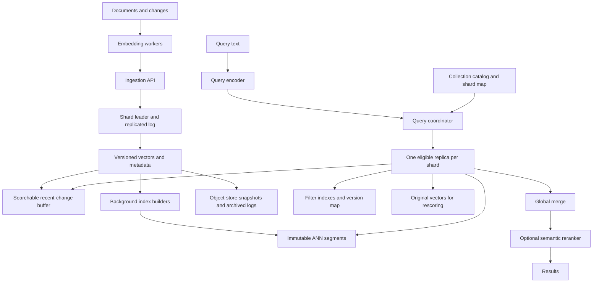

## Interview question and workload

**Design a vector database for a large-scale semantic search service.**

The database stores embeddings alongside identifiers and metadata, then finds nearby vectors subject to filters. For example, a query for “lightweight waterproof jacket” should retrieve semantically similar products that also belong to the requested tenant, are active, and satisfy the price limit. Similarity supplies candidates; filters enforce eligibility.

Begin by agreeing on the workload. The following numbers are **illustrative requirements for this design**, not benchmark results or claims about a particular database.

| Dimension | Assumption or target |
|---|---|
| Corpus | 100 million live vectors initially; plan for 1 billion |
| Representation | 768 dimensions; canonical float32 vectors; one embedding version per collection |
| Query rate | 1,000 queries/s sustained; 3,000 queries/s peak |
| Mutations | 1,000/s sustained; 5,000/s bursts; inserts, replacements, metadata updates, deletes |
| Result size | Vector top 20; optional top 200 for downstream semantic reranking |
| Metadata | Tenant, language, category, active status, price, timestamp, access-control labels |
| Filters | Unfiltered through very selective; eligible fraction from 100% down to 0.01%, plus empty sets |
| Vector quality | Mean ANN recall@20 at least 0.95; at least 0.90 in each agreed critical query slice |
| Database latency | p95 at most 80 ms; p99 at most 150 ms, including its admission queue |
| Full search latency | p95 at most 200 ms; p99 at most 350 ms, including encoding and semantic reranking |
| Freshness | p99 commit-to-search visibility within 5 seconds at supported load |
| Availability | 99.95% monthly successful, complete database queries within a 200 ms default deadline |
| Durability | No acknowledged-write loss after one node or availability-zone failure |
| Regional recovery | Target at most 60 seconds of data loss and 30 minutes to restore service |
| Cost ceiling | Illustrative USD 30,000/month for the database tier at sustained load |

Cost includes serving, replication, storage, backups, networking, and amortised index builds. Query/document embedding and cross-encoder inference have separate budgets. These targets must be tested together: peak QPS is not credible if measured only without filters, updates, or failures.

**Scope:** the vector database accepts embeddings. An upstream [[Dense Retrieval|embedding service]] owns document chunking, encoder execution, and model quality. The database validates dimensions and model identity; it does not make incompatible embeddings comparable. The surrounding semantic-search service owns optional [[Cross-Encoder|cross-encoder reranking]].

## Fix the search contract

Let $q$ be a query vector, $x$ a stored vector, $F_q(x)$ its eligibility predicate, and $k$ the requested result count. Use cosine similarity with nonzero vectors normalised at ingestion and query time. Reject NaNs, infinities, wrong dimensions, and zero vectors.

For unit vectors, the score is:

$$
s(q,x)=q^\top x.
$$

Squared Euclidean distance gives the same exact ordering for unit vectors:

$$
\lVert q-x\rVert_2^2=2-2q^\top x.
$$

This equivalence is useful when comparing index implementations. It does not mean that arbitrary unnormalised dot products are cosine scores, or that quantised reconstructions retain unit norm.[^metric]

Search the **latest visible, nondeleted, eligible vector version** for each ID. Return vector IDs as the evaluation unit; document grouping is a separate operation. Use a deterministic ID tie-break. If fewer than $k$ eligible vectors exist, return all available matches without inventing replacements.

## Exact KNN versus ANN

**Exact k-nearest-neighbour search (KNN)** evaluates the chosen metric against every eligible vector and selects the best $k$. A flat scan is straightforward, requires no learned index, and provides ground truth. Its distance-computation work scales with eligible-vector count and dimension; batching, SIMD, and GPUs can make scans competitive.[^flat]

**Approximate nearest-neighbour search (ANN)** reduces work by navigating a graph, selecting partitions, compressing vectors, or combining these techniques. It can miss true neighbours. ANN recall measures recovery of exact vector neighbours, not human relevance; see [[Approximate Nearest Neighbours]].

| Prefer exact search when… | Prefer ANN when… |
|---|---|
| The eligible subset is small | Many high-dimensional vectors remain eligible |
| Few searches will amortise a build | The index will serve many queries |
| Exact neighbour membership is required | A measured approximation trade-off is acceptable |
| Generating benchmark ground truth | Full scans exceed the serving budget |

Exact search is also the fallback for a selective filter or a small fresh-data buffer. “Large collection” does not imply “ANN for every request.”[^flat]

## Capacity estimates before picking an index

**Inputs:** $N=100{,}000{,}000$ vectors, $d=768$ dimensions, four bytes per float32 component, three replicas. Use decimal GB throughout.

**1. Canonical vector bytes, one copy**

$$
B_{\mathrm{raw}}=N\times d\times4
=307{,}200{,}000{,}000\ \mathrm{bytes}
=307.2\ \mathrm{GB}.
$$

**2. Canonical vector bytes, three copies**

$$
B_{\mathrm{raw,replicated}}=3\times307.2=921.6\ \mathrm{GB}.
$$

This excludes metadata, graph edges, IDs, version maps, logs, allocator overhead, and rebuild headroom. With 32 equally sized logical shards, each copy holds about 3.125 million vectors and 9.6 GB of raw vector data. There are 96 replica placements, which need not mean 96 machines.

**3. Illustrative HNSW graph storage**

Using the rough Faiss-style estimate of two base-layer neighbour slots per connectivity parameter $M$, with $M=32$ and four-byte internal IDs:[^indexes]

$$
B_{\mathrm{links}}\approx N\times2\times32\times4
=25.6\ \mathrm{GB}.
$$

This is a planning approximation, not the full resident set. Upper layers, per-node structures, filters, query workspaces, and implementation choices add memory. Measure actual resident memory under concurrent load.

**4. Illustrative PQ code storage**

For $m=96$ subquantizers and $b=8$ bits per code, each vector uses 96 bytes of PQ codes. An eight-byte ID adds another eight bytes:[^pq]

$$
B_{\mathrm{codes+IDs}}=N\times(96+8)=10.4\ \mathrm{GB}.
$$

This is the compressed search representation only. Keeping float32 originals for exact rescoring still requires the raw storage calculated above. It can move to SSD with a RAM cache; it does not disappear. Codebooks, metadata, replicas, and optional distance tables are additional costs.

## High-level architecture

The following is a **proposed architecture**, not a description of one vendor's implementation.



**Control plane:** collection definitions, quotas, shard placement, model identity, index generations, and routing epochs in a replicated catalog. Coordinators cache validated routing information so a short catalog interruption does not necessarily stop existing reads.

**Data plane:** ingestion, durable shard logs, metadata indexes, ANN segments, raw-vector storage, query execution, and result merging. Separate build workers from serving capacity to control interference.

**Initial choice:** benchmark HNSW with full vectors for the first serving generation; use flat scans for tiny segments and selective filters. Evaluate IVF/PQ as the memory-saving alternative. The RAM budget, filtered recall, and tail latency decide whether the HNSW starting point is affordable.

## Collection creation and ingestion

### Define the collection

A collection is a named search space with a schema and index policy. Record:

- `collection_id`, owner/tenant boundaries, dimension, metric, normalisation, embedding-model version.
- Typed metadata schema and which fields receive filter indexes.
- Logical shard map, replication factor, resource limits, retention, consistency policy.
- Serving index generation and build parameters; query parameters remain a separate request policy.

Choose a new collection generation when dimensions, metric, or encoder compatibility changes. An alias such as `products_current` can switch to the validated generation.

Illustrative API surface, **not a vendor-specific executable API**:

```text
PUT    /collections/{name}                 create schema and policy
POST   /collections/{name}/vectors:upsert   versioned batch writes
PATCH  /collections/{name}/vectors/{id}     metadata-only change
DELETE /collections/{name}/vectors/{id}     versioned tombstone
POST   /collections/{name}/query           vector, filters, k, deadline
GET    /collections/{name}/operations/{id}  durable/searchable progress
```

### Write one vector

Use `(collection_id, vector_id)` as the identity. Store the vector, payload, source version, embedding version, and deletion status together.

1. Authenticate; validate vectors, typed metadata, batch size, and tenant quota.
2. Route by stable virtual partition to the shard leader.
3. Reject an older source version. Treat an identical retry as idempotent; reject different content reusing the same version.
4. Append the mutation to the shard's ordered log. Acknowledge durability after a consensus commit is fsynced on two of three replicas in separate zones.
5. Apply committed entries to the version map, vector storage, filter indexes, and searchable buffer. Publish these changes atomically for a local read view.
6. Return a commit token containing shard, epoch, and sequence. Distinguish `durable` from `searchable` status.

For a multi-shard batch, return per-item or per-shard outcomes. This design does not promise an atomic transaction spanning the whole batch. Bound retry queues and backpressure ingestion if search visibility falls behind.

The log-plus-version pattern has concrete precedents: Qdrant documents logging operations before applying them and comparing point versions during replay.[^storage] The quorum and token rules above are choices for this design, not inferred Qdrant defaults.

### Bulk load

Capture a source snapshot and its change-stream position. Produce embeddings in batches, preserving IDs and source versions. Validate counts, failed records, model identity, and metadata coverage. Train IVF/PQ, if used, on representative corpus vectors with separate held-out evaluation queries. Build segments offline, replay later mutations, and publish a manifest only after validation.

Until an index exists, expose an explicit `building` state or serve a deliberately limited flat-search collection. Do not silently omit the unindexed portion of a supposedly ready collection.

For IVF/PQ, share trained quantizers across segments within a shard generation. The `nlist` examples below refer to that shared codebook; do not train thousands of centroids independently on each tiny update buffer. Query each live generation with its own quantizers during a transition, then merge using original-vector scores.

## ANN approach 1: HNSW

### Build a navigable graph

**Hierarchical Navigable Small World (HNSW)** places vectors in a hierarchy of proximity graphs. All vectors participate at the base; progressively fewer reach higher layers. Random layer assignment creates sparse routes above the detailed neighbourhood graph.[^hnsw]

Insert a vector by navigating from the top toward its neighbourhood, searching more broadly where links will be added, then selecting a bounded set of useful neighbours. A diversity heuristic avoids filling all links with redundant neighbours from one direction. Add reciprocal links and prune overflowing neighbour lists.[^hnsw-code]

Intuition: upper layers help locate a promising area; the base layer explores that area carefully. Graph quality depends on build effort and the data distribution. Do not promise a universal logarithmic query bound for arbitrary embeddings and filters.

### Query the graph

1. Start at the top-layer entry point and greedily move to closer neighbours.
2. Descend using the best location found above.
3. At the base, maintain a candidate frontier, a bounded best-result set, and visited IDs. Expand promising candidates and score their neighbours.
4. Stop according to the search condition, then return the requested candidates.

The query breadth `efSearch` controls the retained search set; it is not an exact count of visited nodes. Increasing it can recover neighbours that a narrower search misses.[^hnsw-code][^hnsw-params]

### Tune HNSW

| Parameter | Main effect when increased | Main cost |
|---|---|---|
| `M` | More graph connections; often better navigation/recall | More index memory and build work |
| `efConstruction` | Broader insertion search; often a better graph | Longer build and insertion time |
| `efSearch` | Broader query exploration; usually better recall | More distance work, scratch memory, and latency |

`M` and `efConstruction` are build decisions. `efSearch` is a query decision and should be at least the number of candidates requested from that graph. Returns diminish; a larger value is not a quality guarantee.[^hnsw-params]

HNSW can support incremental insertion, but update/delete and concurrency semantics are library-specific. For example, hnswlib supports deletion markers, while its documented Python query and insertion operations are not safe to run concurrently against the same index without coordination.[^hnswlib]

For this design, serve immutable large graph segments and search a small mutable buffer separately. Rebuild graphs during compaction rather than assuming arbitrary edge deletion is harmless.

## ANN approach 2: IVF with product quantisation

### IVF narrows where to search

An **inverted file (IVF)** vector index groups vectors into lists using a coarse quantizer, commonly trained by k-means. `nlist` is the number of lists. Assign each vector to a centroid and store it in that centroid's list. At query time, select `nprobe` promising lists and scan their contents.[^indexes]

This is a partition of vector space, distinct from a lexical [[Inverted Index]]. **IVF-Flat** retains original vectors in the lists: distances for visited vectors are exact, but unvisited lists can contain missed neighbours. Probing every list removes this source of approximation, at the cost of an exhaustive scan.

### PQ makes stored candidates smaller

**Product quantisation (PQ)** splits a vector into $m$ subvectors. Train a separate codebook for each part, then replace each subvector with the ID of its nearest codeword. With eight bits, each part chooses among 256 codewords.[^pq]

For the proposed 768-dimensional example, 96 subvectors each have eight dimensions. A vector becomes 96 one-byte IDs. This trades accurate coordinates for a compact representation.

In residual IVF/PQ, encode the difference from the assigned coarse centroid. Let $c_j$ be the centroid assigned to $x$:

$$
r=x-c_j.
$$

Train PQ on such residuals and store the coarse-list membership plus the PQ code. Retain original vectors separately when exact rescoring is required.[^ivfpq]

### Query using lookup tables

For a probed list $j$, define the query residual:

$$
u_j=q-c_j.
$$

Let $z_{t,a}$ be codeword $a$ for subvector $t$, and let $a_t(x)$ be the stored code for that part of $x$. Build a distance table:

$$
L_{j,t,a}=\lVert u_{j,t}-z_{t,a}\rVert_2^2.
$$

Estimate the squared distance using table lookups:

$$
\widehat D(q,x)=\sum_{t=1}^{m}L_{j,t,a_t(x)}.
$$

The query stays uncompressed while database vectors use codes: this is **asymmetric distance computation**. Actual implementations can reuse terms or precompute tables, trading extra memory for speed.[^pq][^pq-impl]

Keep the best approximate candidates, fetch their original vectors, and rescore them. Two distinct errors remain possible: the correct IVF list was not searched, or quantisation pushed a neighbour outside the shortlist. More exact rescoring fixes neither omission once the candidate is absent.

### Tune IVF/PQ

| Parameter | Recall/latency implication | Memory/build implication |
|---|---|---|
| `nlist` | More, shorter lists; more centroid-routing work | More centroid storage and training work |
| `nprobe` | More lists scanned; usually higher recall and latency | More per-query work; no larger stored corpus |
| PQ subvector count `m` | More detailed codes usually reduce distortion | Larger codes and more lookup work |
| Bits per subvector `b` | More codewords can reduce distortion | Larger codes/codebooks; more training/table work |
| Exact-rescore depth | More chances to repair shortlist ordering | More raw-vector reads and compute |

Increasing `nlist` at fixed `nprobe` can reduce coverage; it is not automatically a recall improvement. Increasing `nprobe` does not eliminate PQ distortion. Tune the parameters jointly.[^indexes][^pq-impl][^tuning]

**Illustrative scan estimate:** assume a 3.125-million-vector shard, balanced lists, `nlist=4096`, and `nprobe=32`.

$$
N_{\mathrm{scanned}}\approx3{,}125{,}000\times\frac{32}{4096}\approx24{,}414.
$$

This estimates codes examined before eligibility effects, not milliseconds. Uneven lists, filters, coarse routing, lookup-table setup, and raw-vector I/O affect actual latency.

## Filtering and query planning

Build posting lists or bitmaps for categorical fields and suitable indexes for numeric ranges. Intersect tenant, access-control, category, and range predicates before deciding how to search. Keep these indexes version-aligned with vector visibility.

Use **eligible count**, rather than ambiguous “high selectivity,” when discussing filter strength:

- **Few eligible vectors:** gather their IDs and run an exact scan. The crossover depends on dimension, storage locality, and hardware.
- **Many eligible vectors:** use ANN with eligibility checks. IVF can test list entries against a bitmap. Graph search needs a traversal strategy that preserves navigation.
- **Intermediate or correlated filters:** benchmark specifically. Removing every disallowed node from graph traversal can disconnect useful paths. A node may be traversable without being returnable; access control must still prevent it from appearing in results.

Qdrant's documentation describes both cardinality-based full scans and extra graph edges for filtered HNSW, while noting difficult combinations of strict filters.[^filters] Faiss supports per-query selectors for applicable index types.[^selectors] These are implementation examples, not guarantees shared by all ANN engines.

Post-filtering only the unfiltered top 20 can underfill badly. For an illustrative independent 10% pass rate, even 200 retrieved candidates produce only 20 survivors **in expectation**, not a guarantee. Real filters correlate with vector neighbourhoods; see [[Filtered Vector Search]].

Plan a bounded expansion when too few eligible candidates remain. Never relax a tenant, security, or user-requested constraint to fill the result count. Distinguish “fewer eligible items exist” from “ANN budget exhausted before finding enough”; the latter is an underfilled approximate result.

## Query execution, candidates, and reranking

### One request end to end

1. **Encode outside the database.** Validate the query encoder version. Cache only with model version and relevant normalisation/context in the key.
2. **Admit and plan.** Authenticate, validate filters and requested depth, enforce quota, and attach an absolute deadline. Resolve the collection generation and shard routing epoch.
3. **Fan out.** Query one healthy, sufficiently fresh replica of each relevant shard. Skip a shard only if routing metadata proves it cannot contain eligible items; an approximate centroid router introduces another recall loss.
4. **Search local segments and the recent-change buffer.** Apply filters, suppress stale versions and tombstones, retrieve candidates, and rescore shortlisted original vectors. For multiple segments, collect enough candidates from each before local merging.
5. **Merge globally.** Use the same exact score and ID tie-break across shards. Return vector top 20, or the top 200 for the optional reranker. Include served generation, visibility information, and any partial/underfilled status.
6. **Rerank semantically if requested.** Fetch the corresponding text for the best 100 of those 200 candidates, run the cross-encoder, and return 20. This truncation is a separate relevance trade-off to evaluate.

**Initial candidate settings to benchmark:** request 200 approximate candidates per shard, exact-rescore them locally, and return the local top 200. With 32 shards, the coordinator merges at most 6,400 ID/score/version tuples. Raw vectors remain on shard nodes; batch reads by storage locality. Selective filters may require greater search effort or an exact subset scan.

For a fixed snapshot and identical scoring, each shard's **exact** local top $k$ is sufficient for the global exact top $k$: an excluded item already has at least $k$ better items on its own shard. Approximate local retrieval lacks that guarantee. Subsequent filtering, deduplication, grouping, or semantic reranking can also require a deeper pool.

### Two different meanings of reranking

**Vector rescoring** computes the original metric on retrieved float32 vectors. It repairs quantised score ordering within the pool and makes scores comparable across shards, even with different PQ codebooks.

**Semantic reranking** uses the query and document together to estimate relevance. A cross-encoder is more expensive per candidate and therefore follows retrieval.[^rerank] Its score need not be a calibrated probability, and its final ordering need not match exact vector KNN. Measure its relevance separately from ANN neighbour recall.

### Concrete latency budgets

These are engineering allocations to validate, **not sums of measured component percentiles**. Shards run in parallel, so the shard window is dominated by the slowest required reply.

| Database stage | p95-oriented allocation | p99-oriented allocation |
|---|---:|---:|
| Admission, authentication, planning | 5 ms | 10 ms |
| Shard dispatch and network | 5 ms | 10 ms |
| Slowest shard: filter and ANN/buffer search | 30 ms | 55 ms |
| Slowest shard: raw-vector reads and rescoring | 15 ms | 30 ms |
| Global merge and version/eligibility validation | 8 ms | 15 ms |
| Serialisation and response transfer | 7 ms | 10 ms |
| Slack for queueing and variance | 10 ms | 20 ms |
| **Database budget** | **80 ms** | **150 ms** |

For the full service, allocate 25/50 ms to query encoding, 80/150 ms to the database, 15/25 ms to text fetch, 50/80 ms to cross-encoding, and 30/45 ms to gateway work and slack: 200/350 ms totals. The two values are p95/p99-oriented budgets, respectively. CPU/GPU model choice and sequence length must make the reranker budget feasible.

Measure end-to-end percentiles directly under load: adding component p99 values does not produce a valid end-to-end p99 estimate. Propagate deadlines, bound queues, cancel unused work, and measure cold SSD/cache conditions as well as warm ones.

## Sharding, replication, and consistency

> [!question] Why can a balanced vector database still have hot shards?
> [[System_Design/Vector Search Scaling|Vector Search Scaling]] explains the difference between hash placement and similarity routing, with an infographic and examples of how shards, local ANN indexes, and read replicas scale together.

### Partition data; replicate for capacity and failure recovery

Start with 32 logical shards mapped through stable virtual partitions. Hash vector IDs within a collection to balance ownership. Place each shard's three replicas across separate availability zones. Replica placements share physical nodes only when resource isolation and failure-domain rules permit.

At 3,000 queries/s with all-shard fan-out:

$$
Q_{\mathrm{shard}}=3{,}000\times32=96{,}000\ \mathrm{shard\ searches/s}.
$$

With ideal balancing, each shard's three replicas share its 3,000 searches/s. Losing a replica increases the remaining load. This calculation exposes why capacity must be tested after a failure; 3,000 client queries/s is not 3,000 index searches/s across the cluster.

Use tenant-specific placement later if the access contract lets most requests target fewer shards. Isolate a very large tenant rather than letting it dominate a shared placement. Do not mistake an IVF list for a distributed database shard: lists are search partitions inside an index; shards are ownership and replication units.

### State the consistency contract explicitly

The proposed shard uses a consensus-elected leader and ordered log. Leader epochs fence stale writers. Quorum acknowledgement protects committed data, but it does **not by itself make an ANN index current**. Databases expose different controls for acknowledgement, write ordering, and read consistency; Qdrant documents these as separate settings.[^consistency]

- **Default search:** uses a recent applied view from each chosen replica; freshness is an SLO, not a globally atomic snapshot.
- **Read after write:** a client supplies the commit token. Every affected shard must serve at least that sequence, using the searchable buffer if necessary, or wait/fail within the deadline. A client merges tokens across its writes.
- **Per-record atomicity:** vector, metadata, source version, and tombstone are visible together in a shard's read view.
- **Cross-shard consistency:** ordinary searches may combine different applied sequences. If a use case requires a global snapshot, add a snapshot protocol or route it to an explicit offline query path; do not advertise that guarantee here.
- **Partition policy:** a minority cannot accept writes. Reads from replicas that cannot meet the requested freshness or deletion barrier fail rather than claim stronger consistency.

A token guarantees inclusion of the write in the searchable state, not that ANN must return that vector among its neighbours.

## Updates, deletes, and background index maintenance

### Keep new data searchable

Maintain immutable ANN segments plus a bounded recent-change buffer. A buffer can use exact search initially; once sealed, build an ANN segment while queries continue searching the sealed buffer. Atomically replace it with the completed segment. Never create a gap during the transition.

A version map suppresses an old segment entry when a newer replacement exists, even if that replacement is no longer eligible for a query. Search all current buffer generations as well as immutable segments. Cap their count and size through compaction and admission control: an ever-growing “small” exact buffer will eventually break the latency budget.

During compaction, capture a sequence boundary, merge live versions, build new metadata/ANN indexes, validate them, then publish a new manifest. Queries pin the old manifest until finished. Keep later writes in the delta and reclaim obsolete files only after readers release them.

### Different changes require different work

- **Vector replacement:** publish a new version and suppress the old embedding. HNSW may require reinsertion/rebuilding; IVF/PQ assigns the new vector to a list and encodes it with the current codebooks.
- **Metadata-only update:** atomically update the record/filter view; the vector need not be recomputed. Check whether the chosen filtered-graph implementation also requires graph maintenance.
- **Delete:** log a versioned tombstone immediately; remove it from returnable results before physical reclamation. Retain sufficient version history to reject delayed older upserts.
- **Model migration:** build another collection generation from a snapshot, replay changes, validate, and switch the query encoder and collection alias together. Keep a rollback generation caught up or explicitly state its freshness limit.

For security removals, offer a **delete visibility barrier**: complete it only after every replica eligible to serve has applied the tombstone, or after lagging replicas are removed from routing. Invalidate cached results through the corresponding generation/barrier. Queries beginning after the barrier must not return the ID; define the treatment of already-running requests separately. Physical erasure from segments, logs, and backups follows an explicit retention policy.

Serving gateways and result caches must acknowledge the barrier or be fenced before it completes; an old routing cache must not send a new request to a lagging replica. This stronger operation may wait or fail during a partition.

Monitor buffer growth, build backlog, dead-vector ratio, IVF list imbalance, and recall on recent records. Retrain IVF/PQ when changed data distributions make the existing quantizers unsuitable. See [[Index Updates]] for the broader freshness contract.

## Persistence, recovery, and failure handling

Persist canonical vectors and metadata, the ordered log, collection schema, model identity, filter indexes, and generation manifests. ANN indexes are rebuildable accelerators, but store validated snapshots to avoid a long rebuild after every restart. Faiss supports index serialisation; file serialisation alone is not a complete database durability protocol.[^tuning]

**Recovery procedure:**

1. Load a complete manifest with checksums, shard epoch, model version, and snapshot sequence.
2. Restore vectors, versions, tombstones, filters, and ANN segments from that generation.
3. Replay subsequent committed log records idempotently into the searchable buffer.
4. Compare applied sequence with routing requirements, warm critical pages, and run readiness checks before serving.

Archive logs continuously and take periodic snapshots. Truncate a log only when a durable snapshot and required replicas/recovery copies make replay safe. Three live replicas protect against a node/zone failure; independent snapshots and archived logs address wider loss or corruption. Prove the regional 60-second recovery-point and 30-minute recovery-time targets with restore drills and measured copy/replay rates.

| Failure | Proposed response |
|---|---|
| One replica or zone fails | Route reads to healthy replicas; elect a leader if needed; use reserved capacity |
| Shard exceeds deadline | Try a bounded alternate replica if time remains; otherwise fail a complete query |
| User explicitly permits partial search | Return a marked partial response with missing shards; count it separately from complete success |
| Write response lost | Retry with the same ID/version/idempotency key; distinguish unknown outcome from rejected write |
| Build or compaction fails | Keep the old manifest plus deltas; retry with limits; throttle writes if backlog threatens serving |
| Index file corrupt | Isolate that copy; serve a replica; restore a checked generation and replay |
| All replicas lag the token | Wait within deadline or fail; do not silently weaken the token |
| Semantic reranker fails | Only if the API permits, return vector-ranked results with a degraded-mode flag |
| Embedding service fails | Use a compatible cached query vector if available; otherwise fail explicitly |

Use admission control and tenant quotas before queues grow without bound. Retrying every slow shard can multiply overload, so cap speculative retries and cancel losing requests. Observe p95/p99 by filter class and fan-out size, plus disk reads, CPU, memory, replication lag, applied sequence, and accepted-to-searchable lag.

## Benchmark against exact KNN

### Build ground truth without changing the problem

Freeze a corpus snapshot, embedding version, query set, metric, filters, IDs, and tie rule. Compute exact top $k$ over **all eligible vectors in that snapshot**. Offline scans can be batched across GPUs or corpus blocks and merged; sampling the corpus changes the ground truth problem. A sampled corpus is useful for initial experiments, but validate the chosen design at target scale.

Keep query test data separate from parameter selection. Include real or representative query vectors, rare categories, clustered/duplicate vectors, empty filters, highly selective filters, and filters correlated with semantic neighbourhoods. Record preprocessing and numeric precision; call a result exact only relative to the chosen representation and arithmetic.

For query $q$, define:

- $E_q$: exact eligible top set, with at most $k$ members.
- $A_q$: approximate vector top set after exact vector rescoring, before semantic reranking.
- $C_q$: the candidate pool before final vector truncation.

**Neighbour recall for a nonempty exact set**

$$
\mathrm{Recall@}k(q)=\frac{|A_q\cap E_q|}{|E_q|}.
$$

**Candidate coverage of that exact set**

$$
\mathrm{CandidateCoverage@}k(q)=\frac{|C_q\cap E_q|}{|E_q|}.
$$

When fewer than $k$ eligible items exist, the denominator is their actual count. Empty eligible sets are reported separately, not divided by zero or silently assigned recall one. Penalise missing items on underfilled responses. Count timeouts and failed requests explicitly; do not improve the recall report by dropping difficult requests.

Publish completed-query recall alongside deadline-adjusted recall, where failed nonempty queries contribute an empty result set. For tests with ongoing mutations, reconstruct ground truth at the response's reported per-shard sequence vector; separately measure freshness against committed changes. This separates ANN misses from indexing lag without hiding either.

Measure semantic quality separately using judged relevance, such as nDCG@20, with a stated label rubric and missing-judgment policy. An ANN system can have excellent neighbour recall with poor embeddings, and semantic reranking can deliberately reorder the exact-neighbour list. See [[Search Evaluation]].

### Sweep build and query parameters

Suggested experiment grid, **not recommended universal defaults**:

- **HNSW:** build with `M` in 16/32/48 and `efConstruction` in 100/200/400. For a 200-candidate request, sweep `efSearch` at 200/400/800; for top-20-only experiments, also explore smaller breadths at least 20.
- **IVF/PQ:** try 2,048/4,096/16,384 lists per shard, `nprobe` 8/32/128, PQ `m` 48/96, supported bit widths such as 4/8, and rescore depth 200/500. Ensure sufficient representative training data for each build.
- **Baselines:** exact Flat, IVF-Flat, and uncompressed HNSW help separate partition misses, graph misses, and quantisation error.

Record build duration, peak build memory, index size, query workspace, CPU/GPU use, SSD traffic, mutation throughput, and freshness. Save seeds, library revisions, training snapshot, thread counts, batching, hardware, and index generation. Faiss separates build parameters from query-time tuning; its tooling explores the accuracy/performance frontier.[^tuning]

### Measure the service, not only the library

An isolated ANN benchmark helps compare indexes; it does not establish a distributed service SLO. ANN-Benchmarks provides useful ground-truth datasets and parameter-sweep conventions, with explicit single-query/batch and hardware conditions.[^benchmark]

For this design, use a separate service load test:

1. Generate requests at controlled arrival rates, timestamping from their scheduled arrival so client stalls do not hide overload. Include admission waiting, rejection, and timeout outcomes.
2. Sweep sustained and burst load with realistic filters and updates running concurrently. Measure p50/p95/p99, complete-query rate, recall, underfilling, and freshness together.
3. Repeat with cold pages, compaction, index publication, a missing replica/zone, and replica catch-up. Include hot tenants and long-running tests that accumulate tombstones.
4. Repeat runs and use query-level uncertainty estimates for recall. Tail estimates require enough requests; report sample size and duration rather than treating a short run's p99 as stable.

### Choose an operating point

Reject any measured configuration that fails recall, filter correctness, freshness, complete-query availability, or cost. Among the survivors, choose the lowest-cost option that meets p95/p99 at peak load with failure headroom. A configuration is dominated if another meets at least the same quality with less latency and cost.

The workload's 0.95 mean recall target must also meet the 0.90 critical-slice floor. Report equal-query and fixed traffic-weighted means separately. Start with a reproducible preset per workload class, then consider adaptive search effort based on eligible count and remaining time. Evaluate the adaptive policy as a whole; reducing search effort under overload must not silently change a promised quality mode.

No timings or winning parameter values have been measured for this note. The result of the interview design is a testable plan, not a fabricated benchmark table.

## Cost and growth plan

At 1,000 sustained queries/s for a 30-day month:

$$
Q_{\mathrm{month}}=1{,}000\times86{,}400\times30
=2.592\times10^9\ \mathrm{queries}.
$$

Track database cost per 1,000 successful complete queries:

$$
C_{1000}=\frac{1000\,C_{\mathrm{month}}}{Q_{\mathrm{successful}}}.
$$

The USD 30,000 ceiling is a planning constraint, not a priced infrastructure quote. Include idle/failure headroom, raw-vector I/O, replication traffic, snapshots, compaction, and replacement-index overlap. Measure allocation by tenant and query class. Vector compression can reduce RAM yet raise SSD and CPU cost during rescoring.

**As vectors grow:** compare additional HNSW shards with IVF/PQ plus SSD originals. At one billion vectors, raw float32 storage alone becomes 3.072 TB per copy. Evaluate an SSD-oriented graph approach such as DiskANN when memory is the binding constraint; benchmark its storage and filtering behaviour rather than transferring published latency numbers to this workload.[^diskann]

**As traffic grows:** add read replicas and balance load; this multiplies storage and replication work. Use bounded caches keyed by collection/model generation, query, filters, and authorisation context. A cache hit must obey deletion barriers and freshness policy.

**As updates grow:** reserve log/apply capacity, shorten or repartition build work, and keep delta size bounded. Batch work where latency permits. Upgrade the mutable index only when its concurrency and deletion semantics are understood.

**As fan-out grows:** move from all-shard routing to provable tenant/partition routing where possible. Any learned semantic shard router is approximate and needs its own coverage budget. Adding shards reduces data per shard but may increase network and tail-latency costs.

**Repartition safely:** snapshot the source shard at a known sequence, copy to new owners, replay changes, validate coverage and versions, then atomically publish a routing epoch. Retain old owners for in-flight requests and rollback. All writes must have one authoritative ordering path during migration.

## Interview follow-up exercise

A restrictive filter leaves 8,000 eligible vectors spread across all 32 shards. A metadata update then removes half of them while a replacement index is being built.

Explain which search plan you would try, which view the query observes, how the build incorporates the update, and why a global unfiltered top-20 search followed by filtering is insufficient. Then describe what changes when a client supplies a commit token or requests a strict delete barrier.

## Related Notes

- [[Approximate Nearest Neighbours]] — Algorithm families and neighbour-recall definitions.
- [[Filtered Vector Search]] — Eligibility semantics, underfilling, and correlated filters.
- [[Database Sharding]] — Partition ownership, fan-out, and rebalancing.
- [[Index Updates]] — Durability, freshness, versions, and index cutover.
- [[Search Evaluation]] — Retrieval versus ranking quality and evaluation contracts.
- [[System_Design/Web Application Scaling|Web Application Scaling]] — Replication, queues, and operational growth.

## References & Useful Links

Primary documentation and source code read on 2 October 2026. Architecture, numeric targets, examples, budgets, and benchmark procedure are proposed for this exercise. The original PQ paper's HAL page was inaccessible; the PQ explanation is supported by the Faiss sources below.

[^metric]: [Faiss — MetricType and distances](https://github.com/facebookresearch/faiss/wiki/MetricType-and-distances) — Normalisation, cosine, inner product, and squared L2.
[^flat]: [Faiss — Guidelines to choose an index](https://github.com/facebookresearch/faiss/wiki/Guidelines-to-choose-an-index) — Flat baselines, build amortisation, and memory considerations.
[^indexes]: [Faiss — Index methods](https://github.com/facebookresearch/faiss/wiki/Faiss-indexes) — Index representations, approximate storage requirements, coarse lists, probing, and encoded candidates.
[^hnsw]: [Malkov and Yashunin — Efficient and robust approximate nearest neighbor search using Hierarchical Navigable Small World graphs](https://arxiv.org/abs/1603.09320) — Original HNSW paper, first submitted 2016; abstract read for the hierarchy and construction concept.
[^hnsw-code]: [hnswlib — HNSW implementation](https://raw.githubusercontent.com/nmslib/hnswlib/master/hnswlib/hnswalg.h) — Insertion, neighbour selection, greedy descent, and base-layer search.
[^hnsw-params]: [hnswlib — Algorithm parameters](https://github.com/nmslib/hnswlib/blob/master/ALGO_PARAMS.md) — Connectivity, construction breadth, and query breadth.
[^hnswlib]: [hnswlib — README](https://github.com/nmslib/hnswlib) — Update, deletion-marker, and concurrency behaviour of this implementation.
[^pq]: [Faiss — ProductQuantizer definition](https://raw.githubusercontent.com/facebookresearch/faiss/main/faiss/impl/ProductQuantizer.h) — Subquantizers, codebooks, training, and distance tables.
[^ivfpq]: [Faiss — IndexIVFPQ definition](https://raw.githubusercontent.com/facebookresearch/faiss/main/faiss/IndexIVFPQ.h) — Residual encoding and IVF/PQ construction.
[^pq-impl]: [Faiss — Implementation notes](https://github.com/facebookresearch/faiss/wiki/Implementation-notes) — Distance calculations and PQ precomputation trade-offs.
[^filters]: [Qdrant — Indexing](https://qdrant.tech/documentation/manage-data/indexing/) — Filter-aware planning and graph-navigation difficulties.
[^selectors]: [Faiss — Search parameters for one query](https://github.com/facebookresearch/faiss/wiki/Setting-search-parameters-for-one-query) — Per-request effort and ID selection.
[^storage]: [Qdrant — Storage](https://qdrant.tech/documentation/manage-data/storage/) — A concrete WAL and point-version recovery design.
[^consistency]: [Qdrant — Consistency guarantees](https://qdrant.tech/documentation/scaling/consistency-guarantees/) — A concrete distinction between write acknowledgements, ordering, and read consistency.
[^rerank]: [Sentence Transformers — Retrieve & Re-Rank](https://sbert.net/examples/sentence_transformer/applications/retrieve_rerank/README.html) — Bi-encoder candidate retrieval followed by cross-encoder scoring.
[^tuning]: [Faiss — Index I/O and hyperparameter tuning](https://github.com/facebookresearch/faiss/wiki/Index-IO,-cloning-and-hyper-parameter-tuning) — Serialisation, build/query settings, and Pareto operating points.
[^benchmark]: [ANN-Benchmarks — Repository and methodology](https://github.com/erikbern/ann-benchmarks) — Ground-truth datasets and reproducible algorithm comparisons; use as methodology, not a production SLO claim.
[^diskann]: [Microsoft — DiskANN](https://github.com/microsoft/DiskANN) — Alternative vector indexing with in-memory and disk-backed providers.
