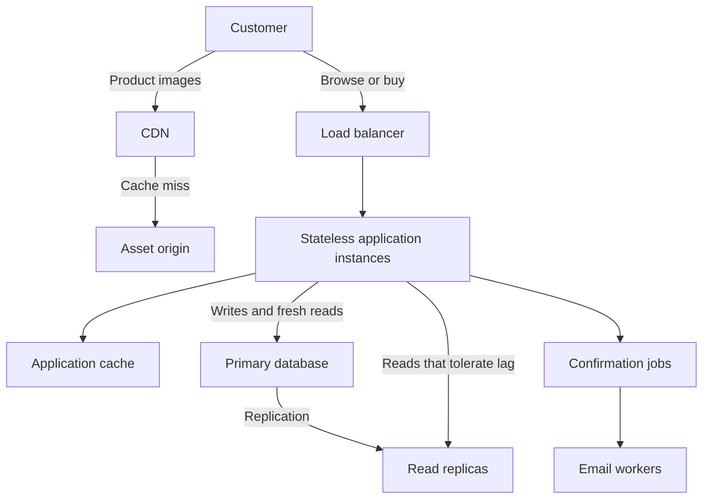

## Core idea

**Scaling means handling more work while keeping response time, reliability, and cost acceptable.** Start with a simple design, measure what limits it, and change the part responsible for that limit.

This study companion starts from ByteByteGo’s *Scale From Zero To Millions Of Users*.[^chapter] Supporting documentation and an original shop example explain the components and their trade-offs.

## Running example: a small online shop

Imagine a shop with three operations:

- **Browse:** read a product’s description and price.
- **Buy:** create an order and update inventory.
- **Receive confirmation:** send an email after the order is accepted.

Initially, one machine runs the application and database. This is easy to understand, but both compete for resources and depend on the same machine.

Consider three different symptoms: browsing becomes slow, checkout writes become slow, or email delivery delays checkout. These need different remedies. More application servers alone will not necessarily fix any of them.

The example is illustrative. There is no universal number of users at which a particular component becomes necessary: request rate, operation cost, data volume, and access patterns matter.

## How a request reaches the application

The **Domain Name System (DNS)** resolves a domain name to an address. The browser then connects to the service and sends an HTTP request, normally over HTTPS. DNS resolution and application request processing are separate steps; DNS is not a proxy carrying every request.[^chapter]

After adding a load balancer, the address can lead to the balancer rather than an individual application machine. It distributes requests across servers. Redundant application instances provide somewhere else to send traffic when an instance fails.[^chapter]

**Availability questions:** Which health check removes an unhealthy instance from routing? Can the surviving servers handle the load? What happens if the load balancer itself fails? Are backend servers protected from unwanted direct access? These questions make the failure behaviour explicit.

## Choose storage and separate responsibilities

Move the database into its own tier when independent resource allocation or operation becomes useful. Choose storage by **queries and correctness requirements**, rather than assuming that large systems must use NoSQL.[^data]

| Storage model | Typical fit in the shop |
|---|---|
| Relational tables | Orders, inventory, relationships, transactions |
| Key-value | Lookup by a known key, such as a session identifier |
| Documents | Product records with varying attributes |
| Wide-column | Access organised around partition keys and related records |
| Graph | Traversing relationships |
| Object storage | Product photographs and downloadable files |

Compare transaction boundaries, indexes, consistency, query patterns, operational effort, and cost. A relational database may already meet the requirements; combining several stores adds operational responsibilities. “Needs low latency” or “contains JSON” alone does not select a database.[^data]

## Scale the application tier

### Bigger machines or more machines?

[[Horizontal & Vertical Scaling|Vertical scaling]] adds resources to a machine; horizontal scaling adds instances. Scaling up is often simpler, but machines have limits. Scaling out requires work to be distributable. Increasing machine size and adding redundancy are separate decisions.[^autoscale]

**Autoscaling** turns measured demand into resource changes. Choose a signal that reflects the bottleneck: request load, CPU, memory, or queue depth. Allow for startup time, set sensible limits, and avoid repeatedly adding and removing instances around one threshold. Also check downstream capacity: more application instances can produce more database connections and queries.[^autoscale]

### Keep request-specific state outside individual servers

A stateless application instance does not require the next request from a user to return to the same process. Persistent information lives in backing services.[^processes]

For example, if a shopping cart exists only in server A’s memory, a request reaching server B cannot find it. Store the cart in shared storage so either instance can handle the request. Temporary local caches are possible, but correctness must not depend on their survival.

Sticky sessions route a user back to one instance. They can accommodate existing applications, but tie requests to that instance’s lifecycle. Externalising session state makes replacement and scaling easier. **Stateless application servers do not mean a stateless system**: the database and session store still hold state.[^processes]

## Replication: copies for reads and recovery

In a primary-and-replica design, the primary accepts writes and eligible replicas can serve reads. The primary can also serve reads; it is not inherently write-only. PostgreSQL hot standbys are one concrete implementation.[^replication]

**Replication lag** means a replica may not yet contain the latest committed write. In the shop, reading a newly created order from a lagging replica could make it appear missing. Route freshness-sensitive reads appropriately rather than treating every read destination as interchangeable.

If the primary fails, recovery can involve promoting a replica. Asynchronous replication can lose changes that had not reached it; synchronous replication trades additional coordination and latency for stronger acknowledgement guarantees. Failover needs a defined procedure, not simply an extra database icon.[^replication]

Replication also does not replace backups: deletions or corruption can propagate into the copies. Keep recoverable historical data and practise restoration.[^recovery]

## Caching: avoid repeating expensive reads

For a frequently viewed product, a **cache-aside** read works like this:[^cache]

1. The application asks the cache for the product.
2. On a hit, it returns the cached value.
3. On a miss, it reads the database, fills the cache, and returns the value.

The application manages the miss in cache-aside. In read-through caching, the cache abstraction manages loading. This distinction clarifies the chapter’s terminology.

- **Expiration:** a time-to-live (TTL) limits how long an entry remains usable.
- **Eviction:** memory pressure can remove an entry before its TTL expires; least recently used is one possible policy.
- **Invalidation:** a write may require removing or updating a cached value.
- **Consistency:** separate database and cache operations can race; caching does not automatically preserve immediate freshness.

In the shop, a cached description may tolerate delay, while checkout must validate the authoritative price and inventory. A failed or cold cache can send extra traffic to the database, so plan the miss path as well as the hit path.[^cache]

## CDN: deliver assets near users

A **content delivery network (CDN)** serves content through distributed edge locations. For a product photograph, an edge cache hit can avoid a request to the origin. On a miss, the CDN retrieves the object from the origin and can cache it for later requests. Routing is typically based on network latency, not simply physical distance.[^cdn]

This differs from the application cache: the CDN handles delivery to clients, while the application cache avoids backend work. A CDN does not eliminate the origin; misses still need it. CDNs can also deliver dynamic responses, although caching personalised responses requires an appropriate policy.[^cdn]

Choose expiry, invalidation or versioned asset URLs, and an outage response deliberately. Account for delivery costs and origin capacity.[^chapter]

## Queues: finish suitable work asynchronously

After the shop accepts an order, it can enqueue a confirmation-email job. A worker processes it separately. The customer need not wait for email delivery before receiving the order confirmation. The producer and worker can scale independently.[^queue]

A queue buffers bursts; it does not create processing capacity. If jobs consistently arrive faster than workers complete them, waiting time and backlog grow. Watch queue depth and job age, and limit workers to what downstream services can sustain. Adding workers indiscriminately can overload the email provider or database.[^queue]

**Design questions:** What confirms that a job was safely accepted? What happens after a worker crashes? Can a retry send the same email twice? What is the maximum acceptable delay? Durability and delivery guarantees must be established for the chosen queue and configuration.

## Sharding: distribute different parts of the data

[[Database Sharding|Sharding]] divides data among partitions. Replication maintains copies of data. A system can use both, with replicas for each shard.[^sharding]

Suppose orders are partitioned by customer. A customer-order lookup may reach one shard, while a report across every customer may require several. The **shard key** determines routing and strongly influences performance.

Key trade-offs include:

- **Balance:** evenly distributed record counts do not guarantee evenly distributed traffic.
- **Hotspots:** a heavily accessed key or tenant can overload one partition.
- **Rebalancing:** moving data consumes resources and needs routing coordination.
- **Cross-shard work:** joins, transactions, and aggregates become harder to coordinate.
- **Denormalisation:** storing data together can simplify reads but complicate updates.

Consider simpler capacity improvements before committing to sharding. Once adopted, changing the partitioning scheme can be expensive.[^sharding]

## Multiple locations: define the recovery behaviour

Separate locations can reduce the impact of a site failure. **Active/passive** uses a recovery site; **active/active** serves traffic from multiple sites. These differ in cost, operational complexity, and recovery behaviour.[^recovery]

Specify:

- **Recovery point objective (RPO):** how much recent data loss is acceptable, expressed as time.
- **Recovery time objective (RTO):** how long service restoration may take.
- How traffic reaches the surviving location and whether it has enough capacity.
- How data, application code, configuration, and required services become available there.

Traffic redirection alone is not recovery. Test restoring service and data together. Replication, backups, and infrastructure automation support different parts of that process.[^recovery]

Geographic or latency-based routing can select a regional endpoint. Separately decide where writes go and how the regions keep data consistent.[^recovery]

## Monitoring and automation belong in the design

Monitor **latency, traffic, errors, and saturation**. Separate successful-request latency from failure latency, and inspect slow percentiles rather than relying only on averages. Correlate user-visible symptoms with component metrics and logs.[^monitoring]

For the shop, a useful investigation asks: are product reads slow, checkout writes failing, database connections exhausted, or emails waiting too long? Business outcomes and infrastructure health answer different questions.

Use repeatable build, test, and deployment steps as the system grows.[^chapter] Treat recovery configuration and infrastructure as versioned, reproducible assets.[^recovery] A scalable architecture is difficult to operate if each server must be repaired by hand.

## Put the pieces together

This original diagram illustrates the shop’s request and background-work paths. It is a menu of components to justify, not a required starting architecture.

DNS resolves the service names before these connections. Monitoring spans the components. Sharding and additional locations are omitted to keep the request flow readable.

## Exercise: choose the next change

The following values are invented for practice:

1. Product reads are slow, repeatedly request the same records, and tolerate 30 seconds of staleness. Which layer would you investigate first?
2. Email jobs arrive at 120 per second; workers complete 100 per second. What happens to the queue?
3. A customer creates an order, then a replica read says it does not exist. What mechanism could explain that?
4. Application CPU is low while database connections are exhausted. Would adding application instances necessarily help?

> [!example]- Suggested reasoning
> Consider cache-aside for the repeated product reads, with an explicit freshness policy. The queue grows by 20 jobs per second while those rates persist. Replica lag could explain the missing order. More application instances may increase database pressure; investigate connection use and the database bottleneck first.

## Related Notes

- [[System Design]] — Requirements and component trade-offs.
- [[Search Caching]] — Applying cache keys and freshness decisions to search.
- [[Latency vs Throughput]] and [[Tail Latency]] — Interpreting response time under load.
- [[Monitoring - MLOPS]] — Operational monitoring in ML systems.

## References & Useful Links

Sources read on 2 October 2026. The chapter provides the study scope; the additional sources support terminology, mechanisms, and caveats.

[^chapter]: [ByteByteGo — Scale From Zero To Millions Of Users](https://bytebytego.com/courses/system-design-interview/scale-from-zero-to-millions-of-users) — Starting chapter and overall architecture progression.
[^data]: [Microsoft — Understand data models](https://learn.microsoft.com/en-us/azure/architecture/data-guide/technology-choices/understand-data-store-models) — Choose storage using access patterns and correctness requirements.
[^autoscale]: [Microsoft — Autoscaling guidance](https://learn.microsoft.com/en-us/azure/architecture/best-practices/auto-scaling) — Scaling mechanisms, signals, limits, and operational considerations.
[^processes]: [Adam Wiggins — The Twelve-Factor App: Processes](https://12factor.net/processes) — Stateless application processes and external session state.
[^replication]: [PostgreSQL — Log-shipping standby servers](https://www.postgresql.org/docs/current/warm-standby.html) — PostgreSQL 18 documentation when reviewed: readable standbys, asynchronous replication, promotion, and synchronous replication trade-offs.
[^cache]: [Microsoft — Cache-Aside pattern](https://learn.microsoft.com/en-us/azure/architecture/patterns/cache-aside) — Miss handling, expiration, eviction, and consistency limitations.
[^cdn]: [AWS — How CloudFront delivers content](https://docs.aws.amazon.com/AmazonCloudFront/latest/DeveloperGuide/HowCloudFrontWorks.html) — Edge routing and the cache-to-origin request path.
[^queue]: [Microsoft — Queue-Based Load Leveling](https://learn.microsoft.com/en-us/azure/architecture/patterns/queue-based-load-leveling) — Buffering, asynchronous processing, and downstream capacity limits.
[^sharding]: [Microsoft — Sharding pattern](https://learn.microsoft.com/en-us/azure/architecture/patterns/sharding) — Partition keys, distribution, routing, and operational trade-offs.
[^recovery]: [AWS — Disaster recovery options in the cloud](https://docs.aws.amazon.com/whitepapers/latest/disaster-recovery-workloads-on-aws/disaster-recovery-options-in-the-cloud.html) — Recovery strategies, backup versus replication, and reproducible restoration.
[^monitoring]: [Rob Ewaschuk — Monitoring Distributed Systems](https://sre.google/sre-book/monitoring-distributed-systems/) — Google SRE guidance on monitoring signals and latency distributions.
