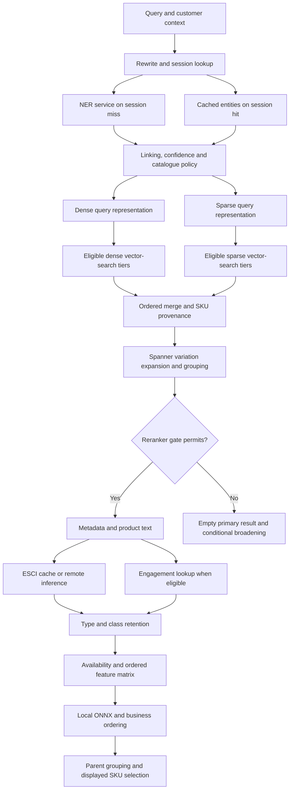

Start with **how a Transformer builds context-aware token vectors**, then learn how different output heads turn those vectors into entity tags, retrieval representations, or relevance predictions. Finally trace those outputs through [[Search2.0 architecture]]. This is a learning plan first, followed by explanations and exercises you can return to while reading.

**Evidence boundary:** the Search 2.0 mapping below comes from the existing architecture note's **26 September 2026 source snapshot**, commit `1dfaa528621e7306135ffc62a0972508091cd4f9`. Its service boundaries and policies are documented evidence, not a fresh source-code or deployment audit. The internal NER, ESCI, and sparse model implementations were not established by that note. It does identify `text-embedding-005` in the checked-in dense configuration, while leaving that model’s internal architecture outside the review. BERT-based NER, cross-encoder ESCI, bi-encoder retrieval, and SPLADE below explain standard designs; they are not confirmed checkpoint identities for your services. General mechanisms were checked against the primary sources and official documentation in the final references section.

## The destination: explain one query end to end

Use the illustrative query **`sony wireless headphones under 200`** throughout. Assume one currency and a catalogue in which Sony is a valid brand and headphones a valid product type. The examples are invented for learning, not captured model outputs.

By the end, explain:

- [ ] How the text becomes token IDs and then context-aware vectors.
- [ ] Why `sony` can become a brand entity and `headphones` a product type.
- [ ] How `under 200` becomes a numeric constraint through parsing and policy.
- [ ] How dense and sparse representations retrieve complementary candidates.
- [ ] How ESCI judges a query–product pair after retrieval.
- [ ] Why ESCI is followed by feature-based ranking and business ordering.
- [ ] Which computations happen offline, once per query, once per candidate, or only on a cache miss.
- [ ] Where a relevant product can disappear, and which stage owns that failure.

## Learning plan and reading checklist

Follow the sessions in order. A session is a learning unit, not a promise about time. Split it across sittings when the completion exercise is still difficult. For every link below, the following paragraph says what to extract from that note.

### Session 1 — Text, vectors, and the prerequisite operations

- [ ] [[Tokenization#Subword Tokenizers for Transformers|Tokenization: subword tokenizers]]

  **Essential content:** word versus subword; vocabulary versus token occurrence; token IDs; WordPiece versus byte-pair encoding; special tokens, padding, truncation, and attention masks. A model consumes its own tokenizer's IDs, not arbitrary numbers assigned to words. Predict how a model number or uncommon brand might split; check actual splits only with the chosen tokenizer. The shorter [[Tokenization - NLP]] is a companion, not the primary reading.

- [ ] [[Embeddings]]

  **Essential content:** an embedding lookup produces initial token vectors; an encoder produces contextual token vectors; pooling can produce a whole-text vector. These are three different objects. Understand why an arbitrary pretrained BERT `[CLS]` vector is not automatically a good retrieval representation.

- [ ] [[Cosine Similarity]] and [[Softmax Function]]

  **Essential content:** dot products compare vectors; cosine removes vector-length effects. Softmax converts a group of logits into weights summing to one. In attention, the group is the allowed key positions for one query position; in ESCI classification, it is the set of classes for one pair.

**Completion check:** draw `text → tokenizer → IDs → embedding lookup → token-vector matrix`. Label rows as positions and columns as features. Explain why equal token IDs start with equal lookup vectors but can end with different contextual vectors.

### Session 2 — Understand one Transformer encoder block

- [ ] [[Transformers]]

  **Essential content:** read “Self-Attention Step by Step,” the three-token worked example, “Multi-Head Attention,” “The Rest of a Transformer Block,” and “Positional Information.” Explain query/key/value projections, row-wise softmax, value mixing, residual connections, and the position-wise feed-forward network. Recalculate the example before reading all the training history.

- [ ] [[Layer Normalization]] and [[ReLU Function]]

  **Essential content:** LayerNorm acts across a token's feature dimensions; it is not BatchNorm. Residual paths preserve an additive route through a deep network. The feed-forward network transforms each position after attention mixes information across positions. Learn GELU for BERT and ReLU for the SPLADE weight transformation.

- [ ] [[Encoder-Only Model (Transformers)]]

  **Essential content:** bidirectional attention, padding masks, one output vector per input position, and pooling. Separate the encoder backbone from the task-specific head attached to it.

**Completion check:** sketch one complete block without looking. Explain what attention does that the feed-forward network does not, and what positional information adds.

### Session 3 — What BERT is, and why parallelism matters

- [ ] [[BERT]]

  **Essential content:** BERT is a pretrained encoder-only Transformer family. Learn WordPiece, token/position/segment embeddings, `[CLS]`, `[SEP]`, masked language modelling, original next-sentence prediction, and task fine-tuning. Separate the pretraining objective from what the deployed task head predicts.

- [ ] [[Sequence Models]] and [[LSTM]]

  **Essential content:** compare the recurrent dependency across positions with attention's matrix operations. Read the correction in this document's speed section: LSTMs can use GPUs and batch parallelism; the limitation is their recurrent dependence across time steps.

- [ ] [[RoBERTa]]

  **Essential content:** architecture, tokenizer, and training recipe are different choices. RoBERTa changes the pretraining recipe and tokenization; learning BERT does not prove the deployed model is BERT or uses BERT's exact special-token format.

**Completion check:** answer “What is the difference between Transformer, BERT, and a BERT NER model?” Then explain why a full encoder forward pass does not generate one word at a time.

### Session 4 — NER and query understanding

- [ ] [[Named Entity Recognition]]

  **Essential content:** token classification, BIO span labels, subword-label alignment, entity-level evaluation, and the separate entity-linking step. Work through how a recognised surface string becomes a canonical catalogue entity.

- [ ] [[Query Understanding]] and [[Query Intent Classification]]

  **Essential content:** extraction, normalization, rewriting, intent routing, and hard versus soft constraints. These are cooperating steps, not synonyms for NER.

- [ ] [[Search2.0 architecture#Query Understanding and Filters|Search 2.0: query understanding and filters]]

  **Essential content:** query rewriting, session reuse keyed by `search_id`, active-catalogue checks, entity-specific confidence gates, and conversion to categorical/numeric filters. Inspect which input text reaches each stage; do not assume every model sees the original query.

**Completion check:** write an illustrative entity list and filter plan for the running query. Explain why a correct brand span can still map to the wrong catalogue ID, and why a wrong hard filter can make later relevance models powerless.

### Session 5 — Dense and sparse recall

- [ ] [[Dense Retrieval]]

  **Essential content:** independently encode query and product text, pool token vectors, train compatible representations, precompute catalogue vectors, then use a similarity index. Understand positives, negatives, and why hard negatives teach finer distinctions.

- [ ] [[SPLADE]]

  **Essential content:** sparse weights over vocabulary dimensions, masked-language-model logits, learned expansion, pooling, and sparsity regularization. Work through term contributions. Sparse does not mean “not neural,” and a sparse service is not automatically SPLADE.

- [ ] [[Inverted Index]], [[BM25]], and [[Approximate Nearest Neighbours]]

  **Essential content:** distinguish a lexical scoring function, a learned sparse representation, and an index's search algorithm. Learn why sparse matching can traverse postings and dense retrieval can use approximate nearest-neighbour search. The actual managed index need not use the textbook implementation.

- [ ] [[Candidate Generation]], [[Hybrid Retrieval]], and [[Filtered Vector Search]]

  **Essential content:** candidate union, deduplication, source budgets, rank fusion, eligibility, and pre- versus post-filtering. RRF is a useful general technique, but it is not established as the merge rule in your architecture snapshot.

- [ ] [[Search2.0 architecture#Recall and Candidate Expansion|Search 2.0: recall and candidate expansion]]

  **Essential content:** dense/sparse embedding services, read-only embedding cache, filtered and broad tiers, ordered merging, provenance, Spanner parent-to-SKU expansion, and deduplication. Differentiate raw index rows, unique SKUs, parents, and final displayed results.

**Completion check:** show one product only dense retrieves and one only sparse retrieves. Explain how the union helps, and why no union restores an item absent from every channel.

### Session 6 — ESCI and final ranking

- [ ] [[ESCI]]

  **Essential content:** Exact, Substitute, Complement, and Irrelevant are query-relative relevance classes. Read the central-constraint examples. Distinguish class labels, class probabilities, an optional utility score, and evaluation gains.

- [ ] [[Cross-Encoder]]

  **Essential content:** jointly encode query and candidate text; predict a relevance score or classes. Cross-query/product token interaction is the benefit; repeated pair encoding is the cost. Batching does not turn this into a single reusable product vector.

- [ ] [[Search2.0 architecture#Reranking and Final Ordering|Search 2.0: reranking and final ordering]]

  **Essential content:** metadata text assembly; ESCI cache and inference; Exact/Substitute retention plus explicit-attribute exceptions; relevance/type selection; availability; ordered features; local ONNX; final business ordering; parent grouping and SKU selection.

- [ ] [[Learning to Rank]], [[Score Normalization]], and [[Search Ranking]]

  **Essential content:** a relevance classifier and a final ranker have different jobs. Understand the role of engagement, price, availability, and retrieval signals. Request-local normalization can change a surviving item's score when the cohort changes.

**Completion check:** explain why an Exact item need not be first after every business rule, and why the displayed head SKU may differ from the SKU that established a parent's position.

### Session 7 — Evaluate, improve, and diagnose

- [ ] [[Active Learning]], [[Data Labeling]], [[Judgement List]], and [[Annotation Agreement]]

  **Essential content:** choose uncertain or disagreeing examples for annotation, define a consistent rubric, resolve ambiguous labels, and keep a representative held-out evaluation set. Active learning is an offline improvement loop; it is not a required online stage in the documented request flow.

- [ ] [[Search Evaluation]], [[NDCG]], and [[Probability Calibration]]

  **Essential content:** evaluate entity extraction, candidate coverage, relevance classification, final ranking, and score reliability separately. State the unit, cutoff, label gains, unjudged-item policy, and aggregation.

- [ ] [[Search Caching]], [[Latency vs Throughput]], and [[Tail Latency]]

  **Essential content:** cache key/version correctness, cache hit versus miss paths, critical-path latency, batching, contention, and tail behavior. Measure performance with the actual model, candidate count, hardware, and concurrency.

**Completion check:** produce a one-query trace with candidate IDs/counts at each boundary. Locate the first disappearance of a known relevant product before proposing a model or ranking change.

### Optional branches after the core path

- [ ] [[Decoder-Only Model (Transformers)]]

  **Essential content:** causal masking, next-token training, autoregressive generation, and KV caching. This explains why chat-style generation has a different latency pattern from encoder classification.

- [ ] [[Encoder-Decoder Model (Transformers)]] and [[Machine Translation]]

  **Essential content:** an encoder reads the input; a decoder generates output using self-attention and encoder–decoder cross-attention. Understand this before assuming that an ESCI cross-encoder contains a Transformer decoder.

- [ ] [[Transformer Papers]] and [[Research_Paper/Attention is not all you need]]

  **Essential content:** use the first as a paper-reading sequence. The second concerns degeneration in pure attention networks and why residual/MLP components matter; it is a different paper from *Attention Is All You Need*.

## How a Transformer works: the minimum complete explanation

Read [[Transformers]] alongside this section. Let the token sequence have $n$ positions, hidden width $d$, and one attention head's query/key width $d_k$.

**1. Represent positions.** Token lookup vectors combine with positional information. In BERT, segment embeddings are also used. The resulting matrix has shape $n \times d$.

**2. Learn three views of the same input.** Each attention head projects token vectors into queries, keys, and values:

$$
Q=XW_Q,\qquad K=XW_K,\qquad V=XW_V.
$$

These attention queries are internal vectors for each token, not the user's whole search query. Their role is to decide which positions contribute information.

**3. Mix contextual information.** For an attention mask $M$:

$$
H_{\mathrm{head}}=\operatorname{softmax}\!\left(\frac{QK^\top}{\sqrt{d_k}}+M\right)V.
$$

The softmax runs across keys in each row. Multiple heads learn different projections; their outputs are combined. Residual connections, normalization, and a position-wise feed-forward network complete the block. Repeated blocks refine every token representation.[^transformer]

For the running query, a contextual representation of `200` can use nearby `under`; a representation of `headphones` can use the brand and feature context. This is intuition, not a claim that one particular head implements a named rule. A trained output head and downstream policy still have to produce the task's answer.

### What BERT adds

[[BERT]] is one particular pretrained Transformer encoder family. Original BERT learns from masked-token prediction and next-sentence prediction, then adapts its encoder and output head to supervised tasks. It uses bidirectional context rather than causal masking. Original BERT-base has 12 encoder layers and hidden width 768.[^bert]

The same architectural family supports different output structures:

| Task | Encoder input | Output head/result |
|---|---|---|
| NER | Query tokens | Label distribution at each position |
| Dense retrieval | Query or product independently | Pooled whole-text vector |
| SPLADE-style retrieval | Query or product independently | Vocabulary-coordinate weights |
| Cross-encoder ESCI | Query and product jointly | Pair-level class distribution |

This table describes possible designs. Each can have separately trained weights, tokenization, and serving infrastructure. Sharing an architecture family does not mean sharing one running model.

## Why the architecture can be fast

### Parallel token processing versus recurrent dependence

An LSTM's next state depends on its previous state. A Transformer encoder instead performs large matrix operations across the input positions in each layer. That enables efficient parallel execution; layers still depend on earlier layers. Short paths between positions also help information exchange.[^transformer]

**Correction while reading [[LSTM]]:** its statement that recurrence cannot use GPUs is too strong. Recurrent models can run on GPUs and parallelize over examples and internal matrix operations; the limitation is the sequential dependency along time. **Correction while reading [[Time Series]]:** attention does not provide an infinite context window.

Parallelism does not make a full block constant-cost. With sequence length $n$ and hidden width $d$, the usual leading terms for attention interactions, projections, and feed-forward work are summarized as:

$$
O(n^2d+nd^2).
$$

The interaction term grows quadratically with sequence length. Hardware, padding, depth, width, and batching determine actual latency. [[Transformers]] and [[Layer Normalization]] give the component details; the original paper's complexity table separates self-attention from recurrent computation.[^transformer]

### Search is fast partly because it avoids repeated work

For [[Dense Retrieval]], product representations can be computed offline. An arriving query needs a query encoding and index search, rather than joint Transformer encoding against every catalogue item. A [[Cross-Encoder]] pays for joint inputs only after candidate retrieval.[^sbert]

Illustrative workload: one million catalogue products, 200 retrieved candidates, and all ESCI scores missing from cache.

- NER examines the query once in the ordinary uncached path.
- Dense and sparse services represent the query; catalogue representations already exist for retrieval.
- Index lookups reduce the catalogue to candidates.
- A conventional ESCI cross-encoder processes the 200 query–product pairs, possibly in batches.
- Feature ranking operates on the retained rows.

This is workload counting, not a measured speedup. The documented system can have more candidates after tier merging and SKU expansion, and cached or alternative request paths change the work.

### Encoder inference versus generated output

An encoder can label all input positions in one forward evaluation through its stack. An autoregressive decoder generates successive output tokens in dependent steps. Parallel training of a causal model does not imply parallel generation of all future tokens. See [[Decoder-Only Model (Transformers)]].

### Search 2.0 serving mechanisms

In the architecture snapshot, dense and sparse HTTP embedding calls can overlap; vector tiers run concurrently; ESCI and engagement lookup overlap after metadata; recall and reranking orchestration run inside the Rust process. Session, embedding, metadata, and ESCI caches can save different kinds of work. Local ONNX sessions still consume CPU and use mutexes.

A useful trace budget separates rewriting/session/NER, embeddings, vector tiers, expansion, metadata, ESCI/engagement, availability, and final ranking. Concurrent work contributes along its actual critical path; queueing, network time, and failures can change the dominant stage. No service latency or speedup is verified here.

## NER in detail: from text to a retrieval constraint

Primary reading: [[Named Entity Recognition]], then [[Search2.0 architecture#Query Understanding and Filters]].

### Standard encoder token-classification design

A typical design tokenizes a query, encodes it, and applies a small classifier to every token's final hidden vector. For token $i$, hidden vector $h_i$, label weights $W$, and bias $b$:

$$
p(y_i\mid q)=\operatorname{softmax}(Wh_i+b).
$$

The head predicts labels such as `B-BRAND`, `I-BRAND`, or `O`. BERT token-classification implementations attach this kind of linear head to encoder hidden states.[^bert-docs] Some systems use span heads, CRFs, rules, or generative extraction instead; your architecture note does not identify which your parser uses.

Illustrative word-level annotation, before actual subword tokenization:

| Surface text | Illustrative tag | Meaning |
|---|---|---|
| sony | B-BRAND | Brand span |
| wireless | B-FEATURE | Feature span |
| headphones | B-PRODUCT_TYPE | Product-type span |
| under | B-PRICE_OPERATOR | Price comparison |
| 200 | B-PRICE_VALUE | Numeric value |

This teaching schema is not the service's verified label vocabulary. A real tokenizer may split a word into multiple pieces. Training must align labels to those pieces. One official example labels only the first piece and ignores later pieces and special tokens with loss label `-100`; that is a convention, not a universal rule.[^ner]

### Training and what the loss teaches

A common supervised setup uses queries with annotated spans/types. The classifier is trained to predict the annotated label at each supervised token; fine-tuning can update both the head and encoder. The labels teach the meaning of the task's entity schema, while pretraining supplies useful language representations. See [[BERT]] and [[Cross Entropy Loss]].

A tagger can learn the span `sony` without knowing the catalogue's canonical brand identifier. Extraction training alone also does not define price parsing, confidence gates, or business eligibility.

### Postprocessing is part of the answer

1. **Reconstruct spans:** join begin/inside pieces while preserving offsets.
2. **Normalize/link:** map `sony` to a canonical brand; map plural or synonymous type names to supported catalogue types.
3. **Interpret relations:** associate `under` with the price value and the appropriate price field/currency.
4. **Validate:** require active types/features and apply the appropriate confidence policy.
5. **Plan:** choose filters, routing, and soft signals.

Illustrative plan: a Sony brand restriction, headphone type restriction, a valid wireless feature restriction if supported, and a price upper bound. Do not assume whether “under” is strict or inclusive in your service until its operator mapping is checked.

### Mapping to the documented Search 2.0 path

The orchestrator rewrites text, checks session NER by `search_id`, calls the parser on a miss, and interprets the returned entities using policy. It may reuse entities without rerunning the model. Type/brand/model-family confidence gates differ. Active catalogue state matters. The documented fresh-session model-family policy includes a 0.97 base gate; that is a snapshot-specific policy constant, not a generic BERT requirement.

**Failure examples:** reusing a session ID can reuse unrelated entities; `wireless` can link to the wrong type; an inactive feature can be rejected; an overconfident incorrect hard filter can suppress valid products. Inspect extracted entities, linked IDs, policy decisions, and actual retrieval filters separately.

**Evaluate:** use exact entity-span/type precision, recall, and F1, plus catalogue-link correctness and downstream candidate coverage. Token accuracy can look strong when most tokens are `O`.[^ner]

## Dense recall in detail: meaning in a reusable vector

Primary reading: [[Dense Retrieval]] and [[Embeddings]].

### Offline catalogue side

Choose product text fields; tokenize and encode each product; pool token vectors; optionally normalize; store the resulting vector with the retrieval identity and filterable metadata. Rebuild or update representations when content or model compatibility changes. The architecture note does not audit these upstream jobs.

### Online query side

Encode the effective query into the compatible space. For query encoder $E_Q$ and product encoder $E_D$, a standard inner-product scoring rule is:

$$
s(q,d)=E_Q(q)^\top E_D(d).
$$

The encoders may share weights or use separately trained compatible towers. DPR is an example trained using positives and negative passages; it is not evidence that your service uses DPR.[^dense] Sentence-BERT is another relevant family: task-trained pooling makes text embeddings useful for similarity, rather than assuming any raw BERT pooling works.[^sbert-paper]

For `wireless headphones`, dense recall might retrieve a product described as `Bluetooth over-ear headset`. That is an illustrative semantic match. Similarity can also blur exact capacity, negation, brand, or compatibility; hard requirements need explicit treatment.

### Training intuition

Use a query, a relevant product, and competing products. Training raises the relevant pair's similarity relative to the competitors. Hard negatives might include a similar-looking accessory or the wrong model variant. Negatives must be checked: another relevant product accidentally treated as negative creates contradictory supervision. The actual product model's objective and training data remain open questions.

### What happens in your serving snapshot

The snapshot documents two configurable dense paths: a DVS HTTP embedding service, or a Vertex text-embedding adapter. Its checked-in T02/P03/P04 configurations select **`text-embedding-005`**, with vector deployments `productembeddings_v5`, `productembeddings_v16`, and `productembeddings_v15`, respectively. These are recorded configuration observations, not live deployment checks. They do not identify BERT as the dense backbone. Recall obtains the dense query vector from this embedding boundary or cache and submits dense vector-search requests for the eligible tiers. Returned distances/provenance become candidate evidence; they are not final relevance probabilities. Parent expansion and later ESCI decisions still follow.

**Debug in order:** representation suitability → exact-vector baseline → approximate-index loss → filters/tier limits → parent expansion. Keep ANN agreement with exact vector search separate from human relevance coverage.

## Sparse recall in detail: terms with learned weights

Primary reading: [[SPLADE]], [[BM25]], and [[Inverted Index]].

**Known about your system:** the architecture note has a separate sparse embedding boundary, sparse vector-search tiers, and sparse retrieval evidence. It does not prove the sparse generator is SPLADE. Confirm the encoder/checkpoint and dimension-to-vocabulary mapping before interpreting its coordinates as words.

### The SPLADE-style design to learn

A BERT-style masked-language-model head gives vocabulary logits at each input position. Transform and pool them into one sparse vocabulary vector. In the max-pooling variant, for vocabulary coordinate $j$ and position logit $z_{ij}$:

$$
w_j=\max_i\log\bigl(1+\operatorname{ReLU}(z_{ij})\bigr).
$$

Training combines relevance learning with sparsity regularization; distillation and hard negatives are possible. Nonzero weights can include terms absent from the original input, giving learned expansion. Original SPLADE uses sum pooling; SPLADE v2 explores max pooling.[^splade]

Query and document vectors are encoded separately. Their score is:

$$
s(q,d)=\sum_{j\in V}w_j^q w_j^d.
$$

Shared active coordinates contribute; non-overlapping ones contribute zero. Sparse serving can exploit postings or sparse-vector indexing. This describes the representation's useful structure, not your managed index's internal algorithm.

### Worked term-contribution example

**Inputs:** illustrative query weights `{wireless: 1.5, headphones: 2.0, bluetooth: 0.8}`; product weights `{wireless: 1.0, headphones: 1.8, bluetooth: 1.4}`. Other shared coordinates have zero weight. These are invented, not predictions.

**1. Wireless contribution.**

$$
1.5\times1.0=1.50
$$

**2. Headphones contribution.**

$$
2.0\times1.8=3.60
$$

**3. Bluetooth contribution.**

$$
0.8\times1.4=1.12
$$

**4. Total sparse score.**

$$
1.50+3.60+1.12=6.22
$$

The expanded term `bluetooth` contributes even though it is absent from the original query. The score is not a probability or directly comparable to a dense distance. Sparsity saves storage/matching work, while query encoding and expansion still have computational cost.

### BM25, SPLADE, and dense retrieval answer different questions

| Method | Coordinates | Main evidence | Typical failure |
|---|---|---|---|
| BM25 | Analyzed terms | Lexical occurrence/statistics | Vocabulary mismatch |
| SPLADE-style sparse | Vocabulary terms with learned weights | Contextual weighting and expansion | Harmful expansion or fragmentation |
| Dense | Latent learned features | Whole-text compatibility | Blurred exact constraints |

For `sony`, expanded competitor brands could hurt sparse precision. Model numbers can fragment in both sparse and dense tokenizers. Sparse does not guarantee exact identifier matching; preserve a deliberate lookup or lexical path when required.

**Verify for your sparse service:** query/document model compatibility, vocabulary version, output coordinate IDs, pruning/threshold/top-K policy, weight normalization, document text fields, index metric, and update process. Inspect nonzero counts and term contributions before attributing matches to semantic expansion.

## ESCI in detail: relevance for one query–product pair

Primary reading: [[ESCI]] and [[Cross-Encoder]].

### Labels describe a relationship

For query `sony wireless headphones under 200`, use the following illustrative rubric: brand, wireless capability, product function, and price ceiling are central. Treat a different headphone form factor as an acceptable substitute.

| Candidate | Illustrative label | Reason |
|---|---|---|
| Sony wireless headphones, price 150 | Exact | Meets stated requirements |
| Sony wireless earbuds, price 150 | Substitute | Only if the rubric permits that form-factor substitution |
| Case compatible with the matching headphones | Complement | Used with the requested product |
| Sony wired headphones, price 150 | Irrelevant | Violates a central wireless requirement |

Labels depend on query intent and the explicit rubric. Exact does not mean literal string equality. A product's label can change under a different query. The public ESCI dataset defines the four classes, but it does not establish your internal training corpus or price-aware inputs.[^esci]

### Standard cross-encoder implementation

A conventional BERT-style input is `[CLS] query [SEP] product text [SEP]`. Bidirectional self-attention jointly contextualizes both segments; a pair-level head produces four logits and a softmax distribution. Other backbones use different special tokens. Such classifiers can use supervised query–product labels; your service's objective, backbone, and output-score formula require confirmation.[^crossencoder]

A cross-encoder is not the same as the decoder's cross-attention layer. It can be an encoder-only stack using self-attention over the combined input. Reading a pair jointly lets it compare a requested attribute with a product attribute, provided both survive input assembly/truncation.

### Class, probability, utility, and served score differ

**Inputs:** an illustrative class distribution `[E: 0.60, S: 0.30, C: 0.08, I: 0.02]`; illustrative utilities `[1, 0.1, 0.01, 0]`, matching the benchmark gain convention in [[ESCI]].

**1. Choose the highest-probability class.**

The predicted class is Exact. This uses the largest probability, not a weighted ranking utility.

**2. Calculate one possible expected utility.**

$$
u=0.60+0.1\times0.30+0.01\times0.08=0.6308
$$

This is a teaching calculation, not the documented ESCI service's score formula. A scalar score does not reveal whether it is a logit, class probability, expected utility, or another transformation. Uncalibrated probabilities also need not equal empirical confidence.

### What the documented Search 2.0 reranker does

1. Flatten/deduplicate candidate SKU inputs and fetch metadata.
2. Build cleaned product text from short name and categorical features; omit empty text from ESCI inference.
3. Read override ESCI cache before the ordinary cache; send remaining misses to the remote model; merge results in input order.
4. Run eligible engagement lookup concurrently with ESCI after metadata.
5. Select relevant types and retain Exact/Substitute plus `explicit_attribute` matches.
6. Fetch availability for retained SKUs, build ordered features, run the selected local ONNX model, normalize, apply business ordering, and group parents/SKUs.

Missing ESCI scores default internally to zero and Irrelevant in this snapshot. Ordinary inference does not write back to the ESCI cache. These are architecture-note behaviors, not universal caching advice.

**Input limitation:** if ESCI text lacks structured price, currency, live stock, or compatibility fields, do not assume it can enforce them. Retrieval constraints and later business policy have separate responsibilities.

**Two model boundaries:** remote ESCI supplies semantic relevance evidence. The local ONNX baseline/engagement ranker consumes features. In the recorded snapshot the baseline is linear and the test branch uses XGBoost engagement ranking. An ONNX artifact is a deployment format, not proof that the final ranker is a Transformer.

**Historical warning:** [[K Means]] discusses relevance clustering, but the architecture snapshot's live SKU retention is class-based. Do not insert KMeans into this path merely because another note describes that workflow.

## Map the models onto Search 2.0

This focuses on the ordinary search path. Direct lookup, more-like-this, multi-type-group recalls, dependency errors, and fallbacks are separate branches in [[Search2.0 architecture]]. Offline catalogue-vector generation is a prerequisite; it is not drawn as a query-time model call.

| Boundary | Question answered | Output consumed downstream |
|---|---|---|
| NER/query parser | What entities are mentioned? | Structured entities/confidence |
| Entity/filter policy | Which interpretation is eligible? | Routing and constraints |
| Dense recall | Which products are nearby in the learned space? | Candidates and dense evidence |
| Sparse recall | Which products share weighted dimensions? | Candidates and sparse evidence |
| ESCI | How does this candidate satisfy this query? | Class and relevance evidence |
| Feature ranker | How should retained candidates score? | Model output per row |
| Business/grouping policy | What order and variants are shown? | Parent results and head SKUs |

### Recall tiers and merge policy matter as much as embeddings

The snapshot includes `filtered_dense` with a 150-neighbor budget, `filtered_sparse` with 100, and broader dense/sparse tiers with 250 each when eligible. There are additional featured, condition, and availability tiers. Read the full tier table rather than treating these four as the entire strategy.

“Unfiltered” is relative to NER constraints; base eligibility still exists, and broad tiers may exclude predicted types to discover alternatives. Prompts and exact-SKU restrictions can suppress broad tiers. Results merge in plan order, with first-seen SKU context retained. This is not evidence of RRF or arbitrary dense-plus-sparse score addition.

Parent expansion changes the candidate cohort and unit. The number of model pairs may exceed the number of parents. A later ranker cannot restore a relevant SKU that was lost through retrieval limits, filters, deduplication, or expansion.

### A query walkthrough to reproduce on paper

1. **Input:** preserve original and effective query separately. Assume supported Sony/headphone/price entities and no unrelated cached session.
2. **Understand:** inspect parser entities, canonical IDs, confidence, active catalogue state, and resulting constraints.
3. **Retrieve:** encode the effective query, execute eligible dense/sparse tiers, and record each tier's candidate IDs before merging.
4. **Assemble:** merge in plan order, deduplicate, expand parents to SKU variations, and retain provenance.
5. **Judge:** if the reranker gate permits, build text for each unique SKU and obtain ESCI results. A case accessory can be retrieved but classified Complement and normally removed from the core retained cohort.
6. **Rank:** retain the policy-approved cohort; combine relevance, retrieval, metadata, engagement, and availability features through the selected ranker and business rules.
7. **Display:** order/group parents, reorder SKUs within each parent, and choose the displayed head. Inspect both parent and SKU identities.
8. **Diagnose fallback:** an empty primary search can trigger broadened retrieval. The documented fallback can remove numeric constraints, including the original price bound. This changes result meaning; inspect the fallback flag and effective constraints.

## Evaluation and active learning plan

[[Active Learning]] is useful after you can identify which boundary fails. Uncertain ESCI pairs, NER disagreements, or dense/sparse disagreements can supply annotation candidates. They should not automatically be pooled into one undifferentiated task: span labels, relevance classes, and positive/negative retrieval judgments are different supervision contracts.

- [ ] **NER:** annotate spans/types, verify canonical links, and measure downstream constraint errors.
- [ ] **Recall:** on a fixed catalogue/query set, compare dense, sparse, and their union at specified candidate budgets. State SKU versus parent evaluation units and how unjudged items are handled.
- [ ] **ESCI:** report per-class precision/recall/F1 and confusion, especially Substitute versus Irrelevant; evaluate retained-cohort effects as well as raw classification.
- [ ] **Ranking:** evaluate the final ordering with a stated NDCG gain convention and cutoff. Keep judgments fixed across comparisons.
- [ ] **Serving:** compare cache-hit/miss and degraded paths; record per-stage p50/p95/p99, candidate/pair counts, batch lengths, concurrency, and dependency errors.
- [ ] **Learning loop:** select uncertain examples plus diversity/exploration, annotate, retrain, and compare against random acquisition under the same budget on a separate held-out set.

Completion means you can distinguish “the relevant product never entered recall,” “ESCI removed it,” “a final business rule moved it,” and “the response displays another SKU.” A single end-to-end metric cannot identify these causes.

## Questions to resolve about the actual model services

These items are intentionally unchecked. The architecture note cannot establish them; answer them from model-service source, model cards, training/export configs, and matched request traces.

- [ ] **NER:** backbone/checkpoint, tokenizer, label schema, span versus token head, decoding, linking ownership, price parsing, confidence calibration, and training/evaluation data.
- [ ] **Dense:** query/document encoder versions, shared versus separate weights, text fields, pooling, dimension, normalization, retrieval objective, similarity metric, and index-update compatibility.
- [ ] **Sparse:** SPLADE versus another generator, vocabulary/coordinate semantics, pooling, sparsity penalty, pruning, text fields, index metric, and query/document version compatibility.
- [ ] **ESCI:** backbone, joint versus alternative architecture, exact pair construction, truncation/maximum length, class order, scalar-score meaning, loss, training data, batch policy, and versioned cache keys.
- [ ] **Serving:** current source revision, deployed model artifacts, actual cache behavior, effective query at each boundary, cohort counts, timeouts, fallback paths, and measured stage latency.

## Vault inventory and reading boundary

The local keyword scan found **50 ordinary notes** containing Transformer/BERT/RoBERTa, self-/cross-attention, NER, ESCI, or SPLADE references: **21 core/model-reading notes**, **27 supporting or contextual notes**, and **2 scikit-learn terminology matches excluded from this neural architecture track**. This is a reproducible keyword inventory, not a guarantee of finding every unlinked conceptual prerequisite. Conversation logs, generated outputs, application settings, and drawing payloads were excluded.

### Core architecture, model, and input notes

These are the direct model/input readings identified above; `Language Model` provides the objective vocabulary. The deep dives synthesize the relevant mechanisms; existing source notes were not rewritten.

- [[Transformers]]
- [[BERT]]
- [[RoBERTa]]
- [[Encoder-Only Model (Transformers)]]
- [[Decoder-Only Model (Transformers)]]
- [[Encoder-Decoder Model (Transformers)]]
- [[Transformer Papers]]
- [[Research_Paper/Attention is not all you need]]
- [[Tokenization]]
- [[Tokenization - NLP]]
- [[Embeddings]]
- [[Layer Normalization]]
- [[Sequence Models]]
- [[Language Model]]
- [[Machine Translation]]
- [[Named Entity Recognition]]
- [[Dense Retrieval]]
- [[SPLADE]]
- [[Cross-Encoder]]
- [[ESCI]]
- [[Search2.0 architecture]]

### Supporting and contextual matches

- [[Action-Plan]] — Existing broader preparation plan; use this document for the focused sequence.
- [[Active Learning]] — Choosing examples for the offline annotation/retraining loop.
- [[Annotation Agreement]] — Agreement and ambiguous relevance-label boundaries.
- [[Candidate Generation]] — Retrieval sources, budgets, and candidate assembly.
- [[Data Labeling]] — Annotation contracts for relevance and other supervised tasks.
- [[Deep Learning]] — Broader neural-network prerequisites and links to this architecture.
- [[Discriminative and Generative Models]] — Why a BERT classifier and a text generator solve different modelling tasks.
- [[Filtered Vector Search]] — How NER constraints interact with vector retrieval.
- [[GloVe]] — Static word vectors as a contrast with contextual representations.
- [[Hybrid Retrieval]] — Combining candidate sources and understanding fusion.
- [[Judgement List]] — A consistent relevance evaluation collection.
- [[K Means]] — Historical relevance-clustering discussion; distinguish it from the documented class-based retention.
- [[LSTM]] — Recurrent baseline for understanding position-wise dependency; see the GPU correction above.
- [[NDCG]] — Evaluating an ordered result list with stated gains.
- [[Query Intent Classification]] — Routing queries separately from entity extraction.
- [[Query Understanding]] — Rewriting, entities, normalization, and planning.
- [[ReLU Function]] — GELU in BERT and ReLU in sparse-weight transformations.
- [[Retrieval-Augmented Generation]] — Optional application of retrieval followed by generated answers.
- [[Search Architecture]] — General system map before the concrete implementation.
- [[Search Caching]] — Caching entities, embeddings, or pair predictions at distinct boundaries.
- [[Search Engineering]] — Vault learning map and wider prerequisites.
- [[Search Ranking]] — Ordering candidates after retrieval.
- [[Softmax Function]] — Attention weights and task-class probabilities.
- [[Structured Outputs]] — Optional comparison between trained classification and constrained generated outputs.
- [[System One Models]] — Optional discussion connecting model/classifier choices; not evidence for Search 2.0 internals.
- [[System_Design/Vector Database]] — Vector-index design and retrieve/rerank context.
- [[Time Series]] — Peripheral Transformer comparison; its infinite-attention claim needs the correction above.

### Excluded terminology matches

- [[Customer Transformer - SkLearn]] — Custom scikit-learn data transformation, unrelated to attention-based Transformer networks.
- [[Encoding]] — Includes scikit-learn preprocessing terminology; it is not a Transformer architecture explanation.

**Review status:** created this learning map, inventoried keyword matches, read the model/architecture readings and relevant contextual passages, and checked general mechanisms against the external sources below. The supporting inventory records relevance; it does not certify every claim in those notes. Existing note content, tags, attachments, and settings were left unchanged. Model-service internals, deployed behavior, and Obsidian reading-view layout remain unverified.

## References & Useful Links

The implementation mapping is attributed to [[Search2.0 architecture]] and its recorded source snapshot. The external sources support general model mechanisms, not private implementation claims. Official documentation and paper sections were opened during this pass; Sentence-BERT was checked at abstract level.

[^transformer]: [Vaswani et al., Attention Is All You Need (2017)](https://arxiv.org/html/1706.03762v7) — Encoder blocks, attention mechanics, positional information, and the distinction between parallelism and per-layer work.
[^bert]: [Devlin et al., BERT (2019)](https://arxiv.org/html/1810.04805v2) — Bidirectional encoder architecture, input format, pretraining, and downstream fine-tuning.
[^bert-docs]: [Hugging Face: BERT model documentation](https://huggingface.co/docs/transformers/model_doc/bert) — Encoder outputs and token-classification heads.
[^ner]: [Hugging Face: Token classification](https://huggingface.co/docs/transformers/tasks/token_classification) — NER supervision, subword alignment, ignored labels, and entity evaluation.
[^dense]: [Karpukhin et al., Dense Passage Retrieval (2020)](https://arxiv.org/html/2004.04906v3) — Independent question/passage encoders, offline indexing, similarity, and negative-based training.
[^sbert-paper]: [Reimers and Gurevych, Sentence-BERT (2019)](https://arxiv.org/abs/1908.10084) — Abstract describing independently useful sentence embeddings and siamese/triplet training structures.
[^sbert]: [Sentence Transformers: Retrieve & Re-Rank](https://sbert.net/examples/sentence_transformer/applications/retrieve_rerank/README.html) — Bi-encoder retrieval followed by joint pair scoring.
[^splade]: [Formal et al., SPLADE v2 (2021)](https://arxiv.org/html/2109.10086v1) — MLM-based vocabulary weighting, sum/max pooling, sparsity, and relevance training.
[^esci]: [Reddy et al., Shopping Queries Dataset (2022)](https://arxiv.org/html/2206.06588v1) — Query-relative ESCI classes and benchmark setting.
[^crossencoder]: [Sentence Transformers: Cross-Encoder usage](https://sbert.net/docs/cross_encoder/usage/usage.html) — Per-pair inference, reranking, and output-score interpretation.
